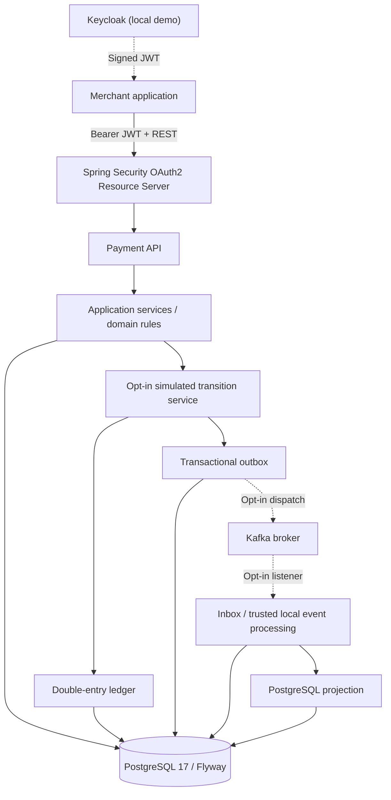

# Enterprise Payment Platform

**A Java 25 / Spring Boot 4.1.2 educational payment-processing simulation focused on transactional consistency, security, and reliable asynchronous messaging.**

[](https://github.com/asambataiden/enterprise-payment-platform/actions/workflows/java-ci.yml)
[](https://github.com/asambataiden/enterprise-payment-platform/actions/workflows/security-ci.yml)
[](https://github.com/asambataiden/enterprise-payment-platform/releases/tag/v0.1.0)


> **Educational scope:** The platform models payment intake and simulated lifecycle transitions. It does **not** move money, interact with a payment service provider, settle funds, or represent a production-certified financial system.

## Overview

This project explores engineering problems found in transactional, event-driven backend systems: concurrent retries, merchant isolation, domain-state invariants, immutable accounting records, the database-to-broker consistency gap, duplicate event processing, and failure recovery.

Rather than claiming a production microservices platform, the implementation uses a **single-deployable modular monolith** with explicit domain, application, security, persistence, and messaging boundaries. Selected components use ports and adapters; the entire codebase is **not** fully hexagonal.

### Implemented capabilities

| Area | Implemented behavior |
| --- | --- |
| Payment API | Merchant-scoped create, retrieve, paginated search and committed event history |
| Authentication | OAuth2 Resource Server with signed JWT validation, issuer/audience validation, scopes and trusted merchant identity |
| Idempotency | Concurrent-safe payment creation backed by PostgreSQL uniqueness and atomic inserts |
| Simulation | Opt-in, scope-protected `RECEIVED → AUTHORIZED → CAPTURED → REFUNDED` lifecycle |
| Ledger | Simulated balanced double-entry capture and compensating refund journals; database-enforced integrity |
| Reliable messaging | Transactional outbox, leased claims, retries, deduplication and poison-event handling |
| Kafka | Opt-in producer and consumer; versioned contracts, explicit security configuration and Testcontainers coverage |
| Engineering quality | Flyway migrations, JUnit/ArchUnit, PostgreSQL and Kafka integration tests, CI and security checks |
| Diagnostics | Correlation IDs, structured logs, bounded monitoring, and opt-in synthetic performance labs |

## Architecture



**Important:** This is a *logical* system view. The signed-JWT local HTTP demonstration operates with Kafka disabled; Kafka transport and consumer scenarios are verified separately. Kafka and Keycloak are **not** presented as one production deployment.

The system is deliberately **at-least-once** at the delivery boundary. A Kafka acknowledgement does not imply successful consumer processing, exactly-once remote effects, or settlement. Inbox deduplication protects specified local database effects.

For architecture decisions, tradeoffs and the tested trust boundaries, read the [v0.1.0 technical case study](docs/portfolio/technical-case-study.md).

## Technology

- **Backend:** Java 25, Spring Boot 4.1.2, Spring Security, Spring Kafka, Maven
- **Persistence:** PostgreSQL 17, Flyway V1–V9, JDBC, Spring transactions
- **Messaging:** Apache Kafka, opt-in producer/consumer, transactional outbox/inbox
- **Identity:** OAuth2/JWT, local Keycloak 26.8.2 demo
- **Verification:** JUnit, ArchUnit, Testcontainers, OpenAPI contracts
- **Automation & security:** GitHub Actions, Trivy, Gitleaks, Docker Compose
- **Diagnostics:** Spring Boot Actuator, Micrometer and structured JSON logging

## Quick start — authenticated local simulation

**Prerequisites:** Java 25, Maven 3.9+, Docker with Compose, Python 3, and free loopback ports `5432`, `8080`, `8180`. Run from the repository root.

> Demo services use locally scoped development configuration. Never use production data, credentials or systems. The script relies on the default Docker Compose project name / Keycloak container name and authenticated `kcadm.sh` session.

### 1. Supply local-only credentials and start dependencies

Use securely chosen local development passwords. Do not commit them, insert them into scripts, or paste them into logs.

```bash
# Set these in your terminal by a secure method before running Compose:
# DB_PASSWORD, KC_BOOTSTRAP_ADMIN_USERNAME, KC_BOOTSTRAP_ADMIN_PASSWORD

docker compose \
  -f compose.yaml \
  -f ops/demo/compose.identity.yaml \
  --profile identity up -d postgres keycloak
```

For an existing persistent PostgreSQL volume, `DB_PASSWORD` must match its configured database password. The Keycloak realm is imported on initial startup; an existing realm may require explicit local maintenance.

### 2. Run the application in simulation mode

```bash
export SPRING_SECURITY_OAUTH2_RESOURCESERVER_JWT_ISSUER_URI=http://localhost:8180/realms/payments
export SPRING_SECURITY_OAUTH2_RESOURCESERVER_JWT_AUDIENCES=enterprise-payment-service
export PAYMENT_SIMULATION_ENABLED=true
export PAYMENT_KAFKA_ENABLED=false
mvn spring-boot:run
```

Supply `DB_PASSWORD` securely in **this** terminal as well. The Kafka flags keep the standalone HTTP demonstration independent of a broker.

### 3. Authenticate the Keycloak admin CLI, then run the smoke test

In a separate terminal, verify health:

```bash
curl -fsS http://localhost:8080/actuator/health
```

Authenticate the admin CLI inside the development container (it prompts for the password; use the configured admin username):

```bash
docker exec -it enterprise-payment-platform-keycloak-1 \
  /opt/keycloak/bin/kcadm.sh config credentials \
  --server http://localhost:8080 \
  --realm master \
  --user "$KC_BOOTSTRAP_ADMIN_USERNAME"
```

Then:

```bash
python3 ops/demo/local-payment-smoke.py
```

The script obtains a local service-account JWT, creates a simulated payment (HTTP 201), performs `AUTHORIZED`, `CAPTURED`, `REFUNDED` transitions and checks the final state and three committed history events. **It does not independently assert Kafka delivery or query ledger balances.** It should not output tokens or client secrets.

### 4. Run regression verification

```bash
mvn -B --no-transfer-progress clean verify
```

This runs normal Maven checks, including PostgreSQL/Kafka Testcontainers integration tests. Docker must be available. Longer synthetic HTTP/SQL benchmark laboratories are opt-in; green CI is **not** a load-test or production-capacity result.

### 5. Stop the demo

```bash
docker compose \
  -f compose.yaml \
  -f ops/demo/compose.identity.yaml \
  --profile identity down
```

This leaves the named database volume intact; do not use `down -v` unless you intentionally want to erase **local synthetic development data**.

## API and authorization

| Operation | Method and route | Required scope |
| --- | --- | --- |
| Create payment | `POST /api/v1/payments` | `payments:write` + `Idempotency-Key` |
| Search payments | `GET /api/v1/payments` | `payments:read` |
| Retrieve payment | `GET /api/v1/payments/{id}` | `payments:read` + merchant ownership |
| Payment history | `GET /api/v1/payments/{id}/history` | `payments:read` + merchant ownership |
| Simulated transition | `POST /api/v1/payments/{id}/simulated-transitions` | `payments:simulate` + `Event-Id` + opt-in configuration |
| Health | `GET /actuator/health` | No bearer token |

The simulation endpoint **does not exist** unless `PAYMENT_SIMULATION_ENABLED=true`. Unknown routes are denied by default. The `merchant_id` is derived from a validated JWT claim, not from a request parameter. See [security configuration](src/main/java/dev/asambataiden/payment/shared/security/PaymentSecurityConfig.java).

## Verification and release evidence

The first published portfolio release is **[v0.1.0](https://github.com/asambataiden/enterprise-payment-platform/releases/tag/v0.1.0)**, corresponding to commit `39ad939a7a43ba7ade370334fa18fe04cf06c916`.

| Release gate | Verified result |
| --- | --- |
| [Java CI](https://github.com/asambataiden/enterprise-payment-platform/actions/runs/42919187324) | Passed on release commit: Maven `clean verify` and Python benchmark-evidence contract checks |
| [Security CI](https://github.com/asambataiden/enterprise-payment-platform/actions/runs/42919187035) | Passed on release commit: packaged application Trivy scan and Gitleaks Git-history scan |
| [Business acceptance test](src/test/java/dev/asambataiden/payment/payments/application/SimulatedPaymentLifecycleAcceptanceIT.java) | Payment lifecycle, compensating journals, outbox/inbox/local projection and duplicate suppression with PostgreSQL; in-process event publishing |
| [Local signed-JWT smoke script](ops/demo/local-payment-smoke.py) | Local Keycloak identity, authenticated create/transition/history |
| Kafka integration suite | Separate broker tests; not equivalent to a production Kafka deployment |

**Evidence rule:** Tests and benchmarks are valid for their recorded SHA, scope and environment. No universal performance SLA or regulated security/compliance certification is claimed.

## Documentation

- **[Technical case study](docs/portfolio/technical-case-study.md)** — architecture, design choices, failure cases, security boundaries, verified evidence and interview answers.
- **[Architecture overview](docs/architecture/system-overview.md)** — context, component and data views; some diagrams preserve historical milestone boundaries.
- **[Runtime scenarios](docs/architecture/runtime-scenarios.md)** — request, transaction and event flows.
- **[Architecture decisions](docs/adr/)** — modular monolith, money/idempotency and simulated ledger tradeoffs.
- **[Outbox contract](docs/architecture/outbox-delivery-contract.md)** and **[Kafka contract](docs/architecture/kafka-integration-contract.md)** — incremental design history and delivery guarantees.
- **[Operational and security documentation](docs/security/)** — token and tenant-isolation boundaries.

**Learning material policy:** Historical step-by-step lab notes currently present under `docs/learning/` are part of earlier public commits and may contain outdated *intermediate-state* statements. A separate **private tutorial/reconstruction repository is planned** for detailed exercises, automation and guided recreations. Moving files in a future commit will **not** erase them from public Git history. The private repository will use newly reviewed material and links to this public, released source instead of copying credentials or sensitive test artifacts.

## Project boundaries

This project is for education and engineering portfolio demonstration. It is **not** a real payment gateway, regulated ledger, production settlement service, or PCI-DSS/financial compliance attestation. A real service would require financial-domain governance, provider integration, infrastructure threat modeling, managed identities/secrets, deployment hardening, recovery objectives, operational monitoring and independent assurance.

## License

[MIT](LICENSE). No real financial accounts or client payment credentials are required for the simulation.
