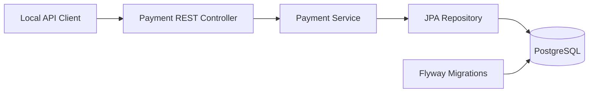

# Architecture — Milestone 1

The application persists **simulated payment intake requests** only. `RECEIVED` does not mean authorized, captured, cleared, or settled.

## Planned bounded contexts (not implemented)
- Payment orchestration
- Double-entry ledger
- Merchant identity and authorization
- Risk/fraud assessment
- Notification and reconciliation

## Nonfunctional requirements
Security-by-design, immutable audit signals, explicit consistency boundaries, request correlation, data retention policy, dependency scanning, observability, reproducible CI, and resilience testing.
