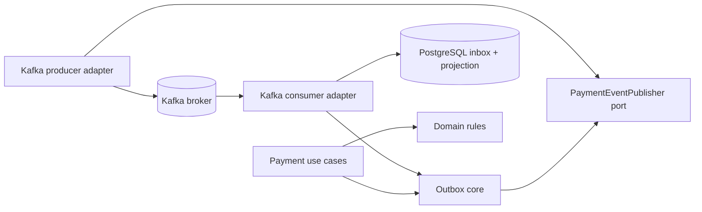

# Payment messaging packages — responsibility-first refactor

## Context

Milestone 06.7E passed 103 tests, but `payments.outbox` held unrelated code: broker-independent delivery, Kafka producer, Kafka consumer, failure observations and metrics. A flat package makes important **transaction, transport and ownership** boundaries harder to discover.

**Decision:** retain the one-deployable modular monolith and keep business transactional outbox logic independent from Kafka. Reorganize production code and tests into dedicated Kafka packages **without extracting a Maven module or introducing a common service library**.

## As-built package architecture

```text
dev.asambataiden.payment
├── payments
│   ├── api
│   │   ├── docs                      # OpenAPI: external HTTP contract
│   │   ├── dto
│   │   ├── error                     # stable RFC 9457 public API error codes
│   │   ├── PaymentController
│   │   └── PaymentApiExceptionHandler
│   ├── application                  # use cases and application ports
│   ├── domain                       # state machine, business exceptions
│   ├── infrastructure.persistence   # payment PostgreSQL adapters
│   ├── outbox                       # broker-independent lease, dispatch, inbox helper
│   │   ├── PaymentOutboxEvent
│   │   ├── PaymentEventPublisher    # transport port
│   │   ├── PaymentOutboxDispatcher
│   │   ├── SupervisedPaymentOutboxWorker
│   │   ├── PaymentInbox
│   │   └── TrustedPaymentEventConsumer
│   └── messaging.kafka
│       ├── producer
│       │   ├── KafkaPaymentEventPublisher
│       │   └── KafkaPaymentTransportConfiguration
│       └── consumer
│           ├── KafkaPaymentConsumerConfiguration
│           ├── OptInKafkaPaymentListener
│           ├── LocalKafkaPaymentRecordProcessor
│           ├── LocalPaymentEventProjection
│           ├── ManualKafkaPaymentConsumerWorker
│           ├── KafkaConsumerFailureObservations
│           └── KafkaConsumerMetrics
├── ledger                         # ledger domain and application
└── shared                         # security and crosscutting observability
```

Tests were moved with their Kafka producer/consumer components. The outbox SQL migrations remain in `src/main/resources/db/migration` because Flyway schema ownership is a deployment concern, not a Java package.

## Dependency rule



The outward adapter depends on the core abstraction, never the reverse. `payments.outbox` must not import `payments.messaging.kafka`; the Kafka consumer adapter must not import the HTTP API. These boundaries are now enforced by ArchUnit.

**Why no new Maven modules?** A Java package is a sufficient organizational boundary for this single deployable and current ownership structure. Maven module extraction becomes valuable only when real compile-time isolation, separate teams or release versioning outweigh the maintenance burden.

**Why no reusable commons library?** Payment-specific lifecycle and ledger rules should remain with their business owner. Stable cross-service technical concerns can be reviewed for extraction later; avoid a shared business-domain dependency that forces lockstep deployments.

## What remains imperfect

- `TrustedPaymentEventConsumer` uses the **same producer database**, so it is not a portable remote-service consumer. Its name/documentation must retain that limitation.
- `PaymentOutboxDispatcher` presently contains SQL claim/ACK/retry responsibilities. Move its persistence operations behind a repository port **only if** additional complexity or transports justify it.
- `PaymentOutboxEvent` currently lives with the outbox core; when independent consumers are introduced, consider a separate schema repository with AsyncAPI/JSON Schema and compatibility tests, not a shared Java domain JAR.
- A package move does not address poisoned offsets, broker ACLs, or production TLS verification.
- The many existing learning documents may contain historical source paths. Read their diagrams as architectural history and prefer the package tree above for current paths.

## Change acceptance

- Production/test classes moved, with imports and package declarations updated atomically.
- Outbox dispatch semantics, Kafka event contract and Flyway V1–V8 remain unchanged.
- ArchUnit catches reversed dependencies.
- Existing integration tests must remain green; post-refactor CI and security checks are the evidence, not an assumption.

## Interview rehearsal

1. Why is keeping the outbox core independent of Kafka a useful ports-and-adapters boundary?
2. When is a package enough, and when do you actually need Maven modules or microservices?
3. What is the danger of a shared `commons` module containing payment-domain rules?
4. What would make the current producer-DB-backed consumer unsuitable for a remote subscriber?
5. How does a package refactor differ from a business-contract change, and how do you prove it?
