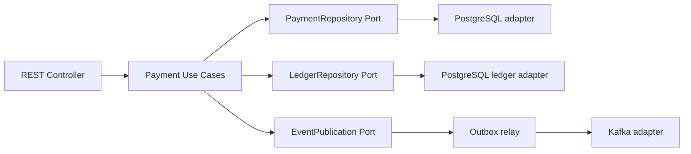

# Module ownership, reusable libraries and avoiding duplicate classes

## Architecture decision: modular monolith first

Keep the current **single Maven module / one deployable JAR** while learning boundaries. A directory structure is a *logical* boundary, not yet an enforced set of Maven modules. Existing ArchUnit checks are useful, but they do not make every internal dependency clean. Extract separate Maven modules **only when they reduce real coupling**, provide a stable independently testable contract, or permit distinct owner/release lifecycles.

**Current logical areas:** `payments.api`, `payments.application`, `payments.domain`, `payments.infrastructure.persistence`, `payments.outbox`, `ledger.domain`, `ledger.application`, `shared.security`, `shared.observability`. Keep business ownership explicit. A useful package name describes a responsibility, not the technology trend of the month.

## What NOT to duplicate

| Concern | Single source of truth | How to reuse / avoid drift |
| --- | --- | --- |
| Payment lifecycle | `PaymentStateMachine` | All state changes go through one policy, not copies in REST and messaging |
| Journal balancing | `JournalEntry` + PostgreSQL V3 deferred constraint | Domain guard for fast feedback; DB guard against bypass/race |
| Merchant identity | verified JWT mapping at inbound boundary | Do not invent it again from headers or Kafka payload without provenance |
| Idempotency policy | payment store DB constraint + request-term comparison | Separate payment *request key* from transport *event ID* and consumer *receipt* |
| Transactional persistence | application transactional use case | Do not create a new transaction for each database write during one business change |
| Serialization | one event envelope version + adapter | New consumers read the contract, not reconstructed fields ad hoc |
| Error handling | shared API exception handler | Domain remains independent of HTTP status and RFC 9457 |
| Correlation / logging | shared observability layer | Propagate context rather than adding ad hoc identifiers at every call |
| Test infrastructure | focused test fixtures / container lifecycle | Extract reusable fixtures once multiple suites need identical setup |

## Ports and adapters: choose the right seam

The currently implemented `PaymentStore` interface is a **port**: application logic does not choose a database technology. `KafkaPaymentEventPublisher` implements the `PaymentEventPublisher` transport interface; the outbox can be tested with a fake publisher. These are useful seams because they isolate unstable external dependencies. Other modules currently call `JdbcTemplate` directly; avoid marketing the project as completely hexagonal until those decisions are intentionally reviewed.

A candidate evolution (not yet implemented):



**Caution:** Avoid placing `KafkaTemplate`, `JdbcTemplate`, Spring MVC or security-token classes in business domain packages. Interfaces should express meaningful business behavior, not merely one-to-one wrappers around framework methods.

## When to extract an external/shared Java library

An extracted dependency is justified only when **two or more bounded contexts or services genuinely share a stable *technical* contract**, the ownership/release policy is explicit, and duplication would be more harmful than coupling. Example future candidates:

- **Observability starter** (correlation propagation, ECS logging configuration, Micrometer conventions) for multiple independently deployed services.
- **Event envelope contract** as versioned JSON Schema/AsyncAPI plus generated/verified clients, not a direct shared dependency on producer domain entities.
- **Test fixtures / integration-test utilities** when PostgreSQL/Kafka setup is repeated consistently in several projects.
- **Security configuration policy** as centrally reviewed standards and deployment templates; tenant authorization rules remain **service-specific**.

Do **not** create a shared `commons` JAR for `PaymentStateMachine`, `JournalEntry` or merchant-domain rules. Those belong to their bounded context; publishing a shared domain JAR across services encourages lockstep releases. Do not extract a library just because a class is used twice in one application.

## Extraction checklist

1. Identify repeated behavior and its actual owner. Cite at least two existing call sites.
2. Decide if it is domain logic, application orchestration, or crosscutting infrastructure.
3. Define a small stable contract, semantic versioning, backward compatibility and threat model.
4. Keep the consuming application able to test against a fake/in-memory implementation.
5. Publish to a private artifact registry with provenance, SBOM, signatures, dependency and license scanning as applicable; verify version updates automatically.
6. Add contract tests and rollout / deprecation policy. Measure reduction in code duplication and coupling.

Before this checklist is met, refactor **within the monolith**. Prefer package-private helpers and fixtures over infrastructure-wide abstraction. Avoid introducing reflection, generalized factories or dynamic configuration merely to reduce a few repeated lines.

## Proposed modular Maven layout — **future, not implemented**

```text
enterprise-payment-platform/
  pom.xml                      # aggregator / parent
  payment-domain/              # no Spring / DB / Kafka dependency
  payment-application/         # use cases and ports
  payment-adapters-http/       # REST and JWT entry point
  payment-adapters-postgres/   # migrations and JDBC
  payment-adapters-kafka/      # producer and consumer adapters
  payment-boot-app/            # runtime composition root
  payment-test-support/        # test scope only
```

**Promotion rule:** Split into these modules only if compile-time boundary enforcement or parallel work warrants the added Maven complexity. Keep migrations owned by the deployed application, avoid cyclic dependencies, and test module boundaries with ArchUnit and Maven dependency checks. For a single service, this future layout may be excessive; a **well-organized single module is a valid industry solution**.

## Current technical debt to prioritize over adding new modules

- `PaymentController.merchantId(Jwt)` is API-layer claim parsing; refactor to a focused validated `MerchantPrincipal` adapter if additional endpoints otherwise repeat it.
- `PaymentOutboxDispatcher` contains claim/ACK SQL, retry decisions and broker boundary orchestration. A repository port is worth considering if implementation grows or a second transport appears, but do not over-generalize yet.
- `TrustedPaymentEventConsumer` is a same-database learning helper, **not** a remote Kafka trust boundary; an external consumer requires its own credential and event-verification strategy.
- Repeated Testcontainers/bootstrap code across `*IT` suites is a reasonable **test-scoped** refactoring target, provided tests remain isolated and CI stays reproducible.
- The README currently emphasizes milestone 05 and must be kept aligned with the evolving 06.x handbook.

## One design principle for interviews

**DRY is not “every matching line of code must become a library.”** Avoid duplicating *knowledge and rules*. A small amount of independent adapter code may be safer than sharing a huge framework module across bounded contexts. Prefer explicit dependency direction and observable business capabilities over class-count minimization.
