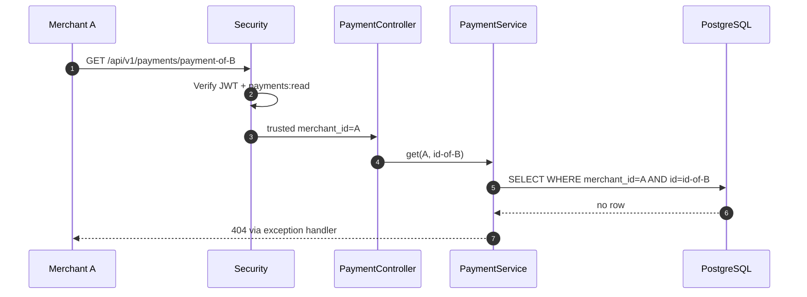

# Runtime and sequence diagrams — why every boundary exists

These describe **code already present on `feat/payment-ledger`**, unless explicitly marked *planned*. Terms: "payment" is a simulated record, "capture" is a simulated accounting event, "ACK" means broker accepted the message, not financial settlement.

## UC-01 — Create a payment; same key, same terms

**Goal:** a merchant safely retries a network request without duplicating a payment. **Input:** signed JWT, `payments:write`, `merchant_id` claim, idempotency key, amount/currency/reference. **Output:** stored `RECEIVED` row. **Why:** HTTP responses may be lost after the server commits a request.

```mermaid
sequenceDiagram
  autonumber
  participant C as Merchant client
  participant S as JWT security / PaymentController
  participant A as PaymentService
  participant P as PaymentStore / JDBC
  participant DB as PostgreSQL
  C->>S: POST /api/v1/payments + bearer JWT + Idempotency-Key
  S->>S: Verify token signature, issuer, audience, scope; read merchant_id
  S->>A: create(verified merchantId, key, amount/currency/ref)
  A->>P: insertIfAbsentAndFind(...)
  P->>DB: INSERT ... ON CONFLICT (merchant_id, key) DO NOTHING
  DB-->>P: winning row / existing row
  P-->>A: stored payment
  A->>A: compare stored amount/currency/reference with request
  alt Same terms
    A-->>S: stable PaymentResult
    S-->>C: payment representation
  else Key reused for different terms
    A-->>S: IdempotencyConflictException
    S-->>C: conflict Problem Details
  end
```

**Important:** PostgreSQL uniqueness is the concurrency arbiter. A Java `synchronized` block is only local to one JVM and would not protect multiple replicas. Exact `BigDecimal` comparisons prevent floating-point drift. Tenant isolation is based on the **validated claim**, not an untrusted request header.

**Evidence:** `PaymentServiceTest`, `PaymentServiceIT`, `PaymentBearerTokenIT`, migrations V1/V2. **Limits:** no published retention/expiry contract for idempotency keys; the API remains simulated.

## UC-02 — Read payment and reject cross-tenant access



Why 404 rather than returning another merchant's payment? Avoid disclosing the existence or contents of a tenant-owned resource. API and integration tests also reject missing merchant claims.

## UC-03 — Simulated authorization then capture: atomic DB consistency

**Goal:** transition state and create journal/outbox without partial commitment. **Scope:** internal method, **not a merchant-accessible API**.

```mermaid
sequenceDiagram
  autonumber
  participant E as Trusted internal caller (concept)
  participant T as SimulatedPaymentTransitionService
  participant DB as PostgreSQL
  participant SM as PaymentStateMachine
  participant L as SimulatedLedgerService
  E->>T: advance(merchantId, paymentId, eventId, CAPTURED)
  T->>DB: BEGIN; SELECT payment WHERE merchant_id=? FOR UPDATE
  DB-->>T: current status, persisted amount and currency
  T->>DB: Look up merchant-scoped eventId
  alt Same event already committed
    T-->>E: Existing transition result (idempotent)
  else New event
    T->>SM: validate AUTHORIZED -> CAPTURED
    SM-->>T: allowed
    T->>DB: UPDATE payments SET status=CAPTURED
    T->>L: append(eventId, balanced journal)
    L->>DB: INSERT ledger entries + postings; finalize
    T->>DB: INSERT payment_outbox event
    T->>DB: COMMIT (including deferred journal constraint)
    T-->>E: CAPTURED
  end
```

**Why `FOR UPDATE`?** It serializes competing transitions for the same payment. **Why DB transaction?** If journal balance or outbox insertion fails, payment status must roll back too. **Why use persisted amount?** Callers must not fabricate accounting terms.

**Failure scenario:** duplicate event ID with a different target must be rejected; cross-tenant payment lookup must not mutate data; an invalid state transition cannot create journal or outbox entries.

**Evidence:** `SimulatedPaymentTransitionServiceIT` and `SimulatedLedgerServiceIT`. **Important simplification:** `REFUNDED` exists as a state but currently creates no refund/reversal accounting. No real authorization provider drives these transitions.

## UC-04 — Transactional outbox, Kafka ACK, and eventual delivery

**Goal:** avoid losing a committed database event when the broker is offline. **Scope:** dispatcher is manually invoked; Kafka publisher is optional.

```mermaid
sequenceDiagram
  autonumber
  participant DB as PostgreSQL outbox
  participant W as SupervisedPaymentOutboxWorker
  participant D as PaymentOutboxDispatcher
  participant K as KafkaPaymentEventPublisher
  participant B as Kafka broker
  W->>D: dispatchOne()
  D->>DB: BEGIN; claim next eligible row FOR UPDATE SKIP LOCKED
  DB-->>D: event + lease_token (30s)
  D->>DB: COMMIT claim
  D->>K: publish(version 1 event, key merchant:payment)
  K->>B: send Kafka record (acks=all, idempotent producer)
  B-->>K: broker ACK
  K-->>D: successful future completion
  D->>DB: UPDATE dispatched_at WHERE lease_token still matches
  DB-->>D: committed ACK
  D-->>W: one claimed item
```

**Why not publish inside the payment DB transaction?** It would tie DB locks and transaction duration to broker availability and still not create a simple atomic distributed transaction. The outbox decouples these boundaries.

**Important:** an ACK says the broker accepted the record, not that any consumer processed it. A crash after broker acceptance but before DB acknowledgment causes **duplicate delivery**. Key ordering is per payment in a stable partition assignment, not across the entire system.

**Evidence:** `PaymentOutboxDispatcherIT`, `KafkaPaymentEventPublisherIT`, `KafkaOutboxEndToEndIT`, V4/V5/V6.

## UC-05 — Broker failure, retries, stale leases and quarantine

```mermaid
sequenceDiagram
  autonumber
  participant D as Dispatcher
  participant DB as PostgreSQL
  participant K as Transport
  D->>DB: claim event and increment attempts
  D->>K: publish outside DB transaction
  alt Publish failure
    K--xD: error
    D->>DB: release matching lease; schedule exponential backoff
    alt Fifth unsuccessful attempt
      D->>DB: set dead_lettered_at and failure category
      Note over DB: Excluded from normal claims; manual investigation required
    end
  else Publish succeeded, ACK update lost or lease stolen
    K-->>D: ACK
    D->>DB: acknowledge only if fencing token matches
    Note over DB: May be retried; consumers must deduplicate
  end
```

**Why `SKIP LOCKED`?** Allows parallel relay workers to claim independent rows without blocking. **Why fencing token?** Old workers cannot acknowledge a later worker's claim. **Why quarantine?** A poison message must not consume unbounded retries. **Open risk:** 30-second fixed lease can expire during slow transport; broker failure simulation and production tuning remain to be done.

## UC-06 — Consumer-side idempotent local effects (helper implemented, Kafka listener planned)

```mermaid
sequenceDiagram
  autonumber
  participant T as Trusted local caller
  participant C as TrustedPaymentEventConsumer
  participant DB as PostgreSQL
  T->>C: consume(consumerName, event, localDatabaseEffect)
  C->>DB: BEGIN; compare event identity with committed outbox
  alt Mismatch / forged event
    C--xT: reject
  else Exact trusted event
    C->>DB: INSERT inbox receipt ON CONFLICT DO NOTHING
    alt Previously processed by this consumer
      C-->>T: duplicate: no local effect
    else First delivery
      C->>DB: Execute local DB effect in same transaction
      C->>DB: COMMIT inbox + effect
      C-->>T: applied
    end
  end
```

This helper assumes the consumer can access the **same producer database** and does **not** authenticate a cross-service Kafka message. For a real remote consumer, broker-level identity, schema verification, tenant authorization, event provenance and a consumer-owned inbox are needed. Local DB effects must not be confused with exactly-once remote side effects.

## Practice questions after reading this page

1. Which operation has a true local ACID guarantee, and which is eventual?
2. How do retries behave before commit, after commit, and after Kafka ACK but before outbox ACK?
3. Where do idempotency keys differ from event IDs and Kafka offsets?
4. Why is `merchant_id` authenticated at the API boundary but still required in SQL predicates and FKs?
5. How would two workers behave when a Kafka publish exceeds the lease?
6. What must change before an event arrives from a *remote* authenticated Kafka consumer?
7. What tests prove a negative property (e.g. another merchant cannot read or post)?
