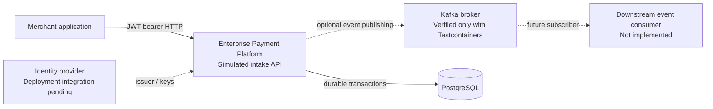
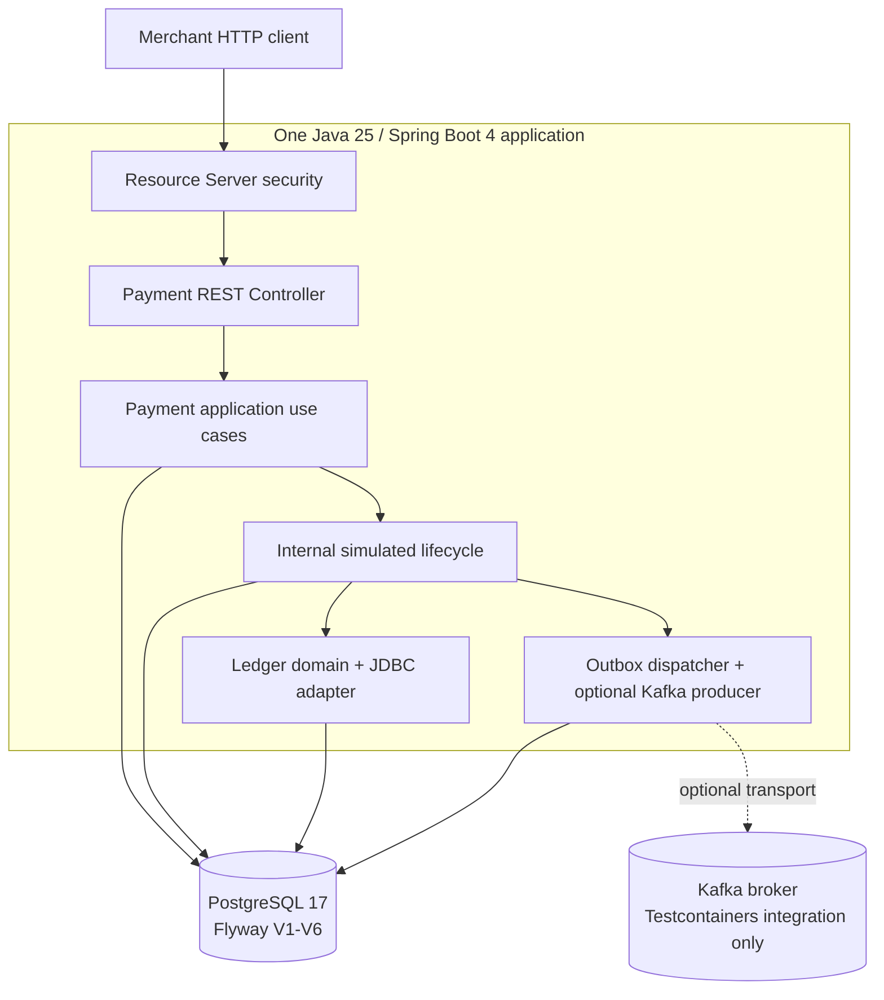
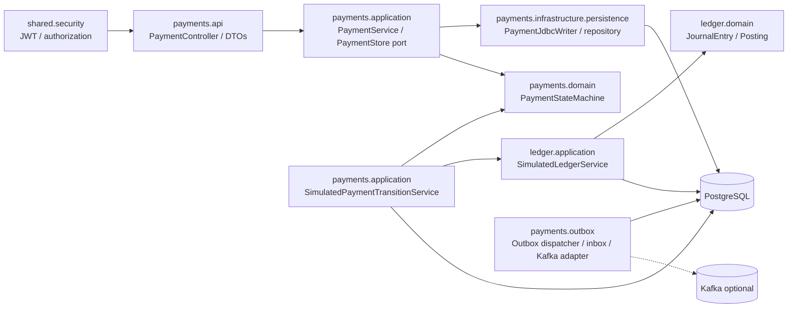
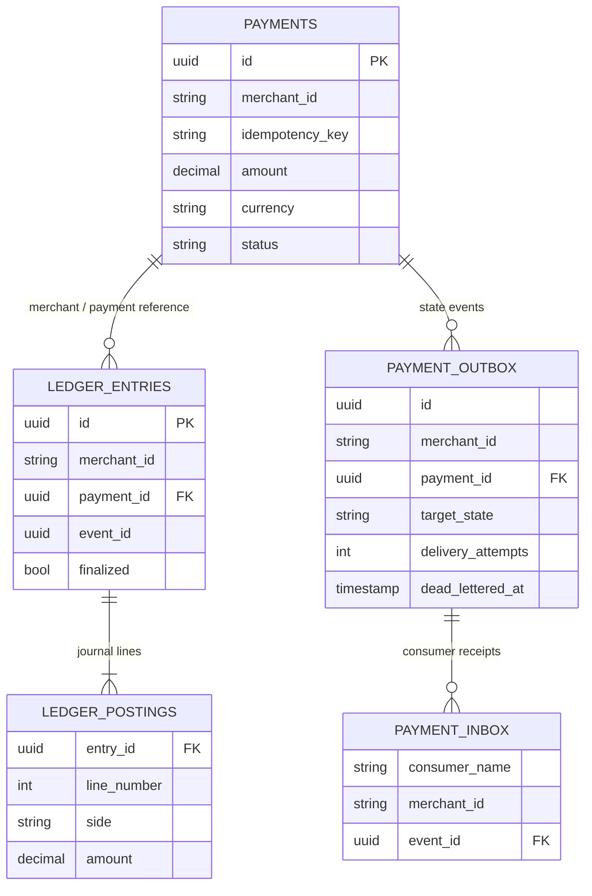

> **HISTORICAL AS-BUILT SNAPSHOT — Milestone 06.6.** This page documents an earlier implementation increment, **not** the final v0.1.0 component inventory. The release includes Flyway V1–V9, an opt-in simulated-transitions HTTP controller, an opt-in scheduled outbox relay and an opt-in Kafka listener/consumer path that were added after this snapshot. The authenticated local HTTP demo runs without Kafka. For current implementation scope, start with the [technical case study](../portfolio/technical-case-study.md) and inspect the [release-tagged source](https://github.com/asambataiden/enterprise-payment-platform/tree/v0.1.0). The diagrams and prose below are intentionally preserved as historical evidence.

# System architecture — bird's-eye view to modules

**As-built baseline:** 06.6 on `feat/payment-ledger`. **Diagram convention:** solid connectors = current code/boundary; dashed connectors = future/optional actors or not yet wired integration. Testcontainers Kafka is real Kafka **only in tests**, not a running production cluster.

## Why diagrams at several levels?

An architecture diagram should answer a question. A context view explains **who uses the system**, a container view explains **where software executes and data lives**, a component view explains **how the Java modules cooperate**, and runtime sequences explain **what happens in order**. Do not draw one overwhelming giant diagram and expect it to communicate every risk. We follow the ideas of [C4](https://c4model.com/introduction) and use [arc42](https://arc42.org/overview/) to organize quality goals, decisions and risks.

## View A — System context

**Trust boundaries:** merchants are untrusted HTTP clients; JWTs must be cryptographically validated, scoped and mapped to an authorized merchant identity; the DB enforces uniqueness and ownership FKs; Kafka security must be configured for the real deployment. No actual payment processor exists.

## View B — Container / deployable view (as built)

The `PaymentOutboxDispatcher` is manually invoked. `SupervisedPaymentOutboxWorker` is a bounded helper, **not** a configured scheduler. Kafka is disabled by default. The live Kafka consumer is not implemented. Runtime identity provider, cloud deployment, managed secrets, audit and alert infrastructure are not established by this test suite.

## View C — Logical module and dependency map

**Important nuance:** `PaymentService` depends on the `PaymentStore` **port**; the concrete JDBC writer supplies it. The simulated transition and ledger services presently use `JdbcTemplate` directly. That is acceptable in a small learning increment, but means **not every component follows full ports-and-adapters layering yet**. Do not call it a fully implemented hexagonal architecture.

### Module responsibilities and why they exist

| Module | Owns | Why separate | Representative code |
| --- | --- | --- | --- |
| API / DTOs | HTTP shapes and status codes | decouple wire contracts from domain rules | `PaymentController` |
| Security | token trust, access control, tenant claim validation | clients must not choose tenant identity | `PaymentSecurityConfig` |
| Application | use-case orchestration and transactions | domain logic not tied to controller | `PaymentService`, `SimulatedPaymentTransitionService` |
| Domain | permitted transitions and accounting invariants | pure testable business rules | `PaymentStateMachine`, `JournalEntry` |
| Persistence | durable atomic inserts / tenant lookups | DB arbitrates races | `PaymentJdbcWriter`, Flyway |
| Ledger | simulated balanced journals | capture semantics distinct from intake | `SimulatedLedgerService` |
| Outbox/inbox | durable message dispatch, retry and replay protection | DB and broker cannot be one ordinary transaction | `PaymentOutboxDispatcher`, `PaymentInbox` |
| Kafka adapter | serialized keyed event and broker ACK | vendor-specific transport behind an interface | `KafkaPaymentEventPublisher` |
| Crosscutting | correlation, JSON errors, architecture tests | consistency without duplicating API code | `shared.observability`, `PaymentApiExceptionHandler`, ArchUnit |

## View D — Data ownership, evolution and invariants

Invariants are more important than diagrams: **tenant-scoped reads**, composite merchant/idempotency uniqueness, enforced payment ownership on journals/outbox, two or more journal postings with debits = credits, finalized journals immutable, event identity unique within each tenant, and consumer receipts unique per consumer+tenant+event. A schema diagram does **not** prove all constraints—read V1–V6 migration SQL and their PostgreSQL ITs.

## View E — Security and operations overlays (not yet fully deployed)

- **Authenticity:** JWT signature, issuer, audience and expiration validation are tested; a real IdP has not been integrated.
- **Authorization:** scopes and merchant ownership; internal simulation transition service is **not** a public endpoint and needs an authorized event source before exposure.
- **Database:** foreign keys, unique constraints, transactions, immutable journal triggers. Production least-privilege DB roles and RLS are not implemented.
- **Messaging:** optional TLS/SASL-ready publisher; test Kafka broker runs locally with PLAINTEXT in Testcontainers. Production broker authentication/ACL smoke tests are future work.
- **Observability:** correlation IDs and ECS JSON logs are present; production metrics, tracing and alerts are future work.
- **Risk:** outbox guarantees at-least-once *attempt semantics*, not exactly-once remote effects. A slow publisher can outlive the 30-second lease.

## How to read the project from scratch

Start at `PaymentController` → `PaymentService` → `PaymentStore` → PostgreSQL. Then trace `SimulatedPaymentTransitionService` → `PaymentStateMachine` → `SimulatedLedgerService` + `payment_outbox`. Finally read `PaymentOutboxDispatcher` → `PaymentEventPublisher` → `KafkaPaymentEventPublisher`; reverse the flow for the `PaymentInbox` local-effect helper. Use [runtime scenarios](runtime-scenarios.md) to follow each flow and [roadmap](../roadmap/enterprise-payment-platform.md) to understand why the order matters.

**Never put the entire enterprise target picture into an “as implemented” diagram without clearly labeling hypothetical components.**
