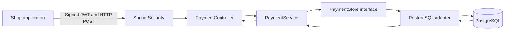

# Start from zero: the Enterprise Payment Platform, explained for a complete beginner

> **Learning objective:** understand and be able to reproduce *why* we built
> the platform, *what every major component does*, *how a request travels*
> through it, *how to test it*, and *how to defend the architecture*.
> **Scope:** educational simulated payment intake. There are no real charges,
> card-data processing, settlement, or banking integrations.

**Read this page before the numbered chapters.** This is a navigational
and practical foundation, not a replacement for the implementation,
tests or later in-depth chapters.

## 1. First understand the business problem (no Java required)

Imagine an online shop tells a payment-recording service:

> "Please remember that customer order 123 has a simulated payment
> amount of €12.50."

The network might fail after the server saves the request. The shop
cannot tell whether the server recorded it. If it sends the same
request again, a badly designed system might create two records.
Another shop must also be unable to read that order.

We solve these three foundational problems:

1. **Durability:** when an operation succeeds, its database record
   survives an application restart.
2. **Idempotency:** re-sending the same operation with the same
   merchant/key/details does not create a second payment record.
3. **Tenant isolation:** merchant A may see only merchant A's payments.
   The tenant identifier comes from a cryptographically validated
   JWT, not a client-controlled header.

Later chapters add a simulated lifecycle, bookkeeping journal,
outbox/inbox, Kafka, observability and performance experiments.
Do **not** study Kafka before you can explain one POST and GET.

## 2. Mini-dictionary — words you will see repeatedly

| Word | Everyday explanation | Here |
| --- | --- | --- |
| API | A counter where another program asks for a service | HTTP routes in `PaymentController` |
| HTTP POST | Ask the server to create something | Create simulated payment intake |
| HTTP GET | Ask the server to show something | Read an owned payment |
| JSON | Text format for sending structured information | `{"amount":12.50,"currency":"EUR",...}` |
| Java class | A named piece of program behavior or data | `PaymentService` |
| Spring Boot | Framework that assembles and starts the Java web service | Runs the HTTP server and components |
| DTO | Shape of data entering/leaving an API | `CreatePaymentRequest` |
| Service | Coordinates one business use case | `PaymentService.create` |
| Port | Interface describing what the application needs | `PaymentStore` |
| Adapter | Concrete implementation of a port | PostgreSQL writer/repository |
| Database | Durable, queryable storage | PostgreSQL 17 |
| SQL | Language used to read and modify the database | SQL migrations and JDBC |
| Flyway migration | Numbered, auditable database schema change | V1–V9 in this repo |
| Transaction | Group of DB steps that commit or roll back together | `@Transactional` |
| JWT | Signed token containing trusted claims | Merchant ID and scopes |
| Scope | Permission the token grants | `payments:read`, `payments:write` |
| Idempotency key | Unique label that makes retries safe | `Idempotency-Key` |
| Ledger | Bookkeeping record of simulated debits and credits | Internal simulation, not real money |
| Outbox | Database table of events to send *after* DB commit | `payment_outbox` |
| Inbox | Record of already-consumed event IDs | Duplicate handling |
| Kafka | Event transport between systems | Optional broker integration |
| HikariCP | Reusable pool of database connections | Limits concurrent DB leases |
| Testcontainers | Starts disposable dependencies for automated tests | PostgreSQL/Kafka tests |
| p95 | Value at/below which about 95% of samples lie | Measured request latency |
| CI | Automated build and test checks on commits | GitHub Actions |

If a term is unfamiliar, stop and explain it in your own words.
You do not need to memorize every term before starting.

## 3. The smallest system picture



**What happens in order:**

1. A shop calls the HTTP endpoint with a bearer token, idempotency
   key, and validated JSON details.
2. Spring Security verifies the token and permission.
3. The controller extracts the trusted `merchant_id` claim.
4. The controller converts request data into a `CreatePaymentCommand`.
5. `PaymentService` opens a database transaction and asks the
   `PaymentStore` port to save or retrieve the idempotent record.
6. The PostgreSQL implementation uses durable uniqueness and an atomic
   insert strategy to arbitrate concurrent requests.
7. The service compares the stored details with the requested details.
   An identical retry returns the same record; different details with
   the same key cause a conflict.
8. The controller constructs an HTTP response.

Read the *actual source*, in this order:
- `src/main/java/dev/asambataiden/payment/payments/api/PaymentController.java`
- `src/main/java/dev/asambataiden/payment/payments/api/dto/CreatePaymentRequest.java`
- `src/main/java/dev/asambataiden/payment/payments/application/PaymentService.java`
- Locate the `PaymentStore` interface and PostgreSQL adapter in your IDE
- Examine the initial payments Flyway migration and the tests

## 4. Setup from an empty terminal

**Requirements:** macOS terminal, Git, JDK 25, Maven 3.9+,
Docker Desktop with its daemon running, and this repository
already cloned. Never commit passwords, real JWTs or payment data.

**Step A — Find the root of the repository**

```bash
ROOT="$(git rev-parse --show-toplevel)"
printf 'Repository: %s\n' "$ROOT"
git -C "$ROOT" status --short --branch
```

Explanation: `git rev-parse --show-toplevel` finds the project root
even when your terminal starts inside `ops/monitoring/...`.
`status` shows your branch and local changes. **Do not discard
uncommitted work** merely to follow a tutorial.

Expected: repository path and current branch. If Git says
"not a git repository", open the cloned repository first.

**Step B — Switch to the learning branch**

```bash
git -C "$ROOT" switch feat/payment-ledger
git -C "$ROOT" pull --ff-only origin feat/payment-ledger
```

Explanation: `--ff-only` refuses an unexpected merge. If this
fails because you have local changes, inspect and resolve them
rather than force-resetting.

**Step C — Check tool versions**

```bash
java -version
mvn -version
docker version
docker info
```

Expected: Java 25, Maven 3.9+, and a reachable Docker daemon.
`docker info` failing usually means Docker Desktop has not started
or its context/socket is unavailable; it is not a Java code failure.

**Step D — Run automated verification**

```bash
mvn -B --no-transfer-progress -f "$ROOT/pom.xml" clean verify
```

Explanation:
- `mvn` = Maven build tool;
- `-B` = noninteractive output suitable for logs;
- `-f` = use this exact project file;
- `clean` = discard previous compiled build results;
- `verify` = compile and execute configured unit/integration checks.

Look for `BUILD SUCCESS`, but also inspect **test counts**,
failures and skips. Tests require disposable PostgreSQL/Kafka
containers; initial dependency/image downloads can be significant.
A green local result proves only the tests executed in *that* build.

**Important:** you can learn the normal request/response flow
without starting the live service. A live service requires a
local database password and a correctly configured JWT issuer,
not a manually invented bearer token. The benchmark tests create
their own *test-only* trusted issuer.

## 5. First hands-on exercise — trace one simulated payment

Request example (only with a legitimate locally configured token):

```http
POST /api/v1/payments
Authorization: Bearer <VALID_TOKEN>
Idempotency-Key: training-order-123
Content-Type: application/json

{"amount":12.50,"currency":"EUR","merchantReference":"order-123"}
```

Replace `<VALID_TOKEN>` with an authorized token from the
configured issuer; never save one in the repository. If you do not
have an identity provider, use `PaymentBearerTokenIT` to observe
signed JWT behavior safely under Testcontainers instead of disabling
security for convenience.

**Predict the result before running a test:**

- First valid POST: HTTP **201**, a `RECEIVED` record.
- Same merchant, same key, same details: record reused; no new payment.
- Same merchant/key with altered amount: **409** idempotency conflict.
- Missing/invalid bearer token: **401**.
- Valid token with insufficient scope: **403**.
- Valid token belonging to another merchant requesting the first
  merchant's payment: **404**.

These are the contracts to locate and verify in tests; do not confuse
a `RECEIVED` record with a real payment authorization.

## 6. Then learn the rest in this exact order

| Stage | What you should understand first | Detailed teaching material |
| --- | --- | --- |
| 00 | Problem, requirements, actors, risks | [Chapter 01](01-problem-domain-and-modular-monolith.md), [Lab 00](guided-labs.md) |
| 01 | HTTP request, JSON, controller, DTO, service | [Chapter 02](02-http-contracts-and-application-boundaries.md) |
| 02 | PostgreSQL, amount types, Flyway | [Chapter 03](03-postgresql-flyway-money-and-idempotency.md) |
| 03 | Safe retries and race conditions | [Lab 03](guided-labs.md), ADR-0002 |
| 04 | JWT validation, scopes and merchant isolation | [Chapter 04](04-jwt-merchant-security-and-trust-boundaries.md) |
| 05 | Tests, logs, errors, CI, security checks | [Chapter 05](05-quality-gates-observability-and-devsecops.md) |
| 06 | State machine and balanced simulated ledger | [Chapter 06](06-ledger-atomic-transitions-and-outbox-fundamentals.md) |
| 07 | Transactions, outbox, inbox and replay | [Guided Labs 06.3–06.5](guided-labs.md) |
| 08 | Kafka producer, consumer, trust and failure recovery | [Chapters 08–34](README.md) |
| 09 | API contracts, search, history and failure handling | [Later chapter index](README.md) |
| 10 | SQL indexes, query plan and benchmark interpretation | [Chapters 43–47](README.md) |
| 11 | Connection-pool saturation and real HTTP load | [Chapters 48–56](README.md) |
| 12 | Release risks, operation and architecture defense | [Roadmap](../roadmap/enterprise-payment-platform.md), [Interview workbook](interview-workbook.md) |

The roadmap and older architecture diagrams include retrospective
snapshots and planned integrations. Always reconcile them with
current code and tests; a design sketch alone is not delivery proof.

## 7. What you write down after *every* exercise

Use this template (copy it into your own learning journal):

```text
Lesson:
Problem in ordinary language:
What each new technical word means:
Before: how the system behaved:
Goal: what should happen after this change:
File and class:
Step 1, Step 2, Step 3 (what I actually did):
Data flow / sequence:
Why we did it this way:
Which other design could work, and why we did not choose it:
Test command and what it checks:
Actual result (pass/fail, number of tests, date, Git SHA):
One expected failure and how to troubleshoot:
Security / tenant / data-integrity risk:
What is still NOT implemented:
How I would explain it to a new colleague:
How I would explain it in an interview (30 sec and 2 min):
```

If you cannot explain the purpose of a component without naming
the framework, reread the problem statement and draw the flow.

## 8. Reproducible mini-lesson: HikariCP (from everyday analogy to tests)

**Analogy:** imagine a restaurant has only two checkout terminals.
Two workers are using both terminals. A third worker must wait
for a terminal. If nobody frees one before the deadline, the
third worker gets a timeout rather than waiting forever.

HikariCP is like that checkout-terminal pool, except its terminals
are database connections. A connection is expensive to open, so
the application reuses them.

1. Inspect `src/main/resources/application.yml` for the
   `spring.datasource.hikari` configuration.
2. Find `HikariPoolSaturationIT` and identify the test-only
   `maximum-pool-size=2` and `connection-timeout=500`.
3. Explain why two held leases force a third acquisition to fail.
4. Find the 503 mapping in `PaymentApiExceptionHandler`.
5. Explain why releasing the two leases should let the next
   database query succeed.
6. With Docker running, execute ordinary `mvn clean verify`.
   Inspect results rather than assuming all tests passed.
7. Only then run the opt-in real-HTTP lab:

```bash
bash "$ROOT/ops/benchmarks/http/run-local.sh"
```

Expected *behavior*, not fabricated timing: HTTP 200 during warm-up,
503 when the two slots are deliberately occupied, and 200 after
they are released. Actual p95 values vary with the host.

**Caution:** do not conclude that two or four connections is a
production best-practice pool size. Pool sizing is workload-specific.

## 9. How we will continue from here

Each new implementation should include:
1. **Before coding:** beginner problem statement, vocabulary,
   current behavior, objective and acceptance checks.
2. **Design:** architecture diagram, request/event sequence,
   responsibilities, security and failure boundaries.
3. **Incremental coding:** exact source paths, small changes,
   why each line/block exists and alternatives.
4. **Verification:** runnable commands, expected output, actual
   output only after execution, troubleshooting and rollback.
5. **Understanding:** a worked example, common mistakes,
   Q&A, interview rehearsal and explicit limitations.

Never trade away security, testability or truthful evidence to make
the tutorial easier. Explain the same correct architecture more
clearly instead.
