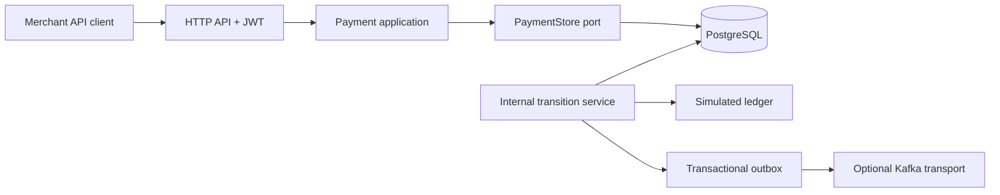

# Chapter 01 — Problem framing and modular-monolith architecture

**Status:** Retrospective learning chapter; describes existing implementation. The platform processes simulated payment records only, not real funds.

## What problem are we solving?

A merchant sends a payment-intake request over an unreliable network. The client may retry after a timeout. Multiple merchants may use identical idempotency keys, and one merchant must never read another's payments. Later, simulated state transitions need an auditable ledger and reliable asynchronous event handoff.

**Requirements:** tenant-scoped payment ownership; same-key/same-terms retry safety; changed-terms conflict; durable decimal values; explicit state transitions; auditable failure/retry behavior.

**Not requirements:** bank acquiring, PCI certification, external settlement, genuine funds transfers, actual merchant onboarding.

## Why begin with a modular monolith?

One deployable and one PostgreSQL transaction boundary minimize cross-service coordination while payment, ledger, and outbox invariants are evolving. Modular packaging and ArchUnit preserve separation without incurring microservice network latency, deployment complexity and distributed transaction problems.

Alternative: start with separate payment/ledger/event services. This would require a stronger consistency model, message choreography and explicit operational ownership before the first meaningful payment invariant is proven.

## Component map

## Incremental build order

1. Define UC-01 create/retry and UC-02 merchant-owned read.
2. Add DTOs, controller and application service.
3. Persist payments with Flyway and PostgreSQL.
4. Add atomic tenant-scoped idempotency and JWT trust.
5. Introduce state-machine and ledger invariants.
6. Couple payment, ledger and outbox within one database transaction.
7. Introduce reliable relay, Kafka and consumer defenses.

See [roadmap](../roadmap/enterprise-payment-platform.md), [system overview](../architecture/system-overview.md), [runtime scenarios](../architecture/runtime-scenarios.md), and [ADR-0001](../adr/0001-modular-monolith.md).

## Lab and interview rehearsal

Draw a synchronous payment creation sequence, labeling the authenticated merchant claim, unique index, transaction boundary and returned resource. Explain why a timeout does not prove failure, and why an event is not sent from inside the payment transaction.

**Interviewer:** Why not microservices? **Answer:** Our first hard problem is correctness and ownership under retries; a modular monolith gives one atomic boundary, simpler diagnostics and a future extraction path. It is an architectural decision for today's constraints, not a universal recommendation.

**Evidence to collect:** exact source paths, source SHA, a successful `mvn clean verify` run, relevant tests and one counterexample. Do not reuse old CI counts as current evidence.
