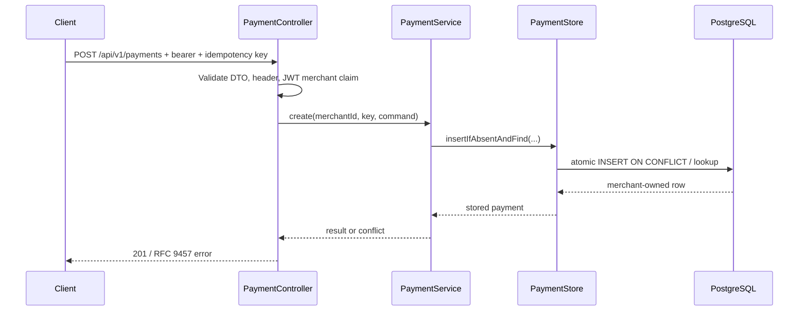

# Chapter 02 — HTTP contracts, commands and application boundaries

**Status:** Existing design explained retrospectively.

## Request-to-response sequence

## Separate responsibilities

- **Request/response DTOs** express external API representation; `CreatePaymentCommand` passes validated intent inward.
- **Controller** performs HTTP binding, authentication-principal extraction and response mapping.
- **Application service** enforces use-case decisions including safe retries.
- **Store port** isolates use-case semantics from persistence implementation.
- **Database** enforces durable uniqueness and constraints.

Why not put SQL in the controller? It would tie transport, business behavior and persistence together, complicating tests, portability and security review.

## Positive and negative paths

Compare valid creation, missing idempotency key, invalid amount, foreign payment ID and same-key/different-terms retry. Distinguish **400** malformed input, **401** unauthenticated, **403** unauthorized, **404** foreign or absent merchant-owned resource, **409** conflicting retry.

OpenAPI is a reviewed API contract; it does not independently guarantee application authorization. Refer to [OpenAPI compatibility chapter](14-openapi-compatibility-gate.md).

## Guided reading

Read `PaymentController` → `CreatePaymentRequest` → `CreatePaymentCommand` → `PaymentService` → `PaymentStore` → `PostgresPaymentStore`. For each hop record what it knows and what it must **not** trust.

**Exercise:** Change a request amount on retry with the same idempotency key; predict service/database response, then locate the assertion in `PaymentServiceIT`.

**Interview:** A DTO is a wire format; a command carries use-case intent; a domain type encodes invariants. The boundaries are useful only when they prevent coupling or untrusted data from becoming authority.
