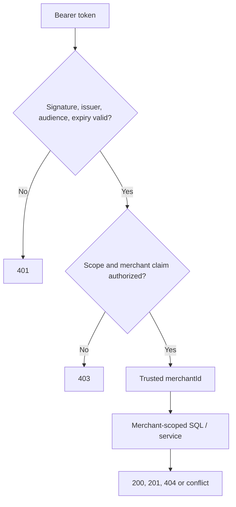

# Chapter 04 — JWT trust, merchant ownership and defense in depth

**Status:** Existing HTTP authorization model explained; not a production identity-provider deployment.

## Threat model

A client can forge headers, select arbitrary UUIDs, replay calls, submit malformed tokens or guess another merchant's resource IDs. Client-supplied `merchantId` is **not** proof of identity.

## Trust flow

Read security configuration and `PaymentController.merchantId`. Real-world verification also depends on trusted JWKS transport, signing-key rotation, token lifetime, operational issuer controls and enforcement at every request path.

Database predicates and composite foreign keys protect against coding mistakes that accidentally omit ownership checks in Java. A foreign resource's UUID should not reveal whether it exists; the merchant-scoped fetch yields not found.

## Test-first security reasoning

Inspect `JwtTrustValidationTest`, `PaymentBearerTokenIT` and `PaymentControllerWebTest`. Identify the test for missing token, wrong issuer/audience, signature failure, missing required scope or merchant claim, and cross-merchant reads. **Do not claim a specific test exists unless you find it.**

**Hands-on:** Sketch the minimum JWT claims for one merchant and a separate tenant. Predict each status for an unauthorized read and for an invalid bearer token. Do not put real credentials or JWTs in documentation.

**Interview:** Authentication verifies the caller/token. Authorization establishes permitted operations and resource ownership. A trusted claim plus an unscoped query can still leak another tenant's data; both checks matter.
