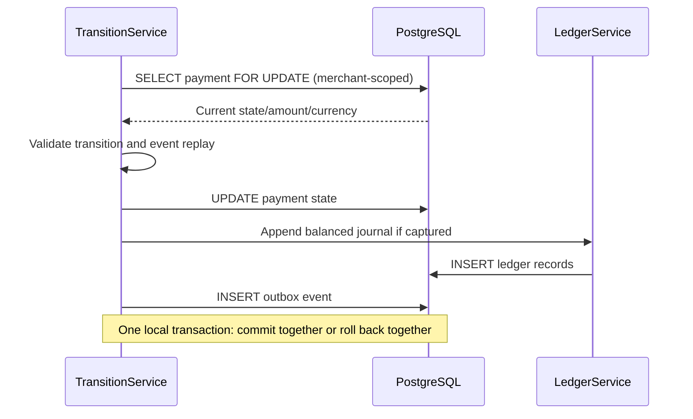
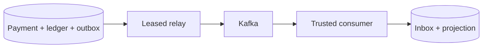

# Chapter 06 — State machine, ledger, ACID transactions and outbox foundations

**Status:** Retrospective foundation linking to later Kafka chapters.

## State invariants

The domain state machine permits only explicit simulated transitions. A successful `CAPTURED` transition derives monetary values from the persisted payment, never from untrusted event payloads.

The journal has debit and credit postings and must balance. A zero sum alone is insufficient; domain construction and database constraints jointly enforce the record's shape and lifecycle. See [ADR-0003](../adr/0003-simulated-ledger-and-payment-state-machine.md).

## Atomic capture sequence

Why not publish directly to Kafka while the SQL transaction is open? SQL commit and broker publish are not one atomic operation without extra distributed coordination. The transactional outbox writes an event record in the local transaction, then a relay publishes committed events independently.

## The duplicate-delivery case

A relay publishes an event, receives a broker ACK and crashes before recording `dispatched_at`. After restart it can publish again. The inbox uniquely records a `consumerName + merchantId + eventId` receipt **in the same transaction** as the local effect, suppressing duplicate local processing. This is not global exactly-once execution.

## Read code in the correct order

`PaymentStateMachine` → `JournalEntry` → `SimulatedLedgerService` → `SimulatedPaymentTransitionService` → Flyway V3/V4/V5 → `PaymentOutboxDispatcher` → `TrustedPaymentEventConsumer`.

## Failure-mode workshop

Simulate the reasoning for (a) debit/credit mismatch, (b) concurrent state updates, (c) duplicate event ID reused for a different target, (d) broker outage, and (e) crash after broker ACK. Find the corresponding existing test before claiming it is covered.

## Interview

Explain the difference between local ACID atomicity, at-least-once message delivery, producer idempotence, inbox deduplication and true distributed exactly-once guarantees. The design proves specific local invariants; it does not implement settlement or irreversible external side effects.
