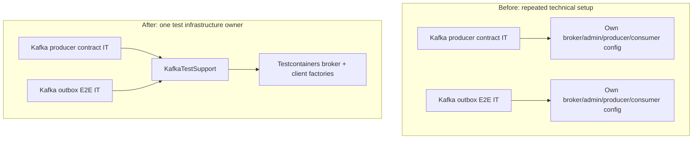

# Milestone 07.1 — Architecture boundaries and test-support reuse

**Status:** Implemented and GitHub CI verified at commit `5d451da` (2026-11-09).

## What problem did we find?

The Kafka producer contract test and PostgreSQL→outbox→Kafka end-to-end test independently repeated the same five technical configuration concerns: broker image, topic creation, producer serializers/acknowledgment behavior, consumer group identity, and consumer deserializers/offset handling. These copies can drift and produce a misleading comparison between tests.

At the same time, the payment and journal domain must remain independent of Kafka and Spring infrastructure. The existing ArchUnit suite checked parts of the payments domain but did not explicitly protect the ledger domain or all payment-domain references to messaging adapters.

**Why this matters:** duplicated test infrastructure makes upgrades inconsistent; transport types leaking into domain logic make future adapters and unit tests harder to isolate. Neither requires a new runtime Maven module.

## Decision: small test-scope helper, not an external library

Introduce `src/test/java/dev/asambataiden/payment/testinfra/KafkaTestSupport.java` with:

- `newBroker()` — one pinned JVM-based Apache Kafka test image (`apache/kafka:4.1.2`);
- `createTopic(broker, name, partitions)` — explicit, deterministic test topic creation;
- `newProducerFactory(broker)` — String key/value serializers, broker `acks=all` and an idempotent producer;
- `newConsumer(broker, groupPrefix)` — unique per-test consumer group, earliest offsets, disabled automatic offset commit.

Refactor two tests to use that helper while leaving each test's **domain scenario and assertions visible in the test**. The helper does not own the simulation's business rules, Kafka event shape, broker delivery assertions, or PostgreSQL transactions. It is **test-scoped** and cannot be packaged into the application's normal JAR.

Do **not** extract a `common-kafka` production library for two tests. The overhead of versioning, release governance, ownership and consumers would exceed the current benefit.

## Dependency-direction protection

Add ArchUnit rules:

1. `ledger.domain` must not depend on Spring, JPA, Kafka, payments HTTP DTOs or the outbox.
2. `payments.domain` must not depend on Kafka clients, Spring Kafka or outbox adapters.

These rules preserve domain purity but are **not a proof of fully enforced hexagonal architecture**. `SimulatedPaymentTransitionService` and `SimulatedLedgerService` still use JDBC directly, which may be refactored later if a stable application port becomes necessary.

## Before → after: what changed?

No production Kafka code paths, Flyway migrations, business transitions, JWT handling or public API contracts were intentionally modified.

## How to study it (hands-on)

1. Open both `Kafka*IT.java` tests and identify their **scenario-specific** lines (publish, assertions, event identity and partition ordering).
2. Open `KafkaTestSupport.java` and identify every **technical** setting now centralized.
3. Explain why `AUTO_OFFSET_RESET_CONFIG=earliest` and a unique group ID make each test independent of other groups.
4. Predict what happens if the test helper sets `ACKS_CONFIG=0`, `ENABLE_AUTO_COMMIT_CONFIG=true` or reuses a common consumer group ID. Why would that weaken what we claim to test?
5. Read `PaymentArchitectureTest.java`: which imports would violate the new domain dependency rules?
6. Run `mvn -B clean verify` with Docker available; compare tests and current CI results to the previous **89-test** baseline.

## Failure modes and tradeoffs

- **Shared helper as an anti-pattern:** if it begins hiding business-specific Kafka tests or grows one option for every test, split its small responsibilities or return to explicit setup.
- **Container reuse:** share configuration, **not a mutable broker/database instance** across otherwise independent test classes; avoid cross-test pollution.
- **Image pinning:** one central version makes upgrades consistent; it does not remove the need to test image/platform compatibility and scan dependencies.
- **Real security:** the test broker intentionally uses local plaintext connections; production opt-in transport requires SSL/SASL, broker identities and ACLs, which are not tested here.
- **Test migration:** an integration test still needs to start a real broker, publish an event and assert what was observed; a mock-only refactor would reduce coverage.
- **ArchUnit scope:** protect high-value dependencies, but avoid brittle rules on every class/name that discourage legitimate evolution.

## Interview questions

**Q: Why didn't you create a separate Java library for common Kafka code?**

A: Both call sites were tests within one deployable application. A test-scoped helper removes configuration drift without adding versioning or distributed coupling. I'd consider a separate test-support artifact only after multiple repositories need a genuinely stable contract.

**Q: What does an architecture test actually protect?**

A: It detects prohibited static dependencies at build time. It complements code review and runtime security tests; it cannot prove correct transaction semantics, absence of runtime reflection or operational readiness.

**Q: What do you mean by DRY?**

A: Avoid repeating *knowledge and policy*. The Kafka image and client defaults are common technical policy, so they belong in one helper. Test assertions and business meaning should remain explicit at their individual use-case boundaries.

## Acceptance evidence

- [x] Reusable test-only Kafka support introduced.
- [x] Producer contract and Postgres→Kafka E2E tests migrated without deleting their assertions.
- [x] Two dependency-direction rules added.
- [x] [Java CI #213](https://github.com/asambataiden/enterprise-payment-platform/actions/runs/42559688890): **91/91 passed**, including 48 fast (2 new ArchUnit) and 43 integration tests.
- [x] [Security CI #127](https://github.com/asambataiden/enterprise-payment-platform/actions/runs/42559688802): Gitleaks and Trivy passed.
- [ ] Local verification on Mac recorded with the exact commit.

**Next increment:** apply the same evidence-driven approach to JWT principal extraction and trusted Kafka consumer/event contracts. Only extract production modules after agreeing on domain ownership and interface boundaries.
