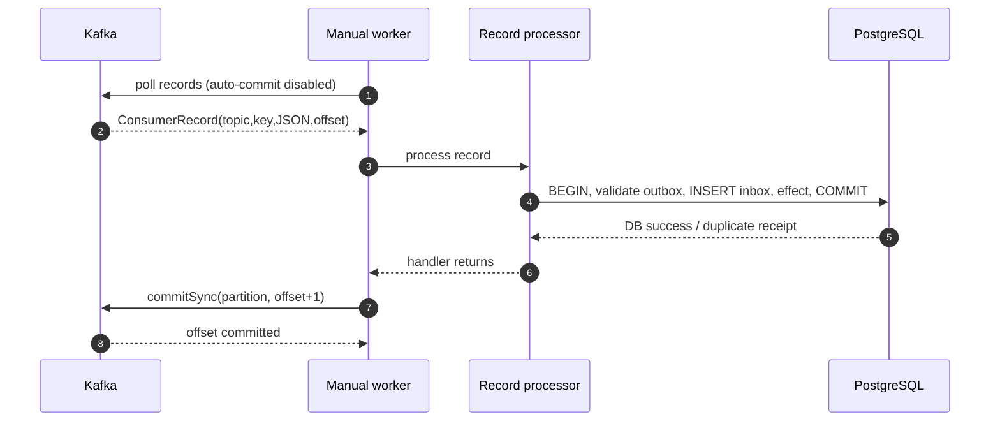
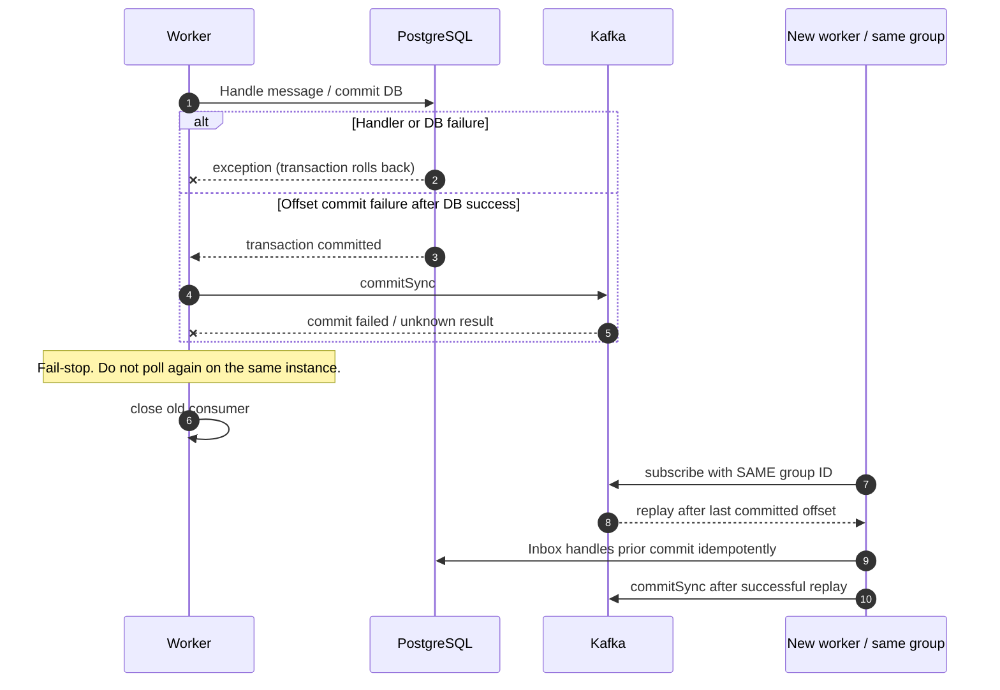

# Milestone 06.7B — Kafka consumer offsets, fail-stop recovery and controlled lifecycle

**Status:** Explicitly invoked consumer worker with real Kafka integration tests. **NOT** a production `@KafkaListener`, background scheduler, authenticated cross-service deployment, or automated dead-letter pipeline.

## Problem

A Kafka consumer may read a message, commit a database transaction, and crash before acknowledging the Kafka offset. It may also encounter a broker outage or a malformed message. If the offset is committed **before** the local transaction, a restart can silently lose work. If offsets are never committed, messages repeat. The correct approach for this simulated same-database consumer is **at-least-once delivery plus consumer-owned transactional deduplication**.

## What we built and why

`ManualKafkaPaymentConsumerWorker` receives an Apache Kafka `Consumer<String,String>` and a narrow `RecordHandler`. It subscribes to one configured topic and is invoked explicitly via `pollOnce(Duration)`:

1. Poll a bounded duration for records. Caller must provide a consumer with `enable.auto.commit=false`; the worker cannot verify the opaque constructor's client settings.
2. For each record, invoke the handler, which runs `LocalKafkaPaymentRecordProcessor` and the PostgreSQL inbox/local effect.
3. **Only when the handler returns successfully**, commit `record.offset()+1` for that topic/partition synchronously with `commitSync`. Returning `false` for an already handled event is also successful: the prior inbox transaction already proved the effect.
4. Any handler or commit failure marks the worker **stopped**. The same instance cannot poll again; the supervising caller must close the consumer and start a **fresh consumer with the same stable group ID**. The broker then replays records after the last committed offset.
5. `close()` releases resources. The consumer is explicitly single-thread-owned, not safe to share across threads.

This separation is intentionally small: the worker handles transport lifecycle and offsets; `LocalKafkaPaymentRecordProcessor` handles schema/key validation; `TrustedPaymentEventConsumer` handles PostgreSQL transaction/inbox. No new generic shared business library is introduced.

## Sequence: successful processing

## Sequence: failure and broker restart

## Quality and operations boundaries

- **No silent poison skipping:** malformed JSON or forged/out-of-contract records fail processing and block offset advancement. This is intentional fail-closed behavior, but it can stall a consumer partition. Automated DLQ routing and a reviewed replay/audit procedure remain **future work**.
- **No automatic lifecycle:** the app does not start a consuming background loop. A future supervised `@KafkaListener` must configure manual ACK, retry/DLQ, bounded concurrency, graceful shutdown, topic ACLs, and metrics/alerts before activation.
- **Broker trust is separate from format validation:** the local outbox lookup only proves the message matches committed data in this same-database educational service. It is not cryptographic producer authentication; a remote subscriber must validate broker identities and authorization.
- **Not exactly once across systems:** Kafka offsets and a PostgreSQL commit are distinct transactions. Crash-after-DB-commit replay is expected; inbox uniqueness avoids repeating local DB effects.
- **Single-thread KafkaConsumer:** never share between threads. A worker failure necessitates closing it and creating a new consumer. Reuse the SAME durable group ID in a recovery deployment; a random group would replay from the configured starting offset.
- **Batch caveat:** Kafka poll can fetch multiple records/partitions; a failure means all uncommitted fetched records must replay. The fail-stop behavior specifically avoids skipping previously fetched records when the same consumer's fetch position has moved.
- **Operational work remains:** retry classification, poison quarantine, offset DLQ fencing, TLS/SASL broker smoke tests, authorized service identities, metrics, alarm thresholds, offset lag, trace context and schema registry compatibility.

## Tests and hands-on interview drills

The Testcontainers-based `ManualKafkaPaymentConsumerWorkerIT` verifies: (1) DB processing followed by offset commit and no replay with a restarted group, (2) handler failure leaves the offset uncommitted, stops the worker and permits replay with a fresh same-group consumer, and (3) a malformed record blocks the offset and reappears until handled by an explicit policy. The exact CI SHA/run should be recorded only after checks complete.

- Drill A: What happens if you use `enable.auto.commit=true`? Why can this commit a fetched record before DB durability?
- Drill B: What happens if the DB transaction commits but `commitSync` fails? Which mechanism prevents duplicate effects?
- Drill C: Why does `poll()` advancing the fetch position not mean records are **committed**?
- Drill D: Why must a failed worker stop rather than retry the next `poll()` on the same object?
- Drill E: What must a real Kafka listener do when encountering invalid JSON without losing subsequent messages on that partition?
- Drill F: Why are consumer group IDs stable per application but isolated per integration test?

## Code reading order

`ManualKafkaPaymentConsumerWorker` → `LocalKafkaPaymentRecordProcessor` → `TrustedPaymentEventConsumer` → `PaymentInbox` → `ManualKafkaPaymentConsumerWorkerIT` → `KafkaTestSupport`.

**Next increment (06.7C):** design and test an opt-in, authenticated, supervised listener with explicit manual ACK/DLQ policy and typed application effects. No listener should be enabled merely because the manual worker tests pass.
