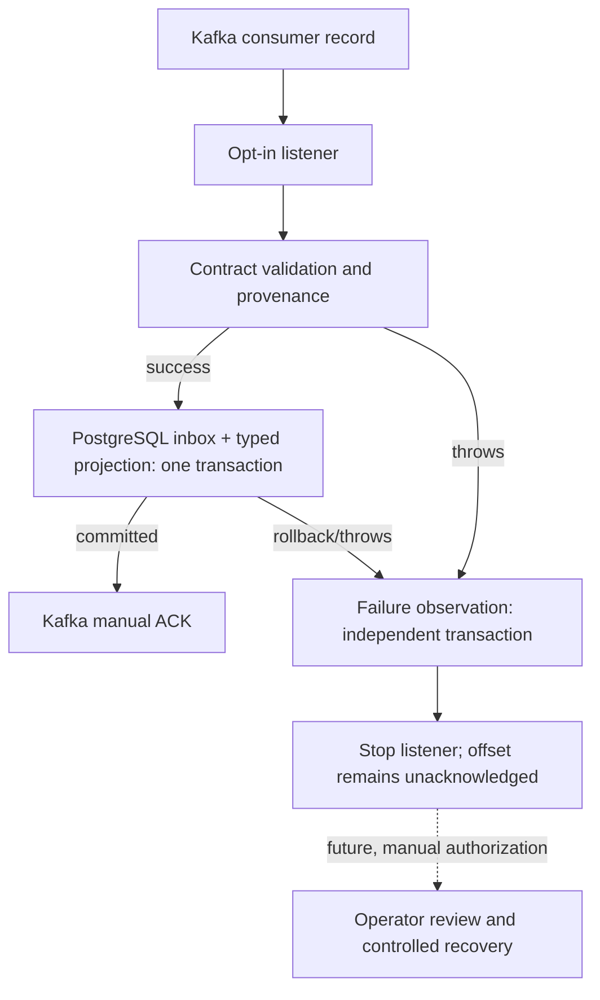

# Milestone 06.7D — Durable Kafka consumer failure observations (fail closed)

**Status:** implemented **failure evidence and operator investigation foundation**, not a functioning dead-letter topic or automatic replay facility. This milestone does **not** claim that a Spring container was started against a TLS/SASL Kafka cluster.

## 1. The problem: an invalid record can block an entire partition

In a strict manual-ack listener, parsing, ownership or database errors must **not** result in offset advancement. Otherwise a malformed/forged payment event could be discarded without a trace. But a fail-stop listener also risks a stuck partition unless an operator can locate the record, understand why it failed, and coordinate corrective action.

We need **durable, minimally sensitive failure observations**, kept independent of the failing inbox/projection transaction. We explicitly separate evidence capture from *processing success*, *offset acknowledgments*, *DLQ publishing*, and *replay authorization*.

## 2. What we built and why

- Flyway **V8** adds `kafka_consumer_failure_observations`, keyed by `(consumer_name, topic, partition_number, record_offset)`. Every record keeps `failure_category`, `payload_sha256`, first/last observation timestamps and a count.
- `KafkaConsumerFailureObservations` uses a dedicated `REQUIRES_NEW` Spring transaction: its metadata can survive rollback of the main business processing. Repeated observations increment the count.
- Categories are deliberately bounded: `INVALID_CONTRACT`, `UNTRUSTED_EVENT`, and `PROCESSING_FAILURE`. Do **not** store exception messages, raw Kafka keys/values, stack traces, JWTs or tenant identifiers in this database table.
- `OptInKafkaPaymentListener` catches a processing failure, tries to record minimal evidence, then rethrows the **original** exception. If observation itself fails, it is attached as a suppressed exception so the primary cause remains visible. **No `Acknowledgment.acknowledge()` is called on failure.**
- Success continues through existing `LocalKafkaPaymentRecordProcessor` → `TrustedPaymentEventConsumer` → transactionally coupled `PaymentInbox` + `LocalPaymentEventProjection` → manual ACK.
- The Kafka error handler is still the **container-stopping** handler. There is no silent offset skip, no DLQ send, and no automated replay.

### Architecture



### Failure sequence

```mermaid
sequenceDiagram
  autonumber
  participant K as Kafka
  participant L as Listener
  participant P as Validator / DB transaction
  participant F as Failure observation DAO
  participant DB as PostgreSQL
  K-->>L: Kafka record (topic/partition/offset)
  L->>P: Validate and process
  P--xL: Validation / ownership / DB exception
  L->>F: Categorize and record failure metadata
  F->>DB: REQUIRES_NEW: UPSERT location, hash, category, count
  DB-->>F: COMMIT
  L--xK: Rethrow (no ACK)
  Note over L,K: Container stopping handler halts; manual review required
```

## 3. Use cases and failure handling

| Use case | What happens | What is deliberately NOT done |
| --- | --- | --- |
| Valid event / first delivery | transactional inbox and typed projection; ACK only after commit | no speculative ACK |
| Valid event / redelivery | inbox deduplicates effect; ACK | no second projection |
| Invalid JSON / schema / key | record `INVALID_CONTRACT`; rethrow and stop | no offset skipping or raw payload storage |
| Forged-looking outbox ID or wrong tenant | record `UNTRUSTED_EVENT`; rethrow | no acceptance based solely on the Kafka key |
| Database or local-effect failure | categorize `PROCESSING_FAILURE`, attempt independent observation, rethrow | no false success |
| Observation DB itself unavailable | preserve original exception with suppressed observation failure; rethrow | no claim of durable audit evidence |

**Limit:** an independently committed observation is useful for forensic triage, but it is **not a complete tamper-evident audit log**. SHA-256 is a fingerprint, not encryption or proof of trusted provenance; hashes of predictable payloads can leak information. Retention and access control must be specified before a production rollout.

## 4. Operator recovery runbook — DESIGN ONLY, no replay command provided

1. **Identify:** alert on stopped container/consumer lag; query observation table by consumer/topic/partition/offset. Keep access scoped to authorized operators.
2. **Assess:** distinguish malformed format, unsupported schema, unauthorized producer, or transient DB outage; use broker-side diagnostics within your access and data-handling policy. Never paste live secrets or payment details into tickets.
3. **Contain:** maintain the stopped partition and uncommitted offset while determining whether replay is safe. Prevent duplicate operators from independently changing offsets.
4. **Correct:** fix producer/schema/authorization or database cause; deploy a reviewed change if necessary.
5. **Approve:** record change ticket, owner approval, affected topic/partition/offset, expected result, rollback plan and observation SHA.
6. **Replay:** only through a future separately authenticated, audited control that verifies the exact offset and does not bypass provenance validation. **Do not manually advance consumer offsets merely to make lag disappear.**
7. **Verify:** inspect inbox/projection, broker committed offset and downstream effects; archive the incident according to retention controls.

No automatic dead-letter topic, DLQ producer, administrative endpoint, replay command or audit authorization flow exists in this milestone. Any later DLQ should publish with durable broker ACK and an explicit offset policy; cross-system publication and offset commit remain separate failure boundaries.

## 5. What to learn and explain in interviews

- Why is `REQUIRES_NEW` appropriate for a *non-business* diagnostic row, but not as a substitute for transactionally correct local effects?
- What happens if the business transaction commits but Kafka offset commit fails? How does inbox deduplication recover?
- Why is a failure record **not** a dead letter? What proof would be necessary to safely commit past a quarantined record?
- Why don't we persist raw Kafka JSON or exception messages?
- Why is a `SHA-256` fingerprint not cryptographic producer authentication?
- How would a real multi-service consumer avoid querying the publisher's private outbox?
- What monitoring and operational ownership does a stopped consumer require?

## 6. Implementation and verification

- `src/main/resources/db/migration/V8__kafka_consumer_failure_observations.sql`
- `KafkaConsumerFailureObservations.java`
- `OptInKafkaPaymentListener.java`, `KafkaPaymentConsumerConfiguration.java`
- `OptInKafkaPaymentListenerIT.java`
- Reproduce with `mvn -B clean verify` and Docker/Testcontainers. Record exact Java and Security CI runs and commit after the final code is verified.
- As before, Spring listener method tests use PostgreSQL and real Kafka records but **do not prove an automatically started Spring listener container connecting to an authenticated broker**.

**Remaining milestone 06.7E:** actual secured listener-container startup/shutdown test, Micrometer observations/alerts, reviewed retry/DLQ design with operator-authenticated recovery, and deployment trust verification.
