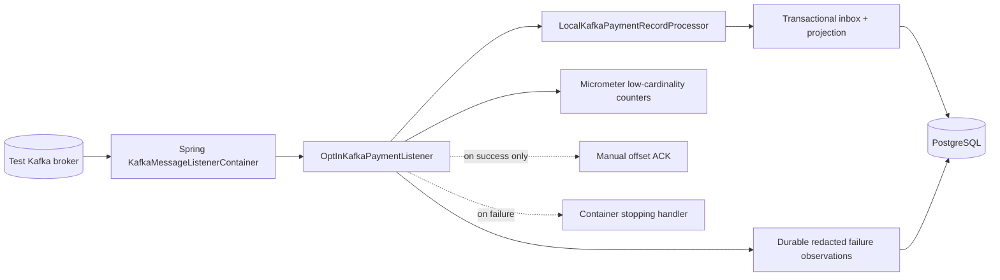
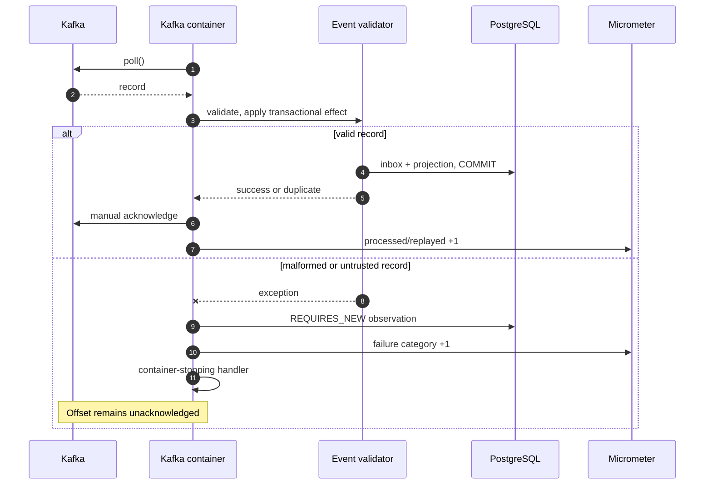

# Milestone 06.7E — Kafka consumer lifecycle and bounded metrics

**Status:** An actual, explicitly assembled Spring Kafka `KafkaMessageListenerContainer` is exercised against Testcontainers Kafka and PostgreSQL. Application `@KafkaListener` auto-registration with a real TLS/SASL broker remains **unverified**, and production consumer activation stays disabled.

## What was missing

Our prior integration tests directly invoked the `onMessage` method. They proved domain behavior but not Kafka's asynchronous poll thread, listener container startup, shutdown or handling of a failing record. We also persisted minimal failure evidence but had no low-cardinality counters suitable for monitoring failure rate and replay trends.

## Design and implementation

- `KafkaConsumerMetrics` uses the existing Micrometer dependency. A single counter family `payment.kafka.consumer.records` has **only** the bounded tag `outcome` with five possible values: `processed`, `replayed`, `invalid_contract`, `untrusted_event`, and `processing_failure`.
- **No** merchant, user, event ID, topic, partition, offset, exception content or message payload is added to metric labels. This prevents uncontrolled time-series cardinality and accidental disclosure.
- `OptInKafkaPaymentListener` increments `processed` or `replayed` **only after** the local database operation returns and manual Kafka acknowledgment succeeds; exception paths increment the appropriate failure category and still rethrow. The existing `REQUIRES_NEW` diagnostic persistence remains separate from the business transaction.
- `KafkaPaymentConsumerConfiguration` injects the Boot-managed `MeterRegistry`. There is no new shared production library and no extra Prometheus registry dependency yet.
- `KafkaListenerContainerLifecycleIT` explicitly builds a Spring Kafka container using Testcontainers' local **PLAINTEXT-only** broker and a dedicated consumer group. It asserts that a real container **starts, polls, processes the message, writes a PostgreSQL projection, acknowledges and stops**, and that a poison record **stops the container without committing its Kafka offset**, allowing replay on group restart.
- `OptInKafkaPaymentListenerIT` additionally checks `processed` and `replayed` counter behavior.

## Component diagram

## Success and poison sequence

## Operational limitations — do not claim readiness prematurely

1. Tests explicitly assemble the listener container with a test-only Kafka client configuration. They do **not** prove production `@KafkaListener` registration, external credential secrets, TLS/SASL handshake, ACL restrictions, consumer-group authorization or deployment health.
2. The Spring actuator currently exposes `health` and `info` only. Micrometer counters exist in the registry but **are not yet exported to Prometheus**. Expose metrics only behind an authenticated/internal monitoring endpoint in a future deployment increment.
3. Counters reset on process restart and are per-instance. Kafka consumer lag requires an independently configured broker/client metric and alert threshold; this increment does not calculate lag.
4. Failure counters and database observation rows improve visibility but are **not** an automatic dead-letter queue. Operators cannot safely skip offsets without an approved replay/quarantine policy.
5. The fail-stop model stops on transient DB errors as well as poison records. Production design needs alerting, bounded reactivation and operational ownership; do not auto-restart indefinitely.
6. Integration test uses a single broker/partition; multi-broker failover, rebalancing, lag measurement and TLS/SASL security remain gates.

## Senior engineer interview practice

- What does it prove to test an actual Kafka listener container rather than calling the listener method with a mock `Acknowledgment`?
- Why does the counter have only `outcome` as a label, and why is `merchantId` a bad metric tag?
- What remains possible between a PostgreSQL commit and Kafka offset commit?
- Why does a fail-stop handler intentionally stop a consumer partition, and who restores service?
- How would you expose metrics securely to Prometheus/Grafana without publishing them on the internet?
- Where should consumer lag be measured, and what constitutes an actionable lag alert?
- What evidence would you need to claim a real TLS/SASL-authenticated deployment is supported?

## Test acceptance

Run `mvn -B clean verify` with Docker available; verify all existing tests plus `KafkaListenerContainerLifecycleIT`. Java CI, security CI and the specific commit SHA must be recorded **after** they complete. A green Spring Kafka method test is not a substitute for a container-level test.

**Next architectural gates:** authenticated real broker/container configuration test; lag metrics and internal dashboards; DLQ with reviewed recovery and offset coordination; security, chaos and alerting tests.
