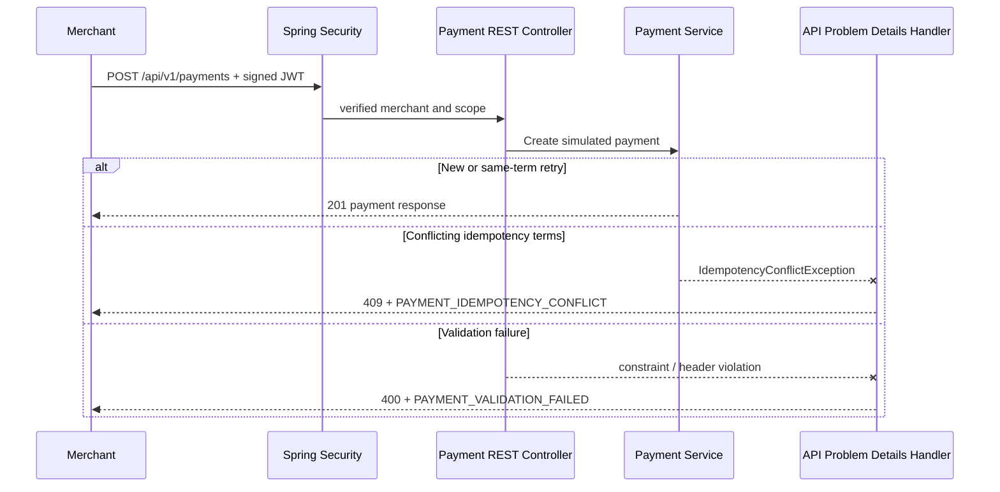

# Milestone 06.7F — Package ownership, typed errors and secured OpenAPI

**Goal:** improve the internal architecture and the externally visible API contract **without changing simulated payment behavior**.

## The three separate engineering questions

1. **Internal structure:** Should Kafka producer, Kafka consumer and outbox transaction classes live together? **No.** They have different reasons to change. A dependency-direction refactor is appropriate, but a new deployable or Java library is not.
2. **API errors:** How should clients distinguish problems reliably? **Use HTTP status for the response class and stable, non-sensitive error codes for specific conditions**, encoded as RFC 9457 Problem Details.
3. **API discovery:** How should collaborators understand the public HTTP API? **Publish a versioned OpenAPI specification**, generated from actual Spring controller annotations and validation constraints, behind opt-in authentication. Do not expose the internal transition service, outbox or Kafka internals as HTTP endpoints.

## Package and dependency architecture

Read [Messaging package boundaries](../architecture/messaging-package-boundaries.md) for the updated source tree, dependency diagram, tradeoffs and interview questions.

## RFC 9457 public error vocabulary

`payments.api.error.PaymentApiErrorCode` is the single source of truth for the following stable codes. It intentionally belongs to the HTTP adapter, not the domain:

| HTTP status | Stable code | Source |
| --- | --- | --- |
| 409 Conflict | `PAYMENT_IDEMPOTENCY_CONFLICT` | idempotency key used with different payment terms |
| 404 Not Found | `PAYMENT_NOT_FOUND` | absent or foreign merchant-owned payment |
| 400 Bad Request | `PAYMENT_VALIDATION_FAILED` | payload, constraints or required-header validation |
| 403 Forbidden | `MERCHANT_IDENTITY_REQUIRED` | validated token has no acceptable merchant identity |
| 400 Bad Request | `PAYMENT_BAD_REQUEST` | known malformed input, including excessive idempotency key |

A Problem Details response has standard fields `type`, `title`, `status`, `detail`; we add a stable `code` extension. The `type` URI uses an `urn:problem:enterprise-payment-platform:<category>` namespace; the repository documents those values. Do not return SQLSTATE, stack traces, broker error text or internal Java exception names in public responses.

**Security boundary:** unauthorized requests rejected inside Spring Security may have an independent 401/403 response format rather than passing through the MVC `@RestControllerAdvice`. Record and test that distinction; do not promise every security rejection has the same JSON error without explicit security entry-point/denied-handler support.

## OpenAPI 3 — API-only, opt-in, scoped

We added the **Spring Boot 4.1 compatible** `springdoc-openapi-starter-webmvc-api:3.2.0` dependency (no Swagger UI). It models only `/api/v1/**` and declares HTTP JWT bearer authentication, POST payment intake, GET merchant-owned payment, validation, idempotency and documented HTTP responses.

- **Disabled by default:** `PAYMENT_OPENAPI_ENABLED=false` (Spring property `springdoc.api-docs.enabled`).
- **Enabled intentionally for a trusted environment:** `PAYMENT_OPENAPI_ENABLED=true`; then `GET /v3/api-docs` requires `SCOPE_payments:docs` authenticated JWT; no anonymous access.
- **No Swagger UI** dependency or public interactive testing interface.
- **Excludes** internal Kafka, ledger implementation and actuator routes from documented API paths.
- `PaymentOpenApiIT` verifies generated routes, JWT scheme and the 401/403 docs gate against a real Spring Boot/PostgreSQL context.

A spec is a **contract publication artifact**, not permission to expose internal services; the service's Spring Security rule is the actual authorization enforcement.

## Why use a generator instead of writing the spec entirely by hand?

Springdoc extracts operation paths and request DTO validation constraints from code, reducing drift. Explicit `@Operation` / `@ApiResponse` annotations document business intent and expected errors that the framework cannot infer. For a longer-lived enterprise contract, we should next **export an OpenAPI snapshot in CI, lint it, and diff it** to detect unintended breaking API changes. A generated endpoint alone does not ensure backward compatibility.

## Sequence: request and error translation

## What not to abstract

- Do not create `BasePaymentException` subclasses for every HTTP status. Domain exceptions already express meaningful business failures; the API advice maps them to HTTP concerns.
- Do not let the domain depend on Swagger annotations or springdoc.
- Do not create an independent `common-errors` Maven module until multiple services need a stable, governed technical contract.
- Do not put internal Kafka event fields into external OpenAPI payment request/response DTOs.

## Interview exercises

1. Why is moving Kafka out of `payments.outbox` a dependency-direction improvement rather than a microservices extraction?
2. What's the difference between HTTP `409`, public error `code`, and Java `IdempotencyConflictException`?
3. Why return `404` for a guessed payment UUID belonging to another tenant?
4. Why disable documentation by default and use a distinct JWT scope?
5. Why use the API-only springdoc starter, and why pin a Boot-4-compatible version?
6. How would you prevent breaking changes to OpenAPI during CI?
7. Why are Spring Security 401/403 responses not automatically formatted by `@RestControllerAdvice`?
8. What tests prove source moves, API errors and docs access have preserved their contracts?

## Evidence checklist

- Existing 103 baseline tests must remain passing.
- New architecture rules in `PaymentArchitectureTest`.
- New API error-code unit assertions and OpenAPI endpoint integration checks.
- Current-head Java CI and Security CI including springdoc dependency scanner.
- Document exact commit/run IDs and known limitations. Never substitute a historical green run for the new implementation.
