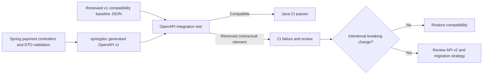

# Milestone 06.7G — OpenAPI compatibility baseline and CI contract gate

**Scope:** a pinned semantic HTTP-API compatibility baseline, validated against generated springdoc OpenAPI. This is an educational simulated-payment API, not a regulatory certification or full semantic-versioning solution.

## Why

A generated OpenAPI document is useful for discovery, but generation alone **does not prevent breaking changes**. A developer might rename `amount`, delete a response or change an operation route and still pass tests that merely check the API document exists. Contract verification belongs in the routine build, not in a manual release checklist.

## What we implemented

- `src/test/resources/contracts/payment-api-v1-baseline.json` is the reviewed, versioned **semantic compatibility baseline**, intentionally stored beside integration tests.
- `PaymentOpenApiIT.generatedSpecPreservesReviewedV1Baseline` calls the **actual secured** `GET /v3/api-docs` endpoint using a JWT with `payments:docs` authority, deserializes the generated JSON, and compares its externally supported invariants to the baseline.
- The baseline requires the `v1` info version, `bearerAuth` security scheme, POST/GET paths, documented response status codes, request properties and required request fields, and public response fields.
- The test runs in the existing `mvn clean verify` Failsafe suite, which is executed by the existing `.github/workflows/java-ci.yml`; **no duplicate CI workflow, service or new dependency** was added.
- Existing `PaymentOpenApiIT` tests still verify unauthorized access, wrong JWT scope, supported routes and exclusion of actuator paths.

## Decision: semantic baseline, not a byte snapshot

OpenAPI documents often include incidental ordering or formatting differences, and springdoc upgrades may reorder harmless components. Comparing raw JSON bytes would generate noisy failures. The semantic baseline lists the contractual elements an API consumer can depend upon; additive schema fields and better descriptions are allowed, while removal of recorded paths, statuses and fields is rejected.

**Limitations:** this is **not an exhaustive backward-compatibility checker**. It does not currently detect every tightening of a request constraint, narrowing of accepted values, response type change, authorization scope change, HTTP media-type change, or schema recursion. It does not prove that an advertised response is actually produced for every runtime scenario. Add explicit semantic checks and HTTP integration tests as contracts mature.

## Review and release process

1. Change the controller or DTO and run `mvn -B clean verify`.
2. If the OpenAPI baseline check fails, identify whether this is a **breaking change** or a benign generator/schema representation change. Never update the baseline automatically to hide a failure.
3. For a compatible additive change, update HTTP tests, OpenAPI annotations, and documentation as needed; normally leave the baseline unchanged.
4. For an intentionally breaking change, decide whether to introduce **`/api/v2`** and a new independent baseline, or obtain explicit migration approval and release coordination. Record impacted clients, deprecation/migration guidance, and compatibility evidence.
5. Update the checked-in baseline only through a reviewed PR with rationale; do not have CI regenerate and accept it by default.
6. Verify GitHub Java CI and Security CI on the final commit. Keep the PR in draft until the designated reviewer approves.

## Contract flow

## Interview rehearsal

- Why should generated documentation have a contract test rather than relying on code review alone?
- What is the difference between semantic compatibility tests and an exact JSON snapshot?
- Why must a breaking change not be silently accepted by regenerating a golden file?
- How would you protect request/response types, allowed values, auth scope, content types and pagination as the API grows?
- Why should HTTP contract governance be separate from versioned Kafka event schema governance?

## Evidence and next increment

- `src/test/resources/contracts/payment-api-v1-baseline.json`
- `src/test/java/dev/asambataiden/payment/payments/api/PaymentOpenApiIT.java`
- `.github/workflows/java-ci.yml` already runs `mvn --batch-mode --no-transfer-progress --errors clean verify`.
- Record exact CI run IDs and SHA when verified. Only then mark this milestone green.
- **Next:** Kafka event v1 schema/shape governance, with negative and forward-compatibility tests, independent of the HTTP OpenAPI contract.
