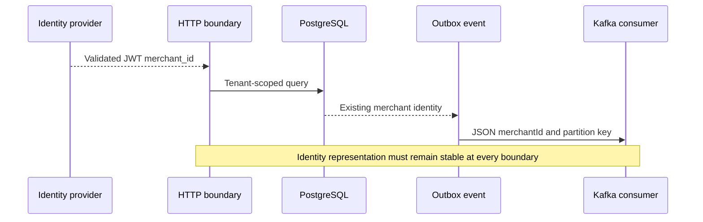

# Chapter 21 — Merchant Identifier Contract Policy: Characterization Before Migration

**Milestone:** 06.7N (contract alignment and compatibility characterization).
**Status:** Test-level changes committed; local Maven verification required. This milestone deliberately does **not** change accepted merchant identities.

## Why are we doing this?

The `merchant_id` value is security-sensitive: it scopes JWT-derived ownership,
PostgreSQL composite keys, idempotency, outbox/inbox records and Kafka partition keys.

Today Java code rejects values where `String.length() > 128` (UTF-16 code units).
The reviewed JSON Schema declares `maxLength: 128` (Unicode code points).
A character outside the Basic Multilingual Plane, such as an emoji, occupies two
UTF-16 code units but one Unicode code point.

**Counterexample:** 65 rocket emoji = 65 code points, 130 Java UTF-16 units.
The JSON Schema-length model accepts it; the current Java event constructor rejects it.

## What changed in this increment?

The focused `PaymentEventContractTest` now:
- Requires canonical 36-character textual UUIDs, matching the consumer boundary.
- Covers short UUID groups for both `eventId` and `paymentId`.
- Includes a *characterization test* explicitly demonstrating the mismatch for
  supplementary Unicode characters without changing Java or JSON Schema policy.

**Important limitation:** This test does not make schema and runtime equivalent.
The test helper checks selected schema properties; it is not a full JSON Schema
validator. UTF-16/code-point drift remains a tracked compatibility decision.

## Trust and identity consequences

Never silently trim, normalize (NFC/NFKC), lowercase, transliterate or rewrite
tenant IDs. Such transformations can merge distinct tenant identities, alter
Kafka partition assignment and break historical composite foreign keys.

A production policy requires:
1. Inventory of existing persisted identifiers and issuer claim semantics.
2. Agreement with the identity provider on a canonical identifier representation.
3. Decision about length metric and allowed character set, including Unicode.
4. Matching API, domain, database and event-schema constraints.
5. Explicit compatibility or versioned migration plan with rollback and replay tests.
6. Regression tests for boundary values, Unicode, key equality and cross-tenant isolation.

For a **new system with no existing tenant data**, opaque ASCII tenant IDs may be
pragmatic; it is **not** safe to impose ASCII restriction automatically here.

## Sequence and evidence



Run:
```bash
mvn -B --no-transfer-progress -Dtest=PaymentEventContractTest test
mvn -B --no-transfer-progress clean verify
```

Expected if no other tests change: **131 tests** (73 unit, 58 integration).
Only actual Maven output establishes successful verification.

## Interview questions

**Why not just change the regex to ASCII?**
Because tenant IDs are already persisted and appear in trusted JWT claims and
message keys. Rewriting their format risks tenant ownership and referential integrity.

**Why write a test proving an inconsistency?**
A characterization test makes legacy behavior explicit and prevents an accidental
silent format change during unrelated refactoring; it also defines a concrete
migration acceptance case.

**Why does UUID validation matter here?**
The schema test's previous UUID parser check was more permissive than the real
Kafka consumer. Aligning it reduces false assurance from a green focused contract
test without changing production event behavior.

**What remains?**
Select a canonical policy only after an issuer/database compatibility review,
then enforce and migrate it deliberately with real schema-validation tooling.
