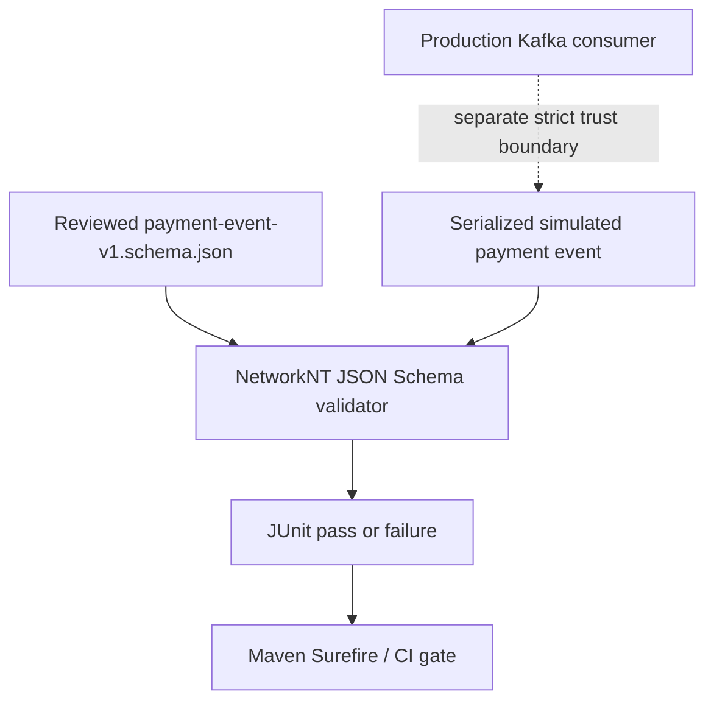

# Chapter 22 — Executable JSON Schema Contract Verification

**Milestone:** 06.7O — executable v1 contract verification.
**Status:** Implemented in GitHub, awaiting local Maven verification.

## What problem did we detect?

The earlier `PaymentEventContractTest` reads the reviewed JSON Schema and
reimplements selected rules in Java. That approach is useful for teaching,
but may diverge from actual Draft 2020-12 behavior.

It already exposed one mismatch: JSON Schema `maxLength` measures Unicode
code points, while existing Java domain constructors limit UTF-16 code units.

## Engineering decision

Introduce a standards-aware validator as a **test-only** dependency:

`com.networknt:json-schema-validator:3.0.8`

This 3.x line supports Jackson 3 and Draft 2020-12. Production shipping code
does **not** acquire a schema-validation dependency.

Add `PaymentEventJsonSchemaValidationTest` to load the actual reviewed
`src/test/resources/contracts/payment-event-v1.schema.json`, explicitly enable
`format` assertions (which are annotations by default in Draft 2020-12),
and verify accepted and rejected example events.

The original custom contract checks remain as supplemental assertions.
No changes are made to the live Kafka consumer or persisted data.

## Executable boundary



The test validates the schema, **not** the authenticity of Kafka producers.
The runtime consumer independently enforces topic, ownership key, duplicate
JSON fields and trusted local-outbox checks.

## Cases exercised

1. A valid serialized `PaymentOutboxEvent` satisfies the schema.
2. Wrong JSON field types, missing required fields and extra properties fail.
3. Abbreviated UUIDs fail when `format: uuid` assertions are enabled.
4. An overlong ASCII merchant identifier fails.
5. A supplementary-Unicode identifier can satisfy the schema's code-point
   length while failing the current Java event invariant: this mismatch
   is intentionally characterized, not silently "fixed".

## Compatibility and migration note

Do **not** automatically restrict existing tenant IDs to ASCII or transform
them using trim/case-folding/Unicode normalization. Their exact representation
is used in JWT, PostgreSQL tenant ownership, outbox/inbox and Kafka keys.
A future policy must first examine actual identity-provider and stored values,
then plan a versioned change if one is necessary.

## Trade-offs

- The test dependency adds build resolution and CVE maintenance cost.
- NetworkNT is not used by production consumers; these tests are a
  build-time verification gate, not runtime schema enforcement.
- Schema format assertion behavior must be explicitly configured.
- Test validation does not cover the entire JSON Schema specification's
  implementation conformance; keep integration and trust-boundary tests.

## Verification

```bash
mvn -B --no-transfer-progress \
  -Dtest=PaymentEventJsonSchemaValidationTest test
mvn -B --no-transfer-progress clean verify
mvn -B --no-transfer-progress dependency:tree \
  -Dincludes='com.networknt:json-schema-validator;tools.jackson.core:jackson-databind'
```

Expected if existing tests remain unchanged: **135 tests**
(77 unit + 58 integration). Record actual Maven output and any
dependency/API incompatibility before claiming success.

## Interview preparation

**Q: Why use a schema engine if we already have a contract test?**
A: Reimplementing the spec in a helper can create false positives.
A spec-aware engine tests the artifact consumers are expected to follow.

**Q: Why test-scope only?**
A: Runtime validation is currently a separate, explicitly implemented trust
boundary. We need a CI contract check, not an unnecessary production library.

**Q: Why can JSON Schema and Java disagree on merchant length?**
A: JSON Schema counts Unicode code points; Java String.length counts UTF-16
code units. A supplementary character is one code point but two units.

**Q: Does successful schema validation prove an event is safe?**
A: No. Schema conformance is only one component of source authentication,
authorization, ownership checks, replay safety and business invariants.
