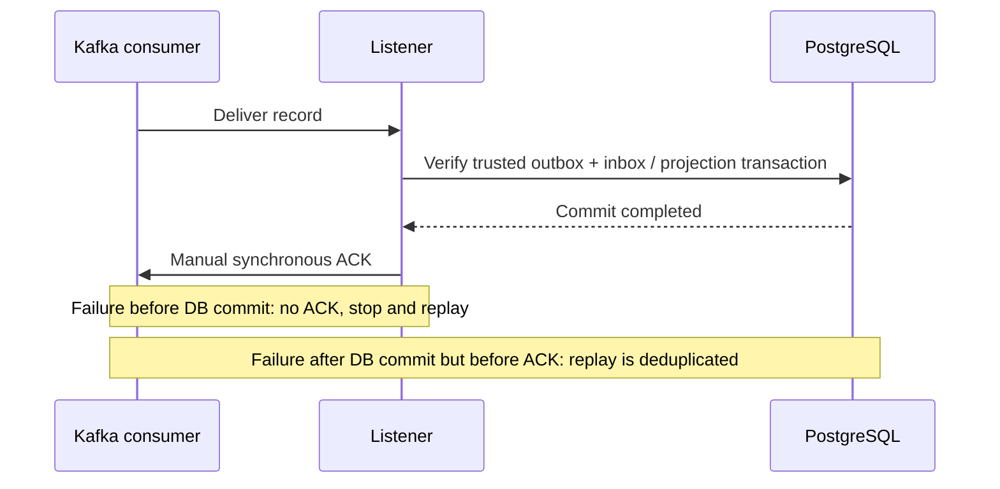

# Chapter 23 — Fail-closed Kafka Consumer Offset Configuration

**Milestone:** 06.7P — explicit manual-commit configuration guard.
**Status:** Committed on `feat/payment-ledger`; local Maven verification pending.

## Problem

The optional Kafka consumer acknowledges records only after its PostgreSQL
inbox/projection transaction succeeds. The application listener container uses
`AckMode.MANUAL_IMMEDIATE`, synchronous commits and a stopping error handler.

A configuration check previously rejected `enable.auto.commit=true` but
accepted a **missing** setting. Kafka's client-level default is `true`.
Assuming an absent property is safe is not a fail-closed policy. The current
application YAML explicitly sets false, but a future change or a different
ConsumerFactory may omit it.

## Why this is dangerous

If background offset commits are enabled, a fetched Kafka record's offset may
advance independently of a successful local database transaction. A process
crash can then leave an unprocessed event skipped on restart.

Manual offset control supports at-least-once consumption. It does **not**
guarantee global exactly-once delivery.

## Change and boundary

`KafkaPaymentConsumerConfiguration` now requires the resolved consumer
factory properties to include `enable.auto.commit` with explicit
`false` (Boolean or string). Missing, true or malformed configurations
cause startup failure when the opt-in consumer is enabled.

The default application YAML already sets:
```yaml
spring:
  kafka:
    consumer:
      enable-auto-commit: false
```

This increment does not change the event schema, payment domain, SQL migrations
or Kafka offset commit order.

## Processing sequence



## Regression tests

`KafkaConsumerAutoCommitConfigurationTest` covers explicit boolean false,
explicit string false, true, missing and invalid property values.

Run:
```bash
mvn -B --no-transfer-progress -Dtest=KafkaConsumerAutoCommitConfigurationTest test
mvn -B --no-transfer-progress clean verify
```

Expected if other tests are unchanged: **137 tests** (79 unit, 58 integration).
Actual counts and status must come from the local Maven run.

## Interview Q&A

**Why does manual acknowledgment alone not guarantee safe offsets?**
Because Kafka background auto-commit must also be disabled; otherwise fetched
offsets can be committed separately from the application transaction.

**Why reject a missing setting rather than relying on configuration binding?**
Startup checks should validate the effective consumer factory configuration and
fail closed if a critical safety invariant is not explicitly satisfied.

**What if the DB commits, but the ACK fails?**
The broker may redeliver. The trusted inbox uniqueness and transactionally
applied local projection make that replay safe in this simulation.

**What remains to make the listener production-ready?**
Broker identities, ACLs, TLS/SASL smoke tests, rollout and restart supervision,
alerting, poison-event runbooks, and recovery drills with measured SLOs.
