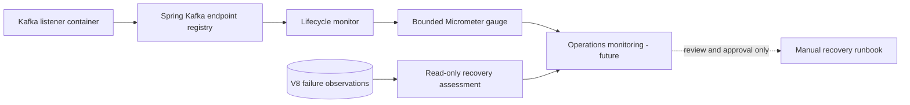

# Chapter 26 — Kafka Listener Lifecycle Observability and Recovery Readiness

**Milestone:** 06.7S. **Status:** Implemented on GitHub; Maven verification pending.

## The operational gap

The consumer is opt-in. A stopping error handler intentionally prevents
poison records from being skipped, but a listener that has stopped can leave
a partition blocked until an operator investigates. A durable failure
observation alone does not tell us whether a listener is currently running.

We must distinguish registration/running state without accidentally
granting operational privileges or promoting a gauge into a false guarantee
of end-to-end delivery health.

## Implementation

`KafkaPaymentConsumerLifecycleMonitor` reads the existing
`KafkaListenerEndpointRegistry` for the fixed Spring listener ID
`simulated-payment-projection-v1`. It publishes one Micrometer gauge:

`payment.kafka.consumer.lifecycle.state`

| Value | Meaning |
| --- | --- |
| 0 | Listener is missing from registry |
| 1 | Listener is registered but not running |
| 2 | Listener is running |

No merchant IDs, event IDs, group IDs, offsets, error text or exception
classes are metric labels. The monitor is created **only** when the
Kafka consumer is explicitly enabled. Its absence when disabled is expected.

This is a state **observation**, not a consumer restart mechanism.
It does not read Kafka committed offsets, lag, broker ACLs or data provenance.
A running container may be idle, disconnected, failing authentication or
unable to make progress, so running is **not equal to healthy**.

## Architecture



## Why no auto-restart?

A poison record can make a consumer repeatedly fail at the same offset.
An automatic restart loop creates alert noise without fixing the underlying
contract, trust or database problem. The correct operational workflow is:
identify stopped listener, inspect exact V8 evidence, verify broker position,
diagnose and correct root cause, obtain approval, restart the same group and
prove replay/inbox correctness.

## Testing

`KafkaPaymentConsumerLifecycleMonitorTest` mocks the Spring registry and
listener, then checks gauge values for missing, stopped and running states,
plus absence of dynamic metric tags. The test does not claim Kafka broker
connectivity or production alert verification.

```bash
mvn -B --no-transfer-progress -Dtest=KafkaPaymentConsumerLifecycleMonitorTest test
mvn -B --no-transfer-progress clean verify
```

If the 140-test baseline remains stable, expected total is **141** (80 unit,
61 integration); only actual Maven output proves the new verification.

## Remaining operational scope

- A dedicated readiness strategy that does not accidentally restart
  blocked consumers in a loop.
- Consumer-group lag, rebalance, authentication and connectivity telemetry.
- Alert rules with realistic time windows and runbook links.
- Operations RBAC, incident approval/audit and tested recovery in TLS/SASL.
- Non-destructive production smoke tests, broker ACL review and secret hygiene.

Do not claim a running container is automatically safe, and do not
merge this one-gauge demonstration into a production availability guarantee.

## Interview questions

**Why use a registry instead of a global boolean?** The registry reflects
the current Spring listener container lifecycle; a manually maintained flag
can drift from actual container state.

**Why low-cardinality metrics?** Values such as tenant IDs and offsets create
unbounded time series and may leak sensitive operational context. A fixed
metric with three bounded values is cheaper to store and safer to expose.

**Why not fail Kubernetes liveness when stopped?** Repeated restarts of a
poison listener can amplify the incident. Liveness, readiness and operator
response have different responsibilities and must be deliberately designed.

**Does a running metric value prove events are processing?** No. Read
consumer lag, committed offsets, error observations and broker connectivity
alongside lifecycle state before deciding that the stream is healthy.
