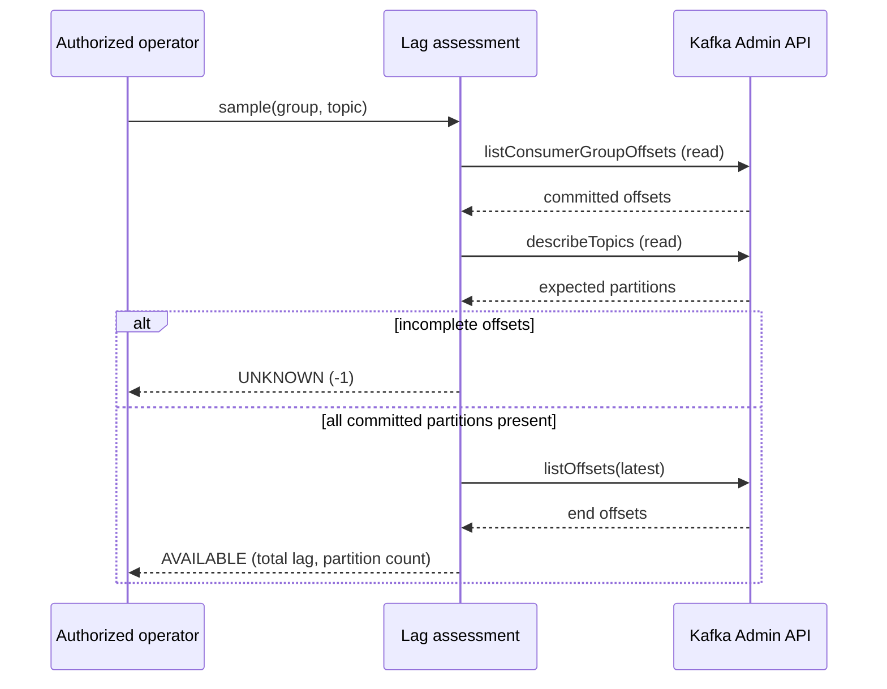

# Chapter 27 — Read-only Kafka Consumer Lag and Alerting Design

**Milestone:** 06.7T — committed-offset lag assessment.
**Status:** Java implementation and real-broker tests committed; local Maven verification pending.

## 1. Operational use case

A running Spring Kafka listener is not proof of processing progress. A consumer
may have stopped, lost broker connectivity, failed authorization, or fallen
behind while reporting a running lifecycle state. Operators need to inspect
**lag = partition end offset − group committed offset**, alongside the
existing listener-state gauge and V8 failure observations.

A high lag value is a backlog indicator, **not** a direct measure of time
behind; lag may also arise from traffic bursts or a slow but healthy consumer.

## 2. Implementation boundary

`KafkaConsumerLagAssessment` is a read-only Java service for authorized,
operator-invoked sampling. It takes an Apache Kafka `Admin`, a stable consumer
group ID and a topic. It calls Kafka admin read operations to fetch:

- The group's committed offsets for the configured topic.
- The current topic partition set, to reject incomplete group initialization.
- The corresponding partition latest offsets.

It sums nonnegative differences only after **every** partition is covered.
It neither changes offsets, starts consumers, rewinds positions, nor reads
raw event payloads. The caller owns and closes the Kafka `Admin` client.

| State | Lag value | Interpretation |
| --- | ---: | --- |
| AVAILABLE | 0 or positive | All topic partitions have committed positions and end offsets |
| NO_COMMITTED_OFFSETS | -1 | No committed positions for this topic; cannot infer backlog |
| UNAVAILABLE | -1 | Missing/partial/inconsistent offsets, broker failure or timeout |

An unknown result must never be interpreted as a healthy zero. Sampling
preserves the thread interrupt flag if interrupted.

**Important:** This is deliberately not a production-ready automatic poller,
Prometheus exporter, readiness gate or secured operator API. Automatic metric
publication requires a separately reviewed lifecycle, bounded polling
frequency, credential/ACL controls, and a last-success timestamp. The
application's existing lifecycle gauge does not automatically sample lag.

## 3. Sequence diagram



## 4. Tests and limitations

`KafkaConsumerLagAssessmentIT` uses a real disposable Kafka Testcontainer.
It verifies the committed vs end-offset calculation across two partitions,
checks that an assessment does not mutate the durable group offsets, and
asserts that partial partition coverage does not return a misleading zero.

The test broker is **PLAINTEXT-only**. Production TLS/SASL, broker ACLs,
authorization boundaries and alert delivery are not validated here.

This implementation measures lag relative to committed offsets of the group's
partitions, not ephemeral positions of a running member. Topic partition
changes, uncommitted new groups and certain offset-retention scenarios are
reported as unknown. Operators should correlate with group member status,
retention windows and broker-side lag telemetry.

## 5. Monitoring and alert policy: proposed, not deployed

Use three independent signals: the Chapter 26 lifecycle state, externally
exported group lag, and the failure observation / processing outcomes.
Do not invent a metric mapping from this Java assessment to Prometheus.

Suggested incident classification:

| Signal | Possible meaning | Response |
| --- | --- | --- |
| Stopped listener + growing lag | fail-stop/poison or infrastructure outage | inspect V8 forensic location and deploy/root-cause evidence |
| Running listener + sustained growing lag | slow processing, capacity issue, rebalance or blocked processing | investigate throughput, broker health and partitions |
| No committed offsets or unavailable lag | unknown state; not zero | investigate group initialization, ACLs and topic retention |
| Lag near zero + recurring invalid/untrusted failures | an incident may still exist | correlate observations; check for manual offset movement |

**Alert thresholds are intentionally not hard-coded.** They require normal
traffic volume, acceptable recovery time and actual exporter metric names.
A production rule should include a time window and avoid triggering on short
bursts, maintenance or intentionally disabled consumers.

Never put tenant IDs, event payloads, sensitive keys, or record offsets in
unbounded metric labels. Never restart a poison consumer automatically or
alter offsets to make the dashboard turn green.

## 6. Verification checkpoint

```bash
mvn -B --no-transfer-progress -Dit.test=KafkaConsumerLagAssessmentIT verify
mvn -B --no-transfer-progress clean verify
```

Prior verified baseline: 141 tests (80 unit, 61 integration). Two new
integration tests would make **143** total if everything is unchanged.
Only local Maven output establishes success.

## 7. Interview preparation

**Q: What exactly is consumer lag?** Difference between the broker's
partition end offset and the group's **committed** next offset. The sum
across partitions is an estimate of the pending records, not their age.

**Q: Why can zero lag be wrong?** A new group may have no committed offsets;
a partial partition set might omit lagging partitions; an unreadable broker
should not be represented as zero.

**Q: Why not continuously call the broker on every metrics scrape?**
Scrapes should be cheap and stable. A future bounded sampler should cache
last-known results and separately report data freshness and errors.

**Q: Why must diagnostics remain read-only?** Safe incident investigation
must not itself change what can be replayed or lose messages. Mutating group
offsets requires distinct approval and audit controls.

**Q: What does this milestone not guarantee?** Broker TLS/SASL security,
actual alert routing, production-grade collector scheduling, or message
freshness / exactly-once delivery.
