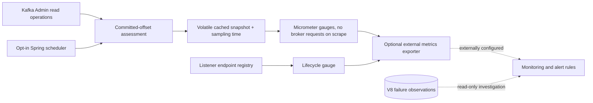
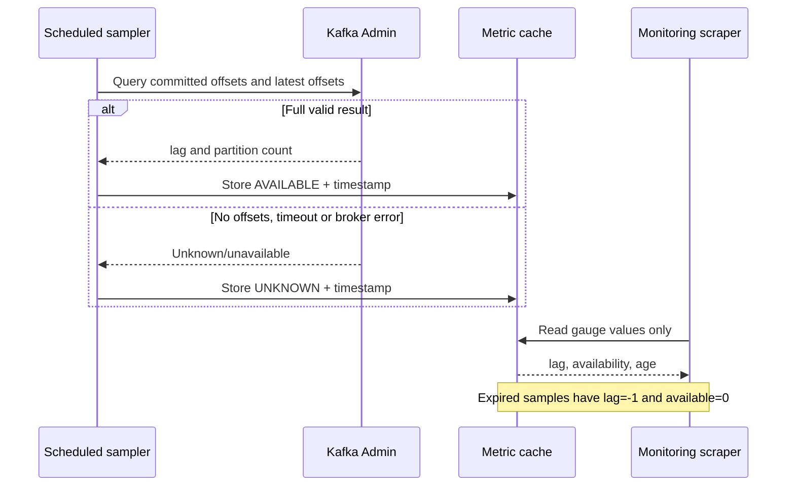

# Chapter 28 — Opt-in Kafka Lag Monitoring, Cached Metrics and Alert Design

**Milestone:** 06.7U — bounded scheduled lag sampling, cached metrics, data freshness.
**Status:** Committed; requires local Maven verification. No dashboard or alert has been deployed.

## The operational problem

Chapter 26 reports whether the opt-in Spring Kafka listener is missing,
stopped or running. Chapter 27 measures **durably committed consumer-group
lag** through read-only Kafka Admin calls. Neither alone proves that a
consumer is healthy:

- A running container may be blocked, behind, disconnected or unauthorized.
- An absent group offset cannot be interpreted as zero lag.
- A measurement that was valid five minutes ago is not a current observation.
- Running Kafka Admin calls directly from a Prometheus scrape risks
  slow or overloaded scrapes, amplified during broker outages.

We therefore **separate periodic collection from metric reads**.

## Implementation

`KafkaConsumerLagMetrics` is a cached Micrometer adapter. Its
`refresh()` method is scheduled at a bounded fixed delay and calls
`KafkaConsumerLagAssessment.sample()` using the secured Kafka Admin
client. Metric collection itself only reads in-memory state.

The application creates the scheduler and Admin client **only when both**
`payment.messaging.kafka.consumer.enabled=true` and
`payment.messaging.kafka.consumer.lag-monitor.enabled=true`.

Configuration defaults (do not enable merely to test the application):

```yaml
payment:
  messaging:
    kafka:
      consumer:
        enabled: false
        lag-monitor:
          enabled: false
          interval-ms: 30000
          maximum-age-ms: 120000
```

The actual flags can be supplied by `PAYMENT_KAFKA_CONSUMER_ENABLED`,
`PAYMENT_KAFKA_LAG_MONITOR_ENABLED`,
`PAYMENT_KAFKA_LAG_MONITOR_INTERVAL_MS` and
`PAYMENT_KAFKA_LAG_MONITOR_MAXIMUM_AGE_MS`. The running code rejects
polling intervals below 5 seconds and a maximum age below the interval.

### Fixed-cardinality metrics

| Micrometer name | Interpretation |
| --- | --- |
| `payment.kafka.consumer.lag.records` | Number of records behind, or `-1` if unknown/stale |
| `payment.kafka.consumer.lag.available` | `1` only for a fresh complete snapshot, otherwise `0` |
| `payment.kafka.consumer.lag.sample.age.seconds` | Seconds since last attempt, `-1` before first attempt |

All metrics have fixed names and **no tenant, topic, partition or offset
labels**. Operators need the state and recency alongside the numerical lag;
never graph negative lag as if it represented caught-up consumption.
The cache intentionally reports `-1` lag after expiration.

The registered Admin bean is closed during Spring shutdown and uses the
same encrypted Kafka client settings as the consumer. Actual broker ACLs
must be independently restricted to the required describe and read operations.

### Architecture



### Failure behavior



## Operator alerting design (NOT deployed)

Correlate three signals instead of a single lag threshold:
the lifecycle gauge (`0/1/2`), fresh lag status/age, and existing
invalid/untrusted/processing-failure observations. For example:

- Stopped listener during active service: investigate immediately; no
  automatic restart loop.
- High or rising **fresh** lag over a defined time window: investigate
  consumer throughput, group stability, database and broker health.
- Lag freshness unavailable or stale: alert as a **monitoring visibility
  incident**, not as an imaginary zero backlog.
- Unexpected poison observations: examine the recorded exact topic,
  partition and offset through authorized operations; do not skip.

Alert thresholds and Prometheus query expressions depend on the actual
exporter names and the service's measured SLOs. The current application
exposes `health` and `info`, not the Prometheus endpoint. This milestone
**does not configure a Prometheus registry, scrape job, dashboards or
external alert routing**.

## Security and reliability boundaries

- Read-only Admin operations never change committed offsets.
- No consumer-group reset, DLQ skip, replay API or auto-restart was introduced.
- Sampling is asynchronous to scraping, preventing broker latency on gauges.
- Default-off activation protects development and deployments without
  configured secured brokers.
- A fresh zero lag is not an end-to-end delivery guarantee.
- Clock changes and long JVM pauses can affect sampled freshness; use a
  separate real-world deployment health assessment before alerting on it.

## Test evidence and verification

`KafkaConsumerLagMetricsTest` tests local caching, sample freshness,
zero-versus-unknown distinction, broker exception fallback, and lack of
network work in gauge reads. The real Kafka Testcontainer behavior was
covered in Chapter 27.

```bash
mvn -B --no-transfer-progress -Dtest=KafkaConsumerLagMetricsTest test
mvn -B --no-transfer-progress clean verify
```

The last confirmed baseline was **143** passing tests (80 unit and 63
integration). The new two JUnit tests would raise it to **145** if all
other suites remain unchanged. Do not claim success before observing
the Maven output on the actual branch commit.

## Interview questions

**Why not issue Admin calls inside a gauge callback?** Scrapes should be
bounded, quick, reliable and cheap; a broker outage must not hold up all
metric collection.

**Why is unknown not the same as zero lag?** A new group, partial commit set,
expired data or failed broker call offers no evidence that consumption has
caught up. A zero requires fresh, complete offset coverage.

**What is the trade-off of caching?** Lower broker load and predictable
scrape latency, at the cost of eventual consistency. Explicit freshness
metrics prevent stale readings from masquerading as current.

**Why guard metrics separately from listener activation?** Production broker
credentials and ACLs are required; opt-in lets us validate the consumer
lifecycle and deployment security before adding monitoring load.

**Does this prove our system is operationally ready?** No. We still need
broker ACL and TLS/SASL integration evidence, stable Prometheus export,
alert routing, monitored recovery drills and SLO evaluation.
