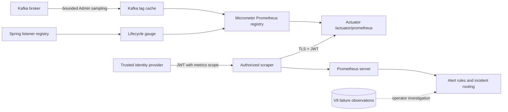

# Chapter 29 — Secure Prometheus Exposition and Alert Rule Integration

**Milestone:** 06.7V. **Status:** Code, regression test and rule examples committed; local Maven and actual deployment verification pending.

## Requirement

Chapter 26 provides an in-process lifecycle gauge and Chapter 28 produces
cached, low-cardinality Kafka lag metrics. Until now, only Actuator health
and info were exposed. A monitoring platform cannot scrape the other gauges
without a Prometheus registry and authorized HTTP access.

## Implementation and security design

1. Add the Spring Boot-managed `io.micrometer:micrometer-registry-prometheus`
   dependency. Spring Boot discovers the registry and creates the
   `/actuator/prometheus` endpoint when present.
2. Keep **default exposure unchanged**: `health,info`. To deliberately opt in,
   set `PAYMENT_ACTUATOR_EXPOSE=health,info,prometheus` in the trusted
   deployment environment.
3. Require verified JWT authority `SCOPE_payments:metrics` for
   `GET /actuator/prometheus`; anonymous requests get 401 and
   other authenticated scopes get 403. This is separate from payment
   read/write scopes. Maintain the JWT issuer/audience trust checks.
4. Continue to require both opt-in Kafka consumer and lag monitor flags
   before publishing lag-specific gauges. When disabled, absence of those
   metrics is **expected**. Do not alert on absence unless monitoring
   is explicitly enabled for that deployment.
5. Add `PrometheusMetricsSecurityIT` with a PostgreSQL Testcontainer and
   actual Actuator endpoint. It tests unauthorized, insufficient-scope and
   authorized HTTP scrape behavior.
6. Add example alert rules in
   `ops/monitoring/prometheus/kafka-consumer-alerts.yml`. These are
   **not deployed** or tuned to the traffic SLO yet.

## Architecture



The scrape path is **read only**. It does not grant event replay, offset
changes, administrative recovery or access to payment data.

## Deployment prerequisites (not part of this milestone)

- Keep the endpoint off on untrusted deployments. If enabling it, use
  network policy/private ingress and verified HTTPS; consider separate
  management ports and identity boundaries for full production isolation.
- Configure your monitoring agent to obtain a short-lived token from
  the trusted identity provider with **only** the `payments:metrics` scope.
  Do not commit bearer tokens, passwords, TLS private keys or scrape
  credentials to Git. Restrict the actual Kafka Admin client via read-only
  ACLs. Use secret management and rotation.
- Set the appropriate `PAYMENT_KAFKA_CONSUMER_ENABLED` and
  `PAYMENT_KAFKA_LAG_MONITOR_ENABLED` flags only when a secured Kafka
  deployment has been prepared. They stay false by default.
- Confirm the exported Prometheus metric names on the deployed endpoint.
  Micrometer's dotted Java names normally become underscore-separated:
  `payment_kafka_consumer_lifecycle_state`,
  `payment_kafka_consumer_lag_records`,
  `payment_kafka_consumer_lag_available` and
  `payment_kafka_consumer_lag_sample_age_seconds`.
  Do not deploy alert rules without verifying these actual names.
- Deploy the sample alert rules into your **external** Prometheus configuration,
  tune thresholds and `for:` durations to measured traffic/incident SLOs,
  and test delivery with a controlled drill. Alerts for a disabled listener
  must not be mistakenly classified as an outage.
- Protect `/actuator/prometheus` against request amplification and avoid
  exporting sensitive identifiers as metric labels.

## Failure and threat scenarios

| Event | Expected behavior |
|---|---|
| Anonymous scrape | 401, no metrics |
| JWT with payment-read scope only | 403, no metrics |
| Valid JWT with metrics scope and exposed endpoint | Prometheus text exposition |
| Endpoint not opted in | no Prometheus web endpoint |
| Listener stops on poison record | lifecycle gauge indicates stopped; operator investigates without auto-ACK |
| Lag sampling unavailable | available=0, lag=-1; not a false zero |
| Lag monitoring disabled | lag metrics are absent by design |
| Unknown or stale lag | alert for observability degradation, not an arbitrary offset reset |

## How to verify

```bash
mvn -B --no-transfer-progress -Dit.test=PrometheusMetricsSecurityIT verify
mvn -B --no-transfer-progress clean verify
```

To run the exporter locally against a configured database without enabling
the consumer, provide valid application DB/JWT settings and set
`PAYMENT_ACTUATOR_EXPOSE=health,info,prometheus`. The exporter still
requires an authenticated `payments:metrics` token; it is not a public URL.

**Prior verified baseline:** 145 passing tests. The three new integration
tests would bring the expected total to **148** (82 unit + 66 integration)
if all existing tests remain unchanged. Do not claim new verification
until Maven reports a complete successful run.

## Interview questions

**Why must Prometheus export and the Kafka lag sampler be separate opt-ins?**
One controls HTTP exposition, the other creates a Kafka Admin client and
periodic broker queries; each has distinct security and cost implications.

**Why use a dedicated metrics JWT authority?** Least privilege. Ordinary
merchant API tokens must not gain infrastructure visibility by default.

**Why is Prometheus text exposition not proof of monitoring readiness?**
It does not establish working TLS, service discovery, scrape credentials,
firing alerts, delivery channels or actionable on-call runbooks.

**How do you prevent false green dashboards?** Export explicit unknown
and freshness signals, correlate consumer lifecycle and lag, and avoid
interpreting absent series as successful processing.

**Why not expose Kafka offset-reset actions alongside metrics?**
Read-only observation and destructive recovery must have separate
authorization, audit and human approval boundaries.
