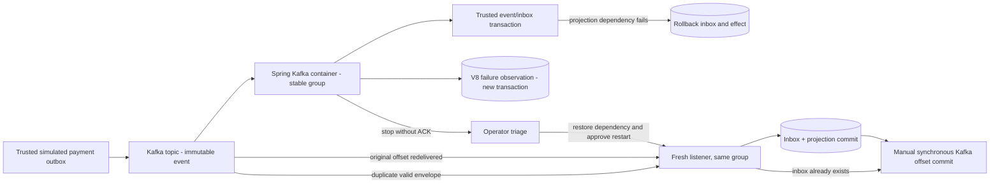

# Chapter 30 — Real Kafka Consumer Failure and Controlled Recovery Drill

**Milestone:** 06.7W — Testcontainers fail-stop, PostgreSQL rollback, durable evidence,
manual remediation, stable-group restart, offset commit and deduplicated replay.

**Status:** Test and learning notes committed. Local Maven verification is pending.

## Scenario and scope

A Kafka listener receives a **valid, immutable** simulated payment event. The
local projection database dependency fails inside the same transaction that
would insert the trusted inbox receipt. The listener must fail-stop without
acknowledging the broker record. An authorized operator investigates the
existing V8 failure metadata and restores the dependency. A new container
using the **same consumer group** processes the original record. A later
duplicate Kafka envelope must not repeat the local effect.

This scenario models **transient processing failure**. A malformed poison
record cannot simply be "fixed in Kafka" in place; Kafka logs are append-only.
Permanent invalid/untrusted event recovery requires separate explicit policy,
review and authorization and is not represented as safe automatic skipping.

## Architecture



## Sequence and observable assertions

```mermaid
sequenceDiagram
    participant K as Kafka broker
    participant L1 as Listener (broken projection)
    participant DB as PostgreSQL
    participant O as Authorized operator
    participant L2 as Listener (repaired projection)
    K->>L1: offset 0, valid event
    L1->>DB: Insert inbox and projection
    DB--xL1: Projection dependency failure, rollback
    L1->>DB: REQUIRES_NEW failure observation
    L1--xK: No acknowledgment; stop container
    O->>DB: Read exact failure location and fingerprint
    O->>K: Inspect committed offsets without mutation
    O->>L2: Approve restart after dependency remediation
    K->>L2: Replay offset 0 in the same group
    L2->>DB: Commit inbox + projection
    L2->>K: Commit next offset 1
    K->>L2: Duplicate envelope at offset 1
    L2->>DB: Inbox duplicate, no second projection
    L2->>K: Commit next offset 2
```

The new integration test
`KafkaListenerContainerLifecycleIT.transientProjectionFailureStopsThenRestartReplaysAndCommitsExactlyOnce`
uses Kafka and PostgreSQL Testcontainers. It specifically checks:

- A real Spring Kafka listener container stops after the injected failure.
- The V8 observation is persisted as `PROCESSING_FAILURE` with a 64-character
  SHA-256 digest and without raw payload storage.
- The initial inbox and projection effects roll back.
- The consumer group's committed offset has not passed failed offset 0.
- A repaired container with the same group commits inbox and projection once.
- The broker's next committed offset advances to 1.
- Publishing the same event again advances the next committed offset to 2
  while keeping exactly one inbox and one projection row.

### Why this is not "exactly once"

The database transaction and Kafka group offset commit are not atomic.
The design relies on **at-least-once delivery** and a transactional inbox
for *effectively once* local database projection. Separate side effects need
their own idempotency and failure strategies.

### Operational safety

This is a **test-scoped** fault injection. It does not create a public
restart endpoint, alter consumer group offsets, auto-ACK poison records,
enable PLAINTEXT in production or introduce a DLQ bypass.

In production, a human-approved recovery must check broker retention,
committed offsets, consumer group ownership, payload contract, trusted
provenance, failure history and actual root-cause remediation. The
test-broker is intentionally PLAINTEXT, while real consumer configuration
continues requiring SSL/SASL_SSL. Broker-level ACL/TLS drills remain future
deployment checks.

## Verification

```bash
git pull --ff-only origin feat/payment-ledger
mvn -B --no-transfer-progress -Dit.test=KafkaListenerContainerLifecycleIT verify
mvn -B --no-transfer-progress clean verify
```

Previous confirmed baseline: **148** passing (82 unit + 66 integration).
One new real-broker integration test would raise the expected full count
to **149** (82 unit + 67 integration). Treat it as pending until Maven
reports results for this commit.

## Interview preparation

**Q: Why choose a valid event and a broken projection for recovery?**
Kafka log records are immutable. After a transient consumer dependency is
restored, replaying the same valid record is the correct use of fail-stop.

**Q: Why is the failure observation in a separate transaction?**
If it shared the failed inbox/projection transaction, the evidence would be
rolled back with it. Separate durable evidence helps operator triage.

**Q: Why inspect offsets before restart?**
To verify the failed event was not acknowledged and that the same group will
replay it. Recovery must never silently skip potentially unprocessed events.

**Q: How does the consumer avoid duplicate projections?**
The inbox receipt and local projection are committed within one PostgreSQL
transaction. On duplicate delivery the inbox detects previous consumption,
allowing acknowledgment without applying the effect again.

**Q: What still needs actual infrastructure-level validation?**
A deployment with TLS/SASL and least-privilege ACLs, offset retention handling,
alert routing, runbooks, recovery approvals, and injected broker disconnects
or consumer rebalances.
