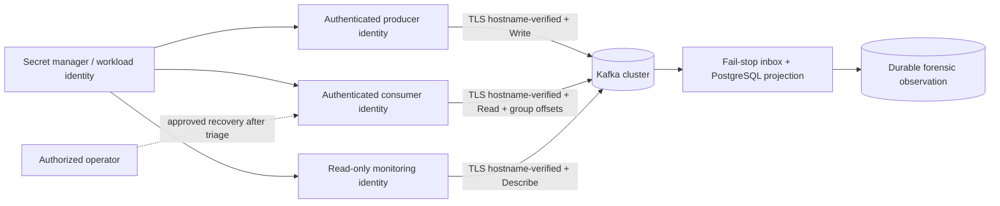
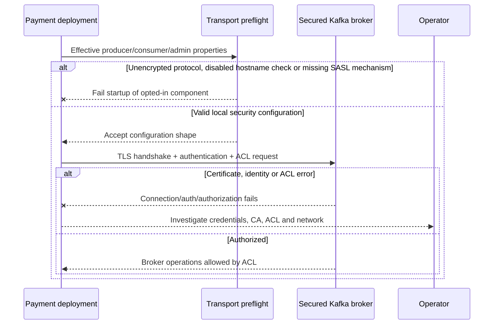

# Chapter 31 — Kafka Deployment Security and Least Privilege

**Milestone:** 06.7X, Kafka transport configuration preflight and deployment threat model.
**Status:** Committed on `feat/payment-ledger`; local Maven and live TLS/ACL deployment verification pending.

## What changed

A transport security preflight, `KafkaTransportSecurity`, is shared by the
opt-in Kafka outbox producer, manually acknowledged listener, and lag-monitor
Admin client. All must meet the same minimum security requirements:

- `security.protocol` must be `SSL` or `SASL_SSL`. Never allow
  `PLAINTEXT` or `SASL_PLAINTEXT` in application deployment wiring.
- The Kafka client's TLS endpoint identification must remain `https`
  (Kafka's documented client default). Explicit blank/disabled or alternate
  settings are rejected to prevent hostname verification bypass.
- `SASL_SSL` requires an explicitly configured, nonblank
  `sasl.mechanism`. Choose the mechanism supported by the managed broker,
  such as `SCRAM-SHA-512` where available; do not assume a default
  GSSAPI mechanism matches your cluster.
- Existing producer `acks=all`, consumer `enable.auto.commit=false`,
  `MANUAL_IMMEDIATE`, synchronous commit and stopping error handler are
  preserved. All opt-in controls remain off by default.

The preflight neither reads authentication secrets nor logs their values.
It does **not** authenticate the broker, verify a remote certificate chain,
prove TLS handshake success or inspect broker-side ACL policy. Those require
integration testing in the actual secured environment.

## Architecture and trust boundaries



Use separately provisioned identities if your deployment allows it. In
the current Java implementation the optional Admin bean derives its
transport properties from the consumer factory; separation into a distinct
monitoring principal is **not yet implemented**. The broker ACLs must be
reviewed accordingly. Do not claim this is already three isolated identities.

## Example secret injection: deployment-only, never committed

Use a platform secret manager or mounted sensitive configuration (Kubernetes
Secrets with encryption-at-rest and workload RBAC, Vault, cloud secret stores
or managed broker IAM authentication). For a SCRAM broker, the necessary
Kafka client options include:

```yaml
spring:
  kafka:
    properties:
      security.protocol: SASL_SSL
      sasl.mechanism: SCRAM-SHA-512
      ssl.endpoint.identification.algorithm: https
      # sasl.jaas.config MUST be supplied by secure runtime injection;
      # never commit passwords or bearer tokens here.
```

Do not paste real `sasl.jaas.config` strings into an issue, shell history
or test output. Prefer workload identity where the broker/provider supports
it. CA trust material should be provisioned from trusted sources; never turn
off hostname verification or certificate validation to fix connection errors.
Do not configure test-container `PLAINTEXT` settings as production defaults.

For production-ready secret management, specify the exact supported broker
authentication mechanism and automate certificate/credential rotation tests.

## Broker ACL proposal: review before applying

| Identity | Resource | Kafka operations | Explicitly exclude |
| --- | --- | --- | --- |
| Outbox publisher | Exact payment events topic | Write, Describe | Alter, Delete, unrestricted topics |
| Projection consumer | Exact payment events topic | Read, Describe | Write, Alter, Delete |
| Projection consumer group | Exact consumer group ID | Read, Describe | Alter/Delete unrelated groups |
| Lag observer | Exact topic + group | Describe and read-only offset inspection as needed by broker/version | Write, offset reset, cluster mutation |

**ACL operations are version- and provider-specific.** Kafka Admin
`listConsumerGroupOffsets`, `describeTopics` and `listOffsets` may
require additional `Describe`/`Read` permissions. Validate actual
broker responses with the chosen Kafka version and auth backend; do not
copy these tables into unreviewed production ACL commands.

The current application Admin bean uses the consumer factory's effective
properties. The principle of least privilege must therefore be reconciled
against the combined consumer+monitor access until a separate Admin principal
is configured.

## Critical operational controls

- Partition ordering relies on tenant+payment keys; do not change key
  semantics casually.
- Never use Kafka `auto.offset.reset=earliest` as an unreviewed production
  recovery shortcut. The application consumer currently configures
  `auto-offset-reset: none` to make missing offsets explicit.
- Scope network connectivity to private broker listeners and enforce
  network policies; avoid publishing Kafka ports to the internet.
- Track broker authorization failures separately from app-level contract
  failures. Monitor cert expiry, secret rotation failures and consumer
  group stability.
- Keep manual poison-event investigation separate from any destructive
  offset reset/replay tooling. Require reviews, audit trails and rollback
  plans before changing offsets.
- Use independent authorization and bearer-token scope for the
  `/actuator/prometheus` scrape endpoint. Kafka ACLs and HTTP metrics
  RBAC are separate trust boundaries.

## Sequence: secure start and failure



## Test checkpoint

```bash
git pull --ff-only origin feat/payment-ledger
mvn -B --no-transfer-progress -Dtest=KafkaTransportSecurityTest test
mvn -B --no-transfer-progress clean verify
```

Previous verified baseline: **149** (82 unit + 67 integration). Three new
unit tests should make **152** (85 unit + 67 integration), pending a full
Maven run.

## Interview questions

**Why is SSL alone not enough?** TLS encrypts and authenticates the server
subject to trust and hostname verification; identity and Kafka ACLs still
control what a client may do. With mTLS, SSL may also authenticate the client.

**Why enforce hostname verification?** A certificate chain that validates
without matching the intended broker host can still enable wrong-endpoint or
man-in-the-middle risks.

**Why is the preflight not proof of secured production readiness?** It only
validates local configuration. Real trust anchors, SCRAM/mTLS credentials,
server identity, broker authorization and operational rotation must be tested.

**How would you isolate monitoring rights?** Provision an independent Admin
client identity with only the read/describe operations required by the lag
assessment; make its configuration and secret lifecycle independent, and
test ACL denial on attempted mutations.

**Why is the consumer offset reset strategy explicit?** A new/expired group
offset is an operational condition requiring a reviewed policy; treating
missing positions as start-from-earliest can unexpectedly replay retained
messages.
