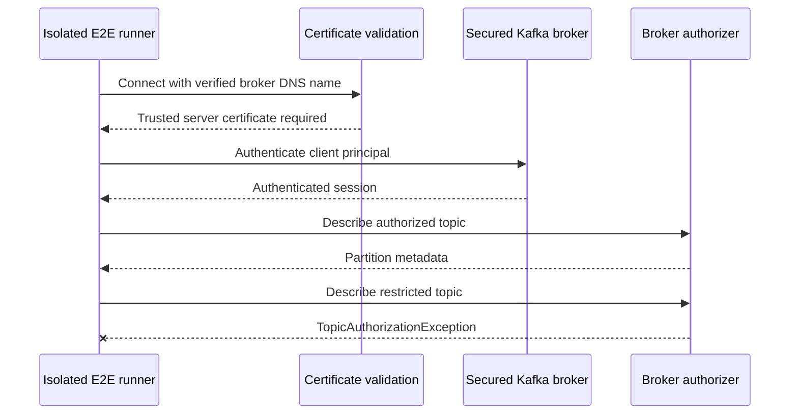

# Chapter 32 — Secured Kafka Broker Integration Contract

**Milestone:** 06.7Y — opt-in verification against a genuinely secured Kafka broker.
**Status:** External-broker test harness implemented and committed; secure broker provisioning and live execution **not yet performed**.

## Why another test layer?

The current Kafka Testcontainers exercise real record consumption, producer ACKs,
offset commits and PostgreSQL consistency, but use a local **PLAINTEXT** listener.
Chapter 31 checks the shape of Kafka TLS/SASL configuration. Neither checks
a real TLS handshake, certificate chain, broker identity, authenticated
principal or ACL enforcement.

Kafka's official Docker guide requires explicit TLS/SASL broker listener
configuration and mounted secret files. The exact material and ACL setup
are broker/provider-specific. See:

- https://kafka.apache.org/41/getting-started/docker/
- https://github.com/apache/kafka/blob/trunk/docs/getting-started/docker.md

## New reproducible integration entry point

`src/test/java/dev/asambataiden/payment/payments/messaging/kafka/security/SecuredKafkaBrokerE2E.java`

The test deliberately ends with **E2E**, not `IT` or `Test`: it cannot
silently run against an unsecured local container as part of the default
Maven build. JUnit also requires
`PAYMENT_SECURE_KAFKA_TEST_ENABLED=true`, so manual invocation without
explicit opt-in is skipped.

It performs two read-only broker operations with the same restricted client:

1. Describe an **existing allowed topic**; require real partition metadata.
2. Describe an **existing denied topic**; require an explicit Kafka
   `TopicAuthorizationException`. A nonexistent topic, connection timeout,
   authentication failure or missing broker does **not** satisfy this check.

The test uses Kafka `Admin` with `SSL` or `SASL_SSL` and hostname
verification `https`. It reuses `KafkaTransportSecurity.validate` and
closes the Admin client. It never attempts destructive ACL or offset changes.

### Prerequisites

Provision a disposable **secured development broker**, not production:

- A certificate whose DNS SAN matches the broker's advertised TLS hostname;
  a trusted CA/root chain accessible to the test JVM.
- An authenticated client identity using SSL client certificates or SASL_SSL.
  For SASL, configure an actual mechanism such as SCRAM-SHA-512 supported by
  the broker. The broker's auth backend must accept this identity.
- Two already-created topics: one where this identity has Describe rights
  and a second where it has **no Describe rights**.
- Broker authorization enforced; disable blanket super-user privileges for
  this test principal. Ensure no broad wildcard ACL grants access to the
  restricted topic. Network connectivity should be private.
- No production data, no committed credentials, no credentials in logs.

### Required environment variables

| Variable | Meaning |
| --- | --- |
| `PAYMENT_SECURE_KAFKA_TEST_ENABLED` | Set `true` only for E2E execution |
| `PAYMENT_SECURE_KAFKA_BOOTSTRAP_SERVERS` | DNS SAN-compatible TLS bootstrap endpoints |
| `PAYMENT_SECURE_KAFKA_PROTOCOL` | `SSL` or `SASL_SSL` |
| `PAYMENT_SECURE_KAFKA_ALLOWED_TOPIC` | Existing topic the principal can describe |
| `PAYMENT_SECURE_KAFKA_DENIED_TOPIC` | Existing topic the principal cannot describe |
| `PAYMENT_SECURE_KAFKA_SASL_MECHANISM` | SASL mechanism, when SASL_SSL |
| `PAYMENT_SECURE_KAFKA_SASL_JAAS` | Runtime-injected client authentication config, when SASL_SSL |
| `PAYMENT_SECURE_KAFKA_TRUSTSTORE_LOCATION` | Optional PKCS12 truststore path; JVM defaults otherwise |
| `PAYMENT_SECURE_KAFKA_TRUSTSTORE_PASSWORD` | Runtime-secret PKCS12 password, when truststore specified |

A separate certificate-based client identity can be supplied using secure
JVM/client configuration when the broker requires mTLS; the current test
harness does **not** assemble a client keystore from env variables. Extend
it explicitly and test it before claiming mTLS coverage.

Use your secret manager or ephemeral CI secret injection for JAAS/truststore
passwords. Never paste secrets into shared chat, source, issue comments,
shell tracing or CI build logs.

## Execution

Default regression suite (will not discover the opt-in E2E class):

```bash
mvn -B --no-transfer-progress clean verify
```

Once an authorized secured test environment has been provisioned:

```bash
mvn -B --no-transfer-progress \
  -Dtest=SecuredKafkaBrokerE2E test
```

The environment flag and remaining variables must be injected securely
before execution. Do not place credentials directly in the command.
A successful local Maven run without the opt-in flag is **not** evidence
of a secured broker connection.

## Threat model and sequence



## Acceptance criteria not yet proven

- Broker actually negotiates TLS and validates CA chain / hostname.
- Client authenticates with a real scoped principal and secrets.
- Positive Describe succeeds for the permitted topic.
- Denied Describe yields `TopicAuthorizationException`, rather than
  timeout or unknown topic.
- Explicit wrong trust anchor, wrong credentials and revoked ACL behavior
  have been tested separately (future hardening).
- Producer Write, consumer Read/group ACL and lag Admin offsets permissions
  have been tested as distinct principals (future hardening).

## Interview preparation

**Why require an explicit TopicAuthorizationException?** To prove the
broker's policy rejected an authenticated request; a timeout or missing
topic proves nothing about ACL enforcement.

**Why keep secured E2E separate from the default suite?** The unit/integration
suite must remain deterministic and runnable without externally managed
secrets, CA files or broker provisioning.

**Why not use PLAINTEXT Testcontainers and claim TLS coverage?** Transport
configuration validation, actual certificate verification, authentication
and authorization test fundamentally different security boundaries.

**What remains before production readiness?** Managed broker provisioning,
TLS/SASL integration evidence, least-privilege ACL validation across
producer/consumer/Admin, secret rotation, incident exercises and formal
runbook review.
