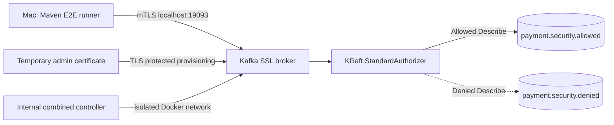
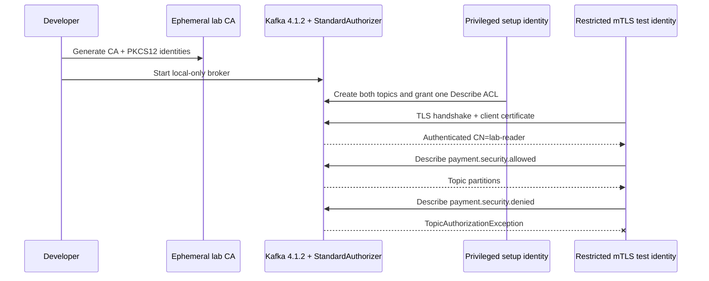

# Chapter 33 — Disposable mTLS Kafka Security Lab

**Milestone:** 06.7Z — provision a reproducible security-test broker for Chapter 32.
**Status:** Lab source and runner committed. Actual Docker execution, TLS negotiation and ACL-denial evidence are **pending**.

## Goal

Chapter 32 introduced a secured-broker E2E contract but had no disposable
broker to run it against. This increment creates a local-only Apache
Kafka 4.1.2 KRaft lab with:

- TLS-required external listener at `127.0.0.1:19093`
- Client-certificate authentication (mutual TLS)
- `StandardAuthorizer` and default-deny access policy
- A privileged setup identity with no access from application tests
- A restricted client identity that can Describe one named topic only
- A second existing topic without the required Describe grant

**Never deploy this single-node combined-role broker to production.**
The controller listener is PLAINTEXT inside the isolated Docker network and
the lab super-user list contains `User:ANONYMOUS` to permit the internal
controller path. This is explicitly **not** a secure production controller
architecture. The local host-published broker port is loopback only.

## What the files do

| File | Responsibility |
| --- | --- |
| `ops/monitoring/kafka-security-lab/compose.yaml` | Start broker with TLS, client cert verification and ACL authorizer |
| `generate-certificates.sh` | Create a short-lived CA, broker/admin/reader identities, PKCS12 keystores and credentials |
| `provision-topics-acl.sh` | Create allowed and denied topics using the admin identity; grant reader Describe on allowed only |
| `run-e2e.sh` | Inject the reader identity into the Chapter 32 Java E2E test without credentials in CLI arguments |
| `.gitignore` | Prevent `generated/` from being committed |

The generated CA and certificates expire after **2 days**, are for the
disposable lab only, and should be regenerated for another run. The local
generated directory contains private keys, password files and a client
properties file: restrict machine access and do not sync or back it up.
For compatibility with the Apache Kafka container's non-root process,
some **lab-only broker input files** are group/world-readable inside the
locally generated directory. This is a deliberate local test limitation
and is unsuitable for production. Use Docker/Kubernetes secrets with
restricted filesystem permissions for a production design.

## Start from the repository root

Requires Docker Desktop / Compose, Java 25, Maven, OpenSSL and
`keytool` from the JDK. No real money or payment messages are used.

```bash
git pull --ff-only origin feat/payment-ledger
cd ops/monitoring/kafka-security-lab
bash generate-certificates.sh
docker compose -f compose.yaml up -d
bash provision-topics-acl.sh
bash run-e2e.sh
```

The expected Chapter 32 outcome is **two E2E passes**:

1. The restricted mTLS client successfully describes the allowed topic.
2. It receives a real `TopicAuthorizationException` for the denied topic.

An authentication error, failed certificate validation, missing topic,
timeout or skipped test does **not** satisfy acceptance criteria.

Check the broker logs if something fails:

```bash
docker compose -f compose.yaml logs --tail=120 broker
```

Never paste or upload raw logs containing passwords, private keys,
JAAS strings or sensitive certificate material. Redact first.

## Tear down after testing

```bash
docker compose -f compose.yaml down -v
```

After shutdown, delete only the generated lab directory
(`ops/monitoring/kafka-security-lab/generated`) using your normal
filesystem controls. It is excluded from Git and contains no user data.

## Architecture



## Sequence



## Important security boundaries

- Authentication by certificate does not automatically authorize all
  Kafka operations; the broker's authorizer enforces the resource ACL.
- A valid certificate needs a trusted chain, a matching advertised
  hostname and the expected client identity; do not disable hostname
  verification to make a failed handshake pass.
- E2E test uses a new PKCS12 keystore option for `SSL` in
  `SecuredKafkaBrokerE2E`. This is lab-only runtime configuration, not
  an embedded application password or a production secret.
- Certificate revocation, negative trust-chain tests, producer/consumer
  group access tests and real secrets rotation remain separate milestones.
- The combined-mode controller's anonymous superuser exception should
  never be copied into a real multi-node environment.

## Reproducibility and verification

```bash
mvn -B --no-transfer-progress clean verify
```

This default suite should remain at **152** passing tests if unchanged
(85 unit and 67 integration). The external two-test E2E runs only when
explicitly selected and enabled by `run-e2e.sh`. It is deliberately **not**
part of the default regression count.

We have not executed Docker or Maven against the secured lab here. A
successful code commit is **not** proof of TLS/ACL functionality.

## Interview preparation

**Why separate the admin and restricted client certificates?** Setup needs
privileged provisioning rights, while normal observation must use
least privilege and must prove that policy denies unapproved access.

**Why use a known-existing denied topic?** An unknown topic may fail
without invoking the intended authorization check; a real denial
exception is the proof of enforcement.

**Why not copy the lab Kafka configuration into production?** It is a
single-node combined controller/broker topology, uses a local CA,
short-lived generated secrets, localhost exposure and an internally
PLAINTEXT controller with an anonymous superuser exception.

**What must a real deployment improve?** Isolated secured controllers,
managed CA and secrets, cert rotation, dedicated principals, replicated
brokers, managed ACLs, audited changes and continuous security monitoring.
