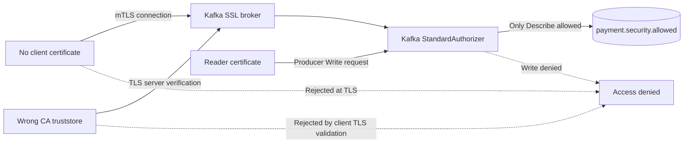

# Chapter 34 — Kafka Negative Security Testing: mTLS and Broker ACLs

**Milestone:** 06.7AA. **Status:** Verified locally on November 9, 2026: application regression 85 unit + 67 integration passed; separately the secured broker suite passed 5/5 E2E tests (2 positive + 3 negative). This is local development-lab evidence, not production certification.

## 1. Use case and business motivation

Our simulated payment event stream carries operationally important payment-state
events. If a client can connect without valid credentials, trusts a forged broker,
or can publish despite only being authorized to observe, payment-state projections
could become unreliable or sensitive event metadata could be exposed.

A positive security test (“authorized reader works”) proves only availability
for an authorized path. The **negative tests** prove that three distinct
security boundaries reject inappropriate requests.

| ID | Scenario | Attacker/failure model | Required outcome |
| --- | --- | --- | --- |
| KSEC-01 | Client has no certificate | Workload omitted its identity secret | TLS client authentication prevents topic metadata retrieval |
| KSEC-02 | Client trusts an unrelated CA | Broker certificate or truststore is substituted | Server certificate validation prevents metadata retrieval |
| KSEC-03 | Describe-only identity attempts publish | Credential misuse / privilege escalation | Broker returns `TopicAuthorizationException` for Write |

## 2. What we introduced

`KafkaNegativeSecurityE2E` is an opt-in real-broker contract alongside
`SecuredKafkaBrokerE2E`. It uses the same legitimate reader identity,
existing topics, TLS truststore, explicit `SSL` transport and
`ssl.endpoint.identification.algorithm=https`.

The CA generator now creates a **separate, unrelated trust anchor** in
`generated/untrusted-truststore.p12`. It does not contain the CA that
signed the broker's certificate. The `run-e2e.sh` script injects the
rogue truststore path and password for the negative case; the generated
directory stays ignored by Git.

The tests use **dummy event data**, not real payment events, and deliberately
do not grant Write privileges to the reader.

## 3. Why each test matters

### KSEC-01 — Missing client identity

With `ssl.client.auth=required`, successful server trust alone does not
authenticate the client. The test removes the client keystore and key
password fields while retaining the valid truststore, then requests
metadata. No usable topic metadata may be returned.

**Evidence limitation:** Kafka Admin APIs may surface SSL handshake rejection
as a timeout or disconnection rather than a specific exception. This test
asserts access failure **while checking the legitimate client succeeds both
before and after**. Inspect sanitized broker/client TLS diagnostics if the
root cause must be established further.

### KSEC-02 — Wrong CA/trust anchor

Certificate validation should fail when the test client substitutes an
unrelated CA. The test swaps only the truststore; the reader client
certificate remains valid. It must not retrieve metadata and the
legitimate reader must still succeed afterward.

**Do not fix this test by disabling hostname verification or trusting all
certificates.** That would erase the security property being tested.

### KSEC-03 — Unauthorized Write

The reader has only `Describe` on the allowed topic. The test constructs
a real Kafka producer with the reader's authenticated TLS identity and
attempts to send `denied-write-probe`. It expects a broker
`TopicAuthorizationException`, not merely a timeout.

This is **broker ACL enforcement**: successful mTLS authentication is not
equivalent to authorization to publish. The test does not perform a real
payment-state transition.

## 4. Trust-boundary architecture



## 5. Sequence and failure analysis

```mermaid
sequenceDiagram
  participant Test as E2E security test
  participant TLS as TLS client/server authentication
  participant Kafka as Kafka broker
  participant ACL as StandardAuthorizer
  Test->>TLS: Correct reader truststore + client certificate
  TLS-->>Test: Baseline authenticated connection succeeds
  Test->>TLS: Remove client certificate
  TLS--xTest: Connection rejected; metadata unavailable
  Test->>TLS: Valid certificate + unrelated CA truststore
  TLS--xTest: Server certificate untrusted; metadata unavailable
  Test->>Kafka: Re-authenticate legitimate reader
  Kafka-->>Test: Describe allowed
  Test->>ACL: Publish dummy record to allowed topic
  ACL--xTest: TopicAuthorizationException
  Test->>Kafka: Legitimate reader Describe again
  Kafka-->>Test: Baseline still healthy
```

## 6. Detailed hands-on tutorial

Run from **any directory within this Git repository** after pulling the
latest `feat/payment-ledger` branch. The explicit Maven POM path avoids the
`MissingProjectException` observed on November 9, 2026:

```bash
ROOT="$(git rev-parse --show-toplevel)"
git -C "$ROOT" pull --ff-only origin feat/payment-ledger
mvn -B --no-transfer-progress -f "$ROOT/pom.xml" clean verify

cd "$ROOT/ops/monitoring/kafka-security-lab"
bash generate-certificates.sh
docker compose -f compose.yaml up -d
bash provision-topics-acl.sh
bash run-e2e.sh
```

**Observed November 9, 2026:** **5 E2E tests passed** (2 positive-contract tests + 3 negative tests), zero failures/errors/skipped, completing at 14:03:39 CET. The ordinary application regression was also independently verified: **85 unit + 67 integration = 152** passing tests. The E2E tests are a separate execution, not part of the 152 count.

The previous lab's `generated/` directory was removed after successful
2/2 positive E2E verification. During the November 9, 2026 Chapter 34
exercise fresh credentials and a broker were created again; completion of
all five E2E tests is **not established by the available log excerpt**. If `generated/` already exists, the
generator intentionally refuses to continue; do not overwrite credentials
in an active test lab.

After observing results:

```bash
docker compose -f compose.yaml down -v
ls -la generated/
# Only if contents are the disposable test materials:
rm -r generated/
```

Do not upload the generated key files, `*.p12` files,
`admin.properties`, `reader.properties` or `store.password`.
For troubleshooting, redact full filesystem paths and sensitive settings
before sharing logs. Test and CI output can contain infrastructure details.

## 7. Best practices and design rationale

- **Fail-closed:** Unexpectedly successful forbidden operations must fail
  the test; errors must not be swallowed and treated as success.
- **Availability control:** Each negative handshake test brackets the
  invalid-client attempt with valid-client baseline checks. This reduces
  the chance of a broker outage being mistaken for effective security.
- **No live payment data:** Use a disposable broker, deterministic topic
  names, dummy payloads, short timeout bounds and short-lived certificates.
- **Separation of duties:** The administrator provisions topics/ACLs;
  the reader tests its own limited permissions. Do not run negative
  authorization tests using a superuser identity.
- **No secret exposure:** Load PKCS12 passwords at runtime and keep
  generated material outside version control.
- **Correct evidence:** TLS failure/no metadata, Kafka ACL exception,
  and application data consistency are **different** properties.
  These tests prove only the former two categories.
- **Production gap:** This single-node KRaft lab uses a PLAINTEXT
  controller and `User:ANONYMOUS` superuser exception for the
  private controller path. It is a training topology, **not** an
  acceptable production security deployment.

### Alternatives and tradeoffs (ADR-style)

**Chosen:** Opt-in external-broker E2E tests. Tests use real broker-side
TLS and ACL enforcement and do not need secrets for regular `clean verify`.

**Alternative A:** Mock Kafka client exceptions. Faster but does not prove
broker-side TLS or ACL behavior.

**Alternative B:** Run all tests against a managed cloud Kafka broker.
Closer to production but introduces cost, credential handling, network
dependencies and potentially destructive external state into routine CI.

**Alternative C:** Add a completely automatic mTLS Kafka Testcontainer with
dynamic provisioning. Good long-term goal but adds certificate-generation
and broker bootstrap complexity. The explicit lab helps us understand
these steps before automating them.

## 8. Troubleshooting and evidence checklist

1. `SSLHandshakeException` / `PKIX path building failed`: examine
   the trusted CA, SAN and certificate lifetime. These are expected in
   the **deliberately invalid** trust scenario, not for the baseline.
2. `TopicAuthorizationException` for **allowed Describe**: ACL or
   certificate-principal mapping is wrong; fix the lab provisioning.
3. `TopicAuthorizationException` for **forbidden Write**: expected.
4. Timeout in forbidden Write: **not** proof of ACL rejection; investigate
   metadata lookup, broker availability, certificates and routing.
5. No E2E tests executed or all skipped: check the runner environment
   and opt-in flag; do not claim secured-broker validation.
6. Record Maven summaries, broker version and sanitized failure details.
   Do not publish PKCS12 passwords or private keys.

## 9. Lessons learned and interview questions

**Q: Why test invalid trust separately from invalid client identity?**

A: They are distinct authentication directions. The client verifies the
broker (server certificate + trusted CA + hostname), while the broker
verifies a client certificate when mutual TLS is enabled.

**Q: Why can TLS pass but a write still fail?**

A: TLS authenticates peers and protects transport. Kafka's authorizer
applies independent operations/resource permissions to the authenticated
principal.

**Q: Is a Kafka timeout enough evidence that an ACL works?**

A: No. A timeout could come from network loss, broker unavailability or
a certificate problem. For ACL denial, assert the specific
`TopicAuthorizationException`.

**Q: Why bracket a failing handshake with valid requests?**

A: To demonstrate the broker remains reachable and authorized operations
still work, reducing false positives when a client fails for unrelated
reasons.

**Q: What else is needed before declaring Kafka production-ready?**

A: Distinct producer/consumer/monitor principals, consumer group
Read/Describe ACL validation, CA and certificate rotation drills, proper
controller security, secrets automation and continuous regression checks.
