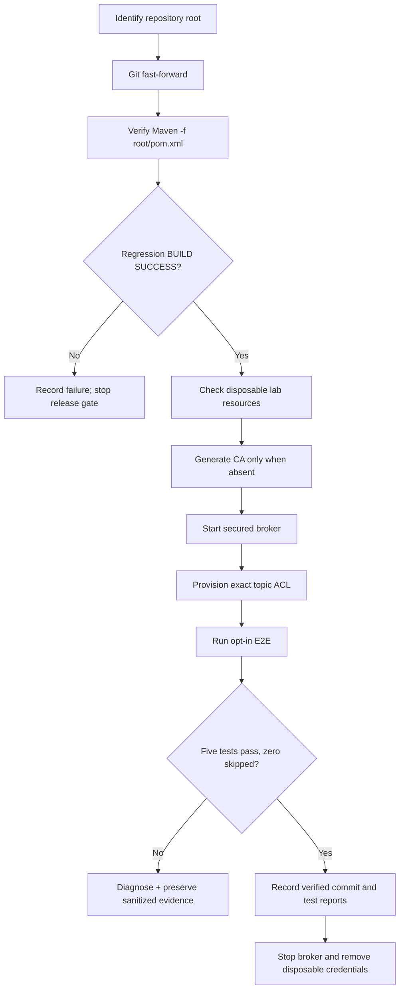

# Chapter 35 — Execution Evidence, Operator Errors and Retrospective Learning

**Purpose:** Preserve the chronology of implementation, local execution,
unexpected outcomes and corrections. This is a living record, **not** a
claim that every historical implementation meets production requirements.

## 1. Use case: reproducible verification from any working directory

**Actor:** developer or release engineer.
**Goal:** verify a Java payment platform and its secured Kafka broker
without mistakenly running Maven in a directory without a project descriptor.
**Risk:** a failed command can be misinterpreted as failing application code,
while later commands proceed and create infrastructure despite the failure.
**Invariant:** no milestone is declared verified until its corresponding
test reports show executed checks (not merely compilation or skipped tests).

### What happened on November 9, 2026

| Stage | Observed evidence | Classification |
| --- | --- | --- |
| Git fetch/fast-forward to `44149dd` | Updated 6 tracked files | Successful source synchronization |
| `mvn clean verify` in `ops/monitoring/kafka-security-lab/` | `MissingProjectException`: no `pom.xml` | Operator working-directory error; **no tests executed** |
| `cd ops/monitoring/kafka-security-lab` | No such directory from inside the same lab directory | Incorrect relative path; shell remains in previous directory |
| `generate-certificates.sh` | `Temporary local mTLS identities generated` | Local credentials created |
| `docker compose up -d` | Broker container started | Container started; **not by itself a proof of broker authorization** |
| `provision-topics-acl.sh` | Output excerpt shows `payment.security.allowed` created | Provisioning partially visible; complete outcome not supplied |
| `run-e2e.sh` | No five-test Maven summary in supplied excerpt | **Pending verification** |

The shell was running multiple commands rather than a single guarded
script. An early Maven failure did not stop later certificate-generation and
Docker commands. This is why automated operational procedures should use
`set -euo pipefail`, explicit root-path discovery, readiness checks, and
clear independently verifiable gates.

**Correction (works from any tracked directory):**

```bash
ROOT="$(git rev-parse --show-toplevel)"
git -C "$ROOT" pull --ff-only origin feat/payment-ledger
mvn -B --no-transfer-progress -f "$ROOT/pom.xml" clean verify
cd "$ROOT/ops/monitoring/kafka-security-lab"
# Do not generate credentials again if generated/ already exists.
docker compose -f compose.yaml ps
bash provision-topics-acl.sh
bash run-e2e.sh
```

If the broker is still running and freshly generated material is present,
reuse it for the current test run. Do **not** regenerate or delete live
credentials merely to follow a tutorial verbatim.

## 2. Earlier milestone retrospective: what / why / how / evidence

These are historical snapshots; read Chapters 1–34 and the linked source
for implementation details. Evidence means the output actually observed,
not a predicted test count.

| Stage | Use case / architectural rationale | Technique | Verified evidence and limits |
| --- | --- | --- | --- |
| 01–06 foundations | Safely represent payment state, tenancy, ledger and request idempotency | Java domain model, Spring REST, PostgreSQL/Flyway, JWT, transactional outbox | Earlier chapters reconstruct design; exact per-commit evidence must be checked |
| 07–14 architecture and API contracts | Stable boundaries and consumer/API compatibility | ArchUnit, API errors, OpenAPI, idempotent inbox, manual Kafka ACK | Tests are documented in individual chapters; distinguish local contract tests from real broker evidence |
| 15–28 contract/recovery and monitoring | Prevent unsafe replay, bad contracts and unnoticed consumer failures | JSON Schema, contract checks, recovery assessment, consumer lag telemetry | Distinguish intentionally insecure test broker from opted-in deployment transport |
| 29–30 Prometheus and real recovery | Detect health/recovery anomalies, prove non-skipping replay behavior | Secure metrics export, Kafka+PostgreSQL Testcontainers recovery drill | Local verified baseline **149 tests** (82 unit + 67 IT); recovery scenario passed |
| 31 Kafka security preflight | Prevent insecure client transport settings | Shared TLS/SASL/hostname checks, three new unit tests | Local verified baseline **152 tests** (85 unit + 67 IT) |
| 32–33 secured broker | Prove TLS and broker ACL behavior, not just config shape | mTLS lab, KRaft authorizer, scoped reader, two real-broker tests | **2/2 E2E passed**, separate from default 152; lab subsequently torn down |
| 34 negative security | Prove missing identity, unrelated CA trust and prohibited Write are rejected | Three additional real-broker E2E cases | **3/3 negative E2E passed** on Nov 9; together with positive tests **5/5 E2E passed** |

### Operational incident: duplicate Flyway migrations

An earlier full Maven run failed to initialize test Spring contexts because
`target/classes/db/migration` contained suffixed duplicates, e.g.
`V1__create_payments 3.sql`, while `src/main/resources/db/migration`
contained only the canonical V1–V8 SQL files. A subsequent
`mvn clean verify` removed stale target output, validated all eight
migrations and passed the regression suite.

**Why it matters:** Flyway requires a unique migration version per
classpath. Never change historical migration versioning, disable Flyway
validation or delete the canonical source migration to work around a
duplicated build artifact. Compare source, target, and Git status first;
then rebuild from a clean output directory.

### Operational incident: incorrect working directory

The developer performed the correct logical stages, but was already in
the Kafka lab directory when the root-relative commands were pasted.
`git pull` succeeds from any tracked subdirectory; `mvn clean verify`
usually needs a nearby `pom.xml`; `cd ops/monitoring/...` expects the
repository root.

**Engineering response:** make runbooks current-directory-independent by
discovering Git root and passing the Maven POM explicitly. If using
independent shell commands, check each exit code before advancing. This
prevents false claims that testing passed.

## Verified continuation — November 9, 2026

After correcting the Maven working-directory issue, the following **actual
local evidence** was supplied. These outcomes supersede the earlier pending
states in the initial Chapter 35 chronology, without changing that history.

| Checkpoint | Observed result | Evidence interpretation |
| --- | --- | --- |
| Application regression, first full run | Failsafe **67 tests, 0 failures/errors/skipped**; BUILD SUCCESS 14:01:27 CET | Combined with its unit suite, the current application baseline is 85 unit + 67 IT |
| Application regression, repeat full run | Surefire **85 tests** and Failsafe **67 tests**; BUILD SUCCESS 14:03:29 CET | Repeated verification of **152 application tests** |
| Secured broker readiness | Container listed **Up**, with `127.0.0.1:19093` published | Development broker was running; not production security evidence alone |
| ACL provisioning | `User:CN=lab-reader` granted only Describe on `payment.security.allowed` | Exact resource scope shown in CLI evidence |
| Positive secured broker tests | **2 tests passed** in `SecuredKafkaBrokerE2E` | Permitted Describe and prohibited Describe checked against broker |
| Negative secured broker tests | **3 tests passed** in `KafkaNegativeSecurityE2E` | Missing client identity, unrelated CA and forbidden producer Write |
| Total secured E2E | **5 tests, 0 failed, 0 errors, 0 skipped**; BUILD SUCCESS 14:03:39 CET | Separate explicit E2E execution, **not** part of the 152 Maven regression test count |

### Failure evidence captured and its meaning

- `SSLHandshakeException` with `PKIX path building failed` appeared
  during the **untrusted CA** test. This is the intended failure to
  establish server-certificate trust.
- `SSLHandshakeException` with `certificate_required` appeared
  during the **missing client certificate** test. This is the intended
  broker-side client-authentication rejection.
- The unauthorized Write test asserted
  `TopicAuthorizationException` rather than treating network timeout
  as successful authorization denial. The test finished without failure.
- **Post-test cleanup verified from a separate terminal transcript:** `docker compose -f compose.yaml down -v` reported removal of the broker container and Docker network. The operator inspected `generated/` (28 directory entries including CA keys, broker/reader PKCS12 keystores, password files and unrelated test-CA material), then ran `rm -r generated/` without a reported error. The output supports normal successful deletion, although a subsequent `test ! -e generated` or `ls` was not captured.
- **Security follow-up:** `admin.properties`, `store.password`, `broker.p12` and `truststore.p12` had mode `0644` while temporarily created. These lab-only files contained sensitive material or trust credentials. Tighten permissions and mount/UID arrangements in the next lab-hardening increment; do not copy this convention into production.
- **State classification:** Milestone 06.7AA application regression and secured E2E tests are verified; lab teardown and credential cleanup completed according to the terminal transcript. No claim is made about backups, iCloud synchronization or forensic erasure of deleted key material.

### Engineering takeaway

**A failing security interaction can cause a passing security test.**
A secure negative test declares success only when the client is
rejected for the intended reason, not when arbitrary connectivity
problems occur. Positive control requests before and after the negative
cases reduce false positives. These cases do not prove credential
rotation, all Kafka ACL operations, a production-hardened KRaft
controller, or a real-money payment workload.

**Test-count discipline:** the project completed **152 application
tests and five additional secured E2E test executions**, or 157 passing
test executions across two distinct suites. Never describe this as one
157-test Maven run.

## 3. Process flow and evidence checkpoints



## 4. Suggested evidence record for each milestone

Create a dated sanitized Markdown record within
`docs/evidence/` or the related learning chapter, with:

- Branch, exact source commit, environment versions, command and working directory
- Intended use case, acceptance criteria, failure hypothesis and test IDs
- Actual Maven test totals and counts of failures/errors/skips
- Infrastructure state, broker security protocol and ACL principal
- Root cause if failure occurred, corrective action, rerun result
- Production-readiness limitations, operational cleanup and follow-up work

Never commit private certificates, token values, passwords, raw JAAS
configuration or full sensitive environment logs.

## 5. Retrospective documentation backlog (historical chapters)

A chapter existing is **not equivalent to complete evidence**.
The review order is:

1. **Chapters 01–06:** reconstruct real business actors, invariants,
   payment lifecycle, data schema, tenant isolation, error paths and SQL.
2. **Chapters 07–14:** add package ownership, boundary diagrams, API
   contract changes, OpenAPI breakage examples, reusable tests and
   rollback rules.
3. **Chapters 15–28:** align consumer event contract, inbox, offset
   semantics, poison-event operations and monitoring with actual classes.
4. **Chapters 29–34:** reconcile state of real-broker security tests,
   metrics permissions, current CLI commands and sanitized evidence.
5. **Cross-cutting:** maintain C4 context/container/component, sequence
   diagrams, ADRs, runbooks, threat models and interview answers tied to
   source paths and implementation commits.

Track gaps before changing production code; do not rewrite evidence to
make old decisions appear tested. An earlier documented assumption should
remain labeled historical until revalidated.

## 6. Interview rehearsal

**Why did Maven fail when the code did not?** Maven used the working
directory to discover the POM. The shell was inside a subdirectory
without a POM, so Maven never reached compilation or test phases.

**Why is `BUILD SUCCESS` insufficient for opt-in security tests?** Maven
may succeed with tests skipped or without discovering that class. Check
Surefire/Failsafe reports and the required exact positive/negative cases.

**How do you distinguish readiness, setup and proof?** Running a container
is setup; topic creation is provisioning; authenticated Describe and
broker-side denial assertions are test evidence. A release gate requires
the correct evidence for each claimed security property.

**How do you preserve engineering knowledge?** Keep implementation,
architecture decisions, sequence diagrams, operational chronology,
test evidence and lessons learned versioned together. Explicitly track
known gaps and changes to accepted practices.


## Milestone 06.7AB — November 9, 2026 verified execution

**Source baseline:** developer pulled `feat/payment-ledger` through
`0c5eaa3` before testing. A Maven invocation anchored to the repository's
`pom.xml` completed at **17:58:51 CET** with **85 unit tests** and **67
application integration tests**, no failures, errors or skips. PostgreSQL
17 Testcontainers, Kafka Testcontainers, and eight Flyway migrations were
exercised as part of the ordinary application regression.

The separate mTLS-secured broker E2E invocation completed at
**17:59:16 CET** with **9 tests, 0 failures, 0 errors, 0 skipped**:

- `KafkaPrincipalAuthorizationE2E`: **4 passed** (dedicated producer
  permitted Write, producer denied other topic, consumer permitted approved
  group, consumer denied forbidden group).
- `SecuredKafkaBrokerE2E`: **2 passed** (allowed Describe and restricted
  topic denial).
- `KafkaNegativeSecurityE2E`: **3 passed** (missing client certificate,
  unrelated CA truststore, and forbidden Write by the Describe-only client).

**Expected failure log signals** included
`GroupAuthorizationException` for `payment-security-forbidden`, and
TLS exceptions for an untrusted CA and a missing client identity. An approved
consumer group also logged a transient `NotCoordinatorException` while
joining; its test nevertheless passed. These exceptions must be evaluated
in the context of explicit assertions, not by grepping for the word ERROR.

**Evidence limit:** only this local developer execution is supported;
this does not prove production Kafka authorization, real payment movement,
producer idempotence permissions or certificate rotation. The initial execution
log did not show cleanup; a subsequent terminal transcript confirms that
`docker compose -f compose.yaml down -v` removed the broker container and
Docker network. The operator listed the disposable `generated/` directory,
including producer and consumer certificates and temporary password material,
then executed `rm -r generated/` without a reported error. A separate
post-deletion filesystem check was not captured. This confirms ordinary
cleanup evidence, not irreversible erasure from backups or synchronized storage.

**Learning point:** Kafka topic Write, topic Read and group Read are distinct
permissions, exercised with separate service certificates. A passing
negative security test is a precisely asserted, intentional refusal—not
an arbitrary connection failure. Record both the successful baseline and
the negative rejection when demonstrating least privilege.

### Cleanup security observation (06.7AB)

The disposable credentials were generated with the expected distinct
`lab-producer` and `lab-consumer` identities. The terminal listing also
shows `admin.properties`, `broker.p12`, `truststore.p12`, and
`store.password` with permission mode `0644`. This allows read access
to other local accounts where operating-system permissions permit it;
the `generated/` directory was `0755`. The local Docker bind-mount
workaround should be replaced with narrowly permissioned runtime
secret delivery (for example a dedicated broker UID/GID or copied
secrets with `0600` or `0640` as appropriate) before any
production-inspired credential-management exercise. Do not rely on
`rm` for assured deletion from backups or cloud-synced storage.


## 06.7AC — Architecture review triggered by a failed test (November 9, 2026)

**Design review result: REWORK. Do not mark the milestone verified.**

The developer ran the standard application Maven regression and the opt-in
Kafka E2E lab after code implementing a new `lab-idempotent-producer`
principal. The outputs revealed **two independent failure modes**:

| Gate | Evidence | Classification |
| --- | --- | --- |
| Application integration | 67 tests executed, 11 errors (8 `SimulatedLedgerServiceIT`, 3 `PrometheusMetricsSecurityIT`); `BUILD FAILURE` | Flyway could not initialize a Spring context because it found duplicate V1 migrations in `target/classes/db/migration` |
| Secured Kafka broker | 12 tests executed, 1 assertion failure; `BUILD FAILURE` | `topicWriteAloneCannotAuthorizeIdempotentProducerId` expected a rejection, but Kafka accepted the idempotent send |
| Negative topic authorization | Idempotent producer targeting `payment.security.denied` logged `TOPIC_AUTHORIZATION_FAILED` | Correct broker topic-level denial; not a failure by itself |

The duplicate migration output included
`V1__create_payments 2.sql` as well as the canonical
`V1__create_payments.sql`. A synced filesystem is one potential source of
conflicting output files, but the uploaded log does **not** prove a cause.
Inspect the canonical source directory and generated target directory
separately before deleting anything.

The unexpected successful idempotent send led to research of
**Apache Kafka KIP-679**. Since Kafka 2.8, nontransactional producer-ID
initialization can authorize a client holding topic Write permission without
requiring a separate cluster IdempotentWrite ACL. The originally written
test and extra cluster grant were therefore inappropriate for the current
Kafka 4.1.2 lab.

**Corrective action (committed, unverified):** remove the redundant
`lab-idempotent-producer` identity and its cluster grant, replace the
obsolete negative assertion with a positive idempotent send using
`lab-producer`, and assert `TopicAuthorizationException` for the
Describe-only identity and the forbidden destination topic.

**Lessons for senior engineering:** do not force reality to conform to an
old documentation table. When a test fails, independently challenge the
requirement, environment and assertion as well as the implementation.
Preserve both the false assumption and its evidence as an architectural
decision correction. Never combine independent Maven failures into a
single fabricated root cause. Consult [Chapter 37](37-kafka-idempotent-producer-authorization.md)
for the detailed design review and reproducible rerun.

**Latest verified baseline remains:** 152 application tests and 9 secured
broker E2E from milestone 06.7AB, **not** the failed 06.7AC execution.


### November 10, 2026 — focused Kafka correction verified

The developer fast-forwarded local branch to `1d5fa35`, confirmed the
obsolete test name was removed, and reran `run-e2e.sh` against the
existing broker. **12 secured-broker E2E tests passed, zero failures,
errors or skips; BUILD SUCCESS at 04:38:28 CET**. This validates the
corrected test code against a running secured broker, **not** the removal
of the obsolete IdempotentWrite ACL from an already-provisioned cluster.
Do not spend another full lab iteration solely to close that known
provisioning-evidence gap; track it separately and prioritize core
payment functionality. The independent Flyway duplicate-V1 problem
remains open and is not resolved by this Kafka success.


### November 10, 2026 — Flyway incident closed; domain transition guard added

The developer removed generated Maven `target/` output and ran
`mvn -B --no-transfer-progress -f "$ROOT/pom.xml" clean verify`.
The submitted run reported **BUILD SUCCESS**, **85 unit tests** and
**67 integration tests**, all passing. Flyway validated/applied exactly
**eight migrations** in the new PostgreSQL Testcontainers databases.
The prior duplicate `V1__create_payments 2.sql` was confined to
generated `target/classes`, not versioned migrations. Removing generated
build output resolved the incident; why the duplicates appeared
(working directory under iCloud Drive is a hypothesis) remains unproven.

**Next increment: business lifecycle regression coverage.**
A compact test in `PaymentStateMachineTest` enumerates all 36
(current, target) combinations of the six simulated payment states.
An independently authored business matrix expects **seven allowed**
transitions and **29 forbidden**, including self-transitions and
terminal-state escapes. No application logic or architecture was
changed. Test added to the connected GitHub branch but **not yet
executed locally**.

**Six-question review:** (1) business objective: prevent invalid
simulated authorization/capture/refund state changes; (2) 10× traffic:
pure in-memory constant-size rule and test, not a throughput bottleneck;
(3) dependency failure: no external dependency in the policy;
(4) simpler: reuse existing domain class, no new framework;
(5) optimization: payment correctness and inexpensive regression
evidence; (6) six-month regret: the duplicated matrix must be
intentionally updated when business policy changes, otherwise the test
should fail and force a deliberate review.

**Next focused validation (no Kafka lab):**
`mvn -B -q -f "$ROOT/pom.xml" -Dtest=PaymentStateMachineTest test`.
Full CI `clean verify` should still run before merge, not after each
trivial test-only commit. Production settlement or refunds are not
implemented by this test.


### Next business increment — full simulated refund ledger reversal (November 10, 2026)

**Senior-engineering gate — GO for a focused implementation, pending local verification.**
The existing internal `SimulatedPaymentTransitionService` already atomically
persists the state change, ledger capture journal and outbox event.
However, `CAPTURED -> REFUNDED` previously only changed status and wrote
an outbox message: it did **not** reverse the capture's accounting entries.
That is an accounting correctness gap.

**Decision:** For the current single-currency, full-refund-only simulation,
append a second balanced *compensating* journal whose two posting sides
are inverted, using the payment's persisted amount and currency. Do not
alter or delete the capture journal. The reversal is written within the
same PostgreSQL transaction as the status update and refund outbox
event. Existing event-ID uniqueness and payment row lock preserve
retry behavior. There is deliberately no refund HTTP route and no
external payment-provider or funds transfer integration.

**Architecture and six-question review:**
1. **Why?** Refund status must not leave the simulated capture ledger
   economically outstanding; append-only audit history is retained.
2. **10× traffic?** Each full refund now writes one extra journal and
   two postings; benchmark write latency, lock contention and index
   growth before changing the design.
3. **Dependency failure?** A ledger uniqueness/constraint failure rolls
   back the refund status and outbox event in the same DB transaction.
4. **Simpler?** Reuse existing service, `JournalEntry` and database
   schema; no new event transport, tables or abstraction.
5. **Optimization?** Atomic accounting correctness, idempotent retries,
   clear audit trail and minimal changes.
6. **Six-month regret?** Refund amount is currently the **entire**
   original capture amount; partial/multiple refunds, fees, external
   settlement and linked compensating-entry IDs are out of scope.
   These would require an explicit domain design, not ad-hoc status updates.

**Focused Testcontainers integration tests (committed; NOT executed yet):**
- Capture then full refund: exactly two journals, opposite posting
  sides, three outbox events and stable replay result.
- Ledger event-ID collision during refund: previous CAPTURED state,
  one existing journal and no refund outbox record survive.

**Run locally after pulling the branch:**
```bash
ROOT="$(git rev-parse --show-toplevel)"
git -C "$ROOT" pull --ff-only origin feat/payment-ledger
mvn -B -q -f "$ROOT/pom.xml" -Dit.test=SimulatedPaymentTransitionServiceIT -DskipTests=false -Dtest=NoSuchTest -Dsurefire.failIfNoSpecifiedTests=false verify
```
The command above targets the Failsafe class but may also invoke the
normal packaging lifecycle; see the Maven Surefire/Failsafe reports
for exact tests executed. The full `clean verify` remains the CI gate
before merge.

**Status of prior small unit-test increment:** `PaymentStateMachineTest`
was run locally with Maven `-q` and returned to the shell without
an error; this provides a successful exit indication, but not an
independent test-count report.
