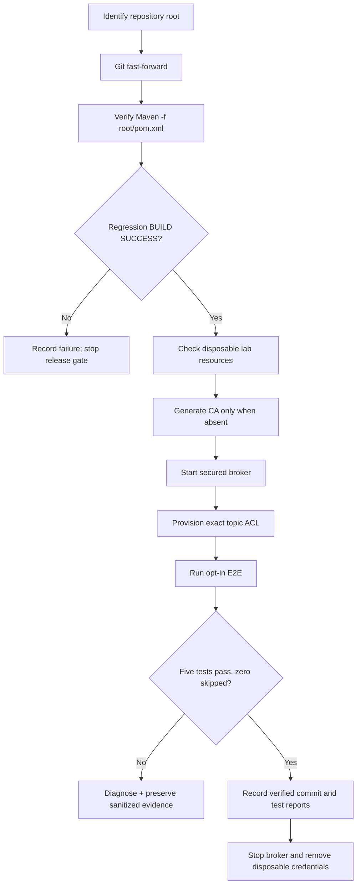

# Chapter 35 — Execution Evidence, Operator Errors and Retrospective Learning

**Purpose:** Preserve the chronology of implementation, local execution,
unexpected outcomes and corrections. This is a living record, **not** a
claim that every historical implementation meets production requirements.

## 1. Use case: reproducible verification from any working directory

**Actor:** developer or release engineer.
**Goal:** verify a Java payment platform and its secured Kafka broker
without mistakenly running Maven in a directory without a project descriptor.
**Risk:** a failed command can be misinterpreted as failing application code,
while later commands proceed and create infrastructure despite the failure.
**Invariant:** no milestone is declared verified until its corresponding
test reports show executed checks (not merely compilation or skipped tests).

### What happened on November 9, 2026

| Stage | Observed evidence | Classification |
| --- | --- | --- |
| Git fetch/fast-forward to `44149dd` | Updated 6 tracked files | Successful source synchronization |
| `mvn clean verify` in `ops/monitoring/kafka-security-lab/` | `MissingProjectException`: no `pom.xml` | Operator working-directory error; **no tests executed** |
| `cd ops/monitoring/kafka-security-lab` | No such directory from inside the same lab directory | Incorrect relative path; shell remains in previous directory |
| `generate-certificates.sh` | `Temporary local mTLS identities generated` | Local credentials created |
| `docker compose up -d` | Broker container started | Container started; **not by itself a proof of broker authorization** |
| `provision-topics-acl.sh` | Output excerpt shows `payment.security.allowed` created | Provisioning partially visible; complete outcome not supplied |
| `run-e2e.sh` | No five-test Maven summary in supplied excerpt | **Pending verification** |

The shell was running multiple commands rather than a single guarded
script. An early Maven failure did not stop later certificate-generation and
Docker commands. This is why automated operational procedures should use
`set -euo pipefail`, explicit root-path discovery, readiness checks, and
clear independently verifiable gates.

**Correction (works from any tracked directory):**

```bash
ROOT="$(git rev-parse --show-toplevel)"
git -C "$ROOT" pull --ff-only origin feat/payment-ledger
mvn -B --no-transfer-progress -f "$ROOT/pom.xml" clean verify
cd "$ROOT/ops/monitoring/kafka-security-lab"
# Do not generate credentials again if generated/ already exists.
docker compose -f compose.yaml ps
bash provision-topics-acl.sh
bash run-e2e.sh
```

If the broker is still running and freshly generated material is present,
reuse it for the current test run. Do **not** regenerate or delete live
credentials merely to follow a tutorial verbatim.

## 2. Earlier milestone retrospective: what / why / how / evidence

These are historical snapshots; read Chapters 1–34 and the linked source
for implementation details. Evidence means the output actually observed,
not a predicted test count.

| Stage | Use case / architectural rationale | Technique | Verified evidence and limits |
| --- | --- | --- | --- |
| 01–06 foundations | Safely represent payment state, tenancy, ledger and request idempotency | Java domain model, Spring REST, PostgreSQL/Flyway, JWT, transactional outbox | Earlier chapters reconstruct design; exact per-commit evidence must be checked |
| 07–14 architecture and API contracts | Stable boundaries and consumer/API compatibility | ArchUnit, API errors, OpenAPI, idempotent inbox, manual Kafka ACK | Tests are documented in individual chapters; distinguish local contract tests from real broker evidence |
| 15–28 contract/recovery and monitoring | Prevent unsafe replay, bad contracts and unnoticed consumer failures | JSON Schema, contract checks, recovery assessment, consumer lag telemetry | Distinguish intentionally insecure test broker from opted-in deployment transport |
| 29–30 Prometheus and real recovery | Detect health/recovery anomalies, prove non-skipping replay behavior | Secure metrics export, Kafka+PostgreSQL Testcontainers recovery drill | Local verified baseline **149 tests** (82 unit + 67 IT); recovery scenario passed |
| 31 Kafka security preflight | Prevent insecure client transport settings | Shared TLS/SASL/hostname checks, three new unit tests | Local verified baseline **152 tests** (85 unit + 67 IT) |
| 32–33 secured broker | Prove TLS and broker ACL behavior, not just config shape | mTLS lab, KRaft authorizer, scoped reader, two real-broker tests | **2/2 E2E passed**, separate from default 152; lab subsequently torn down |
| 34 negative security | Prove missing identity, unrelated CA trust and prohibited Write are rejected | Three additional real-broker E2E cases | Implemented; supplied log stops before complete test result |

### Operational incident: duplicate Flyway migrations

An earlier full Maven run failed to initialize test Spring contexts because
`target/classes/db/migration` contained suffixed duplicates, e.g.
`V1__create_payments 3.sql`, while `src/main/resources/db/migration`
contained only the canonical V1–V8 SQL files. A subsequent
`mvn clean verify` removed stale target output, validated all eight
migrations and passed the regression suite.

**Why it matters:** Flyway requires a unique migration version per
classpath. Never change historical migration versioning, disable Flyway
validation or delete the canonical source migration to work around a
duplicated build artifact. Compare source, target, and Git status first;
then rebuild from a clean output directory.

### Operational incident: incorrect working directory

The developer performed the correct logical stages, but was already in
the Kafka lab directory when the root-relative commands were pasted.
`git pull` succeeds from any tracked subdirectory; `mvn clean verify`
usually needs a nearby `pom.xml`; `cd ops/monitoring/...` expects the
repository root.

**Engineering response:** make runbooks current-directory-independent by
discovering Git root and passing the Maven POM explicitly. If using
independent shell commands, check each exit code before advancing. This
prevents false claims that testing passed.

## 3. Process flow and evidence checkpoints



## 4. Suggested evidence record for each milestone

Create a dated sanitized Markdown record within
`docs/evidence/` or the related learning chapter, with:

- Branch, exact source commit, environment versions, command and working directory
- Intended use case, acceptance criteria, failure hypothesis and test IDs
- Actual Maven test totals and counts of failures/errors/skips
- Infrastructure state, broker security protocol and ACL principal
- Root cause if failure occurred, corrective action, rerun result
- Production-readiness limitations, operational cleanup and follow-up work

Never commit private certificates, token values, passwords, raw JAAS
configuration or full sensitive environment logs.

## 5. Retrospective documentation backlog (historical chapters)

A chapter existing is **not equivalent to complete evidence**.
The review order is:

1. **Chapters 01–06:** reconstruct real business actors, invariants,
   payment lifecycle, data schema, tenant isolation, error paths and SQL.
2. **Chapters 07–14:** add package ownership, boundary diagrams, API
   contract changes, OpenAPI breakage examples, reusable tests and
   rollback rules.
3. **Chapters 15–28:** align consumer event contract, inbox, offset
   semantics, poison-event operations and monitoring with actual classes.
4. **Chapters 29–34:** reconcile state of real-broker security tests,
   metrics permissions, current CLI commands and sanitized evidence.
5. **Cross-cutting:** maintain C4 context/container/component, sequence
   diagrams, ADRs, runbooks, threat models and interview answers tied to
   source paths and implementation commits.

Track gaps before changing production code; do not rewrite evidence to
make old decisions appear tested. An earlier documented assumption should
remain labeled historical until revalidated.

## 6. Interview rehearsal

**Why did Maven fail when the code did not?** Maven used the working
directory to discover the POM. The shell was inside a subdirectory
without a POM, so Maven never reached compilation or test phases.

**Why is `BUILD SUCCESS` insufficient for opt-in security tests?** Maven
may succeed with tests skipped or without discovering that class. Check
Surefire/Failsafe reports and the required exact positive/negative cases.

**How do you distinguish readiness, setup and proof?** Running a container
is setup; topic creation is provisioning; authenticated Describe and
broker-side denial assertions are test evidence. A release gate requires
the correct evidence for each claimed security property.

**How do you preserve engineering knowledge?** Keep implementation,
architecture decisions, sequence diagrams, operational chronology,
test evidence and lessons learned versioned together. Explicitly track
known gaps and changes to accepted practices.
