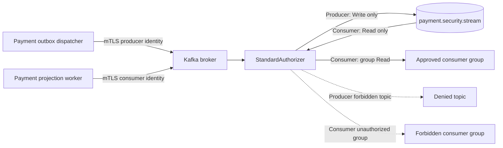
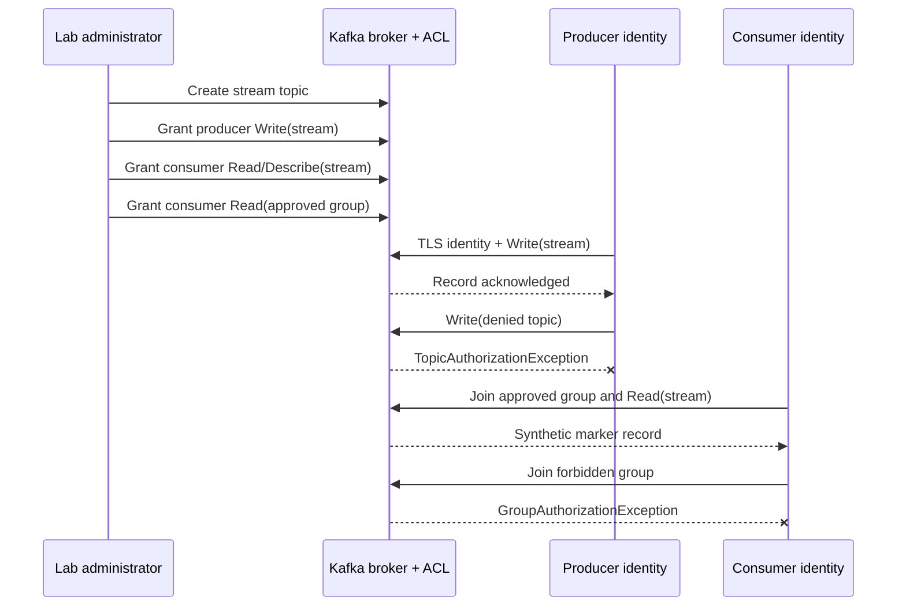

# Chapter 36 — Kafka Producer and Consumer Group Least Privilege

**Milestone:** 06.7AB. **State:** implemented and committed, **not yet executed** on the development Mac.
**Previous verified checkpoint:** 152 application tests and 5 secured-broker E2E tests passed on November 9, 2026. The new suite expects 9 E2E tests.

## 1. Business use case

A payment platform's outbox dispatcher publishes payment-state notifications,
while an independently deployed projection service consumes them. Their
machine identities must not receive interchangeable broker permissions.
A compromised projection should not be able to forge new payment events.
A compromised publisher must not acquire arbitrary consumer-group membership
or read confidential topics.

| ID | Actor | Allowed operation | Negative security boundary |
| --- | --- | --- | --- |
| KSEC-04 | Publisher service | Write to `payment.security.stream` | Cannot Write to `payment.security.denied` |
| KSEC-05 | Projection service | Read `payment.security.stream` using group `payment-security-approved` | Cannot join `payment-security-forbidden` |

Use cases involve only deliberately synthetic probe records, not actual
payment events or transfers.

## 2. What was introduced

- Two ephemeral PKCS12 identities: certificate principals
  `User:CN=lab-producer` and `User:CN=lab-consumer`.
- A dedicated existing topic `payment.security.stream` so older reader
  `Describe` authorization tests retain their own ACL scope.
- An exact `Write` topic ACL for the producer, no ACL on the denied topic.
- An exact topic `Read` plus `Describe` ACL for the consumer, along with
  `Read` on one named consumer group.
- Four opt-in tests in `KafkaPrincipalAuthorizationE2E`.
- An updated `run-e2e.sh` invoking all three E2E classes.

**Locations:** `ops/monitoring/kafka-security-lab/generate-certificates.sh`,
`provision-topics-acl.sh`, `run-e2e.sh` and
`src/test/java/dev/asambataiden/payment/payments/messaging/kafka/security/KafkaPrincipalAuthorizationE2E.java`.

## 3. Why: identity versus permission

mTLS answers **who is connected**. Kafka ACLs answer **which actions
on which resources** are permitted to that identity. A certificate
being valid does not authorize Publish, topic Read or group membership.

Kafka's group `Read` permission is separate from topic `Read`.
Even a consumer whose certificate can access a topic should not be
allowed to join any group name it chooses. Conversely, permission on
a consumer group does not authorize reading arbitrary topics.

The administrator certificate is used only for provisioning; neither
test identity is a superuser. Denied operations target resources that
exist, preventing unknown-topic errors from masquerading as ACL proof.

## 4. Architectural view



## 5. Execution sequence



## 6. Hands-on exercise (repeatable from any repo subdirectory)

Prerequisites: JDK 25, Maven, Docker Desktop, Compose, OpenSSL and keytool.
Earlier lab credentials were removed, so a fresh generation is expected.
If `generated/` already exists, do **not** regenerate credentials or delete
live material without confirming the lab state.

```bash
ROOT="$(git rev-parse --show-toplevel)"
git -C "$ROOT" pull --ff-only origin feat/payment-ledger
mvn -B --no-transfer-progress -f "$ROOT/pom.xml" clean verify

cd "$ROOT/ops/monitoring/kafka-security-lab"
bash generate-certificates.sh
docker compose -f compose.yaml up -d
bash provision-topics-acl.sh
bash run-e2e.sh
```

**Acceptance criteria (not yet verified):**

- 152 default application tests, assuming no unrelated regression.
- 2 existing positive broker E2E, 3 existing negative security E2E.
- 4 additional producer and consumer authorization E2E:
  1. Authorized producer publishes dummy event to the stream.
  2. Producer publishing to the denied topic receives
     `TopicAuthorizationException`.
  3. Approved consumer group retrieves a uniquely identified marker.
  4. Consumer joining the forbidden group receives
     `GroupAuthorizationException`.
- Target total: **9 real secured-broker E2E** passes, with zero failed,
  errored or skipped tests. Until the developer shares output this remains
  an expected result, **not recorded evidence**.

The test itself sets `enable.auto.commit=false` and uses a synthetic
marker rather than making a payment business state change.

## 7. Design decisions and operational limitations

**Separate identities:** each service has its own certificate and scoped ACL;
do not share the lab admin certificate with an application workload.

**Exact ACL resources:** the lab uses exact topic and group names rather than
broad wildcard permissions. Production environments should also restrict
client certificates, principal mapping, role bindings and administration.

**Deliberate idempotence trade-off:** the test publisher sets
`enable.idempotence=false` only to isolate topic-level Write permission
without introducing the broker's idempotent-write authorization in the
same drill. This is **not** a recommended production producer setting.
The application producer has separate stronger reliability settings; a later
milestone must verify real idempotent producer authorization and delivery
guarantees with the appropriate ACL grants.

**Consumer group test:** group authorization is exercised through real
`subscribe`/`poll`, not through manual partition `assign`. The latter
can bypass group membership and therefore cannot prove the group ACL.

**Determinism:** the permitted consumer looks for a UUID-tagged marker.
Its test group is fixed and auto-commit disabled; repeated runs should
not rely on historical committed offsets. The lab is disposable and is
recreated between sessions.

**Lab-specific exception:** the combined broker/controller uses an internal
PLAINTEXT controller listener and `User:ANONYMOUS` superuser for the
isolated local controller path. It must never be copied into production.

**Credential management:** generated material stays Git-ignored. Some lab
broker input files currently use `0644` for nonroot-container
compatibility. Secure delivery of broker credentials, certificate
rotation and private permissioned mounts are open hardening tasks.

## 8. How to diagnose failures

| Symptom | Likely boundary | Action |
| --- | --- | --- |
| `TopicAuthorizationException` on producer's approved stream | Topic Write ACL or principal | Inspect ACL and mTLS mapped principal |
| `GroupAuthorizationException` on approved group | Group Read ACL | Inspect exact group name and ACL |
| `TopicAuthorizationException` on forbidden topic | Expected deny outcome | Validate actual exception type |
| `GroupAuthorizationException` on forbidden group | Expected deny outcome | Validate actual exception type |
| `TimeoutException` instead of denial | Connectivity, metadata or stalled broker | Check broker health and logs; **do not count as ACL pass** |
| Valid producer send but consumer sees no marker | Poll loop, group assignment or offset | Verify group membership, permissions, topic and marker |
| TLS handshake fails for approved identity | Truststore, SAN, certificate expiration | Fix credentials without disabling hostname verification |

After test execution, capture sanitized Maven and broker logs before cleanup:

```bash
docker compose -f compose.yaml ps
docker compose -f compose.yaml logs --tail=100 broker
docker compose -f compose.yaml down -v
ls -la generated/
# Remove ONLY after verifying this is the disposable lab's generated directory.
rm -r generated/
```

Never commit or paste passwords, private keys, PKCS12 keystores or complete
admin client config containing credentials.

## 9. Interview preparation

**Why do Kafka consumers need both topic and group ACLs?**
Topic Read grants access to data in a topic; group Read governs coordinated
group membership and offset management. The two must be explicitly scoped.

**How do you prove the group ACL is enforced?**
Use `subscribe` and `poll` with a real group and assert
`GroupAuthorizationException` for a known unapproved group.

**Why use different producer and consumer certificates?**
Separate identities restrict lateral movement and enable independent
credential revocation, auditing and policy changes.

**Why isn't producer idempotence exercised here?**
This increment isolates Write and group Read authorization. Idempotent
producer authentication and permissions add a distinct security/reliability
surface and must be validated separately without weakening production
settings.

**Can this prove production readiness?**
No. It exercises four broker permissions in one disposable KRaft
development topology. Production readiness also requires managed
secrets, secured controllers, replication, auditability and failure
recovery, plus deployment-specific network and policy checks.
