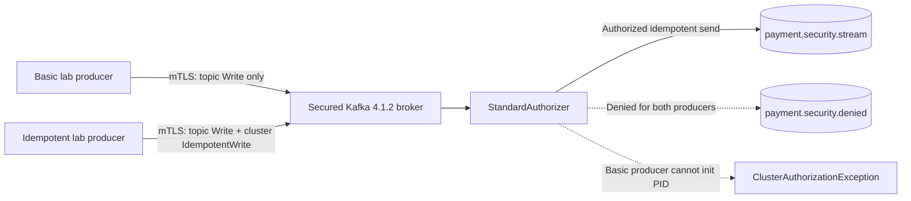
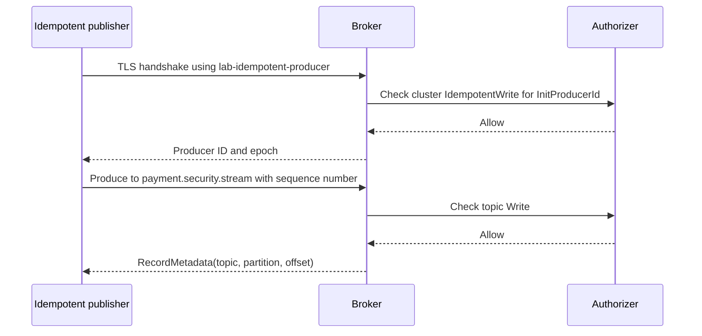

# Chapter 37 — Kafka Idempotent Producer Authorization

**Milestone:** 06.7AC — code committed; local verification **pending**.
**Previously verified:** 152 application tests + 9 secured broker E2E executions.
**Target:** 12 real-broker E2E executions (9 prior + 3 additional).

## 1. Payment-system use case: resilient publishing without privilege escalation

The payment outbox publisher must tolerate retryable network failures without
unnecessarily duplicating a record within a producer session. At the same time,
a compromised client that can publish to one topic must not automatically gain
cluster-wide privileges or the ability to publish to other topics.

**Business actors:** payment outbox dispatcher (producer), broker security
administrator, payment-event consumer and platform operator. The lab tests
synthetic records and *does not* move money.

### Acceptance criteria

| ID | Identity / authorization | Scenario | Expected result |
| --- | --- | --- | --- |
| KSEC-06 | Idempotent producer: topic Write + cluster IdempotentWrite | Send to allowed stream using `enable.idempotence=true` | Broker acknowledges an offset |
| KSEC-07 | Basic producer: topic Write only | Attempt idempotent send / producer ID initialization | `ClusterAuthorizationException` |
| KSEC-08 | Idempotent producer: has cluster grant, but no Write on restricted topic | Send to forbidden topic | `TopicAuthorizationException` |

The negative cases must fail for the **correct Kafka authorization reason**.
A timeout, bad TLS identity or unavailable broker is not proof that the ACL is
correctly enforced.

## 2. What is Kafka producer idempotence?

Kafka allocates a producer ID (PID) and uses producer sequence numbers to
recognize duplicate retries of a batch from the same producer session.
This mitigates duplicates from **broker/client retry of a send**. It does
not deduplicate arbitrary *new application-level sends* with the same
business event ID, nor guarantee end-to-end exactly-once payment processing.

The existing application design uses an outbox/inbox and business
idempotency controls for these independent failure surfaces.

**Required producer settings for this exercise:**

- `enable.idempotence=true`
- `acks=all`
- `retries>0`
- `max.in.flight.requests.per.connection<=5`
- `transactional.id` not configured (this is not a Kafka transaction lab)

For operational production reliability, retry budgets and timeouts must
follow the actual service-level objective and fault model. Three client
retries and short deadlines here bound a disposable test; they are not
a universal production recommendation.

## 3. Why two ACL scopes are tested

The Kafka authorizer checks topic `Write` independently of cluster
`IdempotentWrite` for nontransactional idempotent publishing. A
`transactional.id` introduces another distinct resource and authorization
model, which is deliberately out of scope.

**Principal separation:**

- `User:CN=lab-producer` has only topic `Write`, preserving the previous
  non-idempotent producer tests and demonstrating the missing grant.
- `User:CN=lab-idempotent-producer` has topic `Write` on
  `payment.security.stream` and cluster `IdempotentWrite`.
- Neither producer is a broker superuser.
- Neither producer may write to the existing
  `payment.security.denied` topic.

The `IdempotentWrite` grant is cluster-scoped because Kafka defines that
authorization resource at cluster level. It must not be confused with a
wildcard topic Write grant. <https://kafka.apache.org/40/security/authorization-and-acls/>

## 4. Architecture and trust boundaries





**Negative sequence:** `lab-producer` can satisfy topic Write but lacks
cluster IdempotentWrite, so producer-ID initialization should fail with a
cluster authorization error. Even the `lab-idempotent-producer` cannot
write to the restricted topic.

## 5. Exact implementation changes

1. `generate-certificates.sh`: create `lab-idempotent-producer.p12` and
   temporary client key/certificate, signed by the lab CA.
2. `provision-topics-acl.sh`: grant exact topic Write and cluster
   IdempotentWrite to the new principal. The older principal keeps only
   topic Write.
3. `KafkaIdempotentProducerAuthorizationE2E.java`: implement three
   dedicated external-broker tests, including explicit assertions for
   the expected Kafka error cause.
4. `run-e2e.sh`: check for the new keystore, inject its path and
   include the new class in the opt-in suite.

The test does not deserialize real payment events or modify the payment DB.
It checks the broker's principal/ACL enforcement and producer acknowledgement.

## 6. Step-by-step reproducible tutorial

The previously verified lab credentials were removed after milestone 06.7AB.
Start from any tracked repository subdirectory:

```bash
ROOT="$(git rev-parse --show-toplevel)"
git -C "$ROOT" pull --ff-only origin feat/payment-ledger

# Application regression: retains the established baseline
mvn -B --no-transfer-progress -f "$ROOT/pom.xml" clean verify

cd "$ROOT/ops/monitoring/kafka-security-lab"
bash generate-certificates.sh
docker compose -f compose.yaml up -d
bash provision-topics-acl.sh
bash run-e2e.sh
```

**Expected but NOT yet verified:** 85 unit + 67 application integration
tests (152 in the default Maven build) and 12 secured-broker E2E tests in
a **separate opt-in** execution. Never record 164 as the count in a
single Maven run.

Before interpreting a failed test, check the exact producer principal and
the broker ACL listing. The denied tests should report
`ClusterAuthorizationException` or `TopicAuthorizationException`, not
a generic timeout.

## 7. Security and operations practices

- Use independent mTLS credentials per principal; never use the lab
  administrator's certificate to execute payment publishing.
- Apply topic Write to exact resources. Keep IdempotentWrite scoped to
  the Kafka-defined cluster operation; do not grant general cluster All.
- Keep hostname verification enabled; fail closed on unknown brokers.
- Avoid hardcoding keystore passwords in application source or Maven CLI
  arguments. Generated credentials are Git-ignored and disposable.
- Preserve the separate negative authorization tests so a future
  accidental ACL expansion causes a **red** regression.
- A successful idempotent send tests configuration plus authorization;
  it **does not demonstrate** exactly-once business processing,
  retry de-duplication under failure, or transactional producer fencing.
- The Kafka lab is a single-node, combined controller/broker topology with
  a controller PLAINTEXT listener and anonymous controller superuser
  exception. Production must use a secured controller architecture,
  independently managed secrets and broker replication.
- A previous audit identified local password/broker material using
  permissions `0644`; avoid treating this Docker Desktop compatibility
  workaround as production-grade secret management.

### Technical alternatives and ADR discussion

**A. Keep idempotence off:** simplest permission profile, but unsafe as
a generic production recommendation because client retries can duplicate
records. Used only in the previous isolation test.

**B. Enable idempotence, grant cluster IdempotentWrite (chosen):**
validates the nontransactional idempotent producer's minimum additional
permission without granting arbitrary topic access.

**C. Use transactional producer:** provides a different authorization
model and coordination semantics. More complexity and not a substitute
for outbox/inbox or database business invariants. Requires a separate
transactional-ID and `read_committed` design review.

## 8. Troubleshooting guide

| Symptom | Interpretation / fix |
| --- | --- |
| `ClusterAuthorizationException` on the explicitly authorized idempotent identity | Confirm exact cluster IdempotentWrite ACL and mapped certificate CN |
| `ClusterAuthorizationException` on topic-Write-only identity | Expected negative test; confirm legitimate identity still succeeds |
| `TopicAuthorizationException` on denied topic | Expected negative test |
| SSL handshake error for permitted identity | Verify CA, SAN, keystore, expiry and hostname checks |
| Timeout rather than authorization exception | Check broker readiness, metadata routing and ACL setup; don't count it as a pass |
| Wrong Maven working directory | Invoke Maven with `-f "$ROOT/pom.xml"` |
| Failed rerun after previous cleanup | Regenerate short-lived lab material only when `generated/` is absent |

### After-test teardown

```bash
docker compose -f compose.yaml down -v
ls -la generated/
# Confirm only disposable lab files exist before removal:
rm -r generated/
```

The `rm` command is not a guarantee of forensic erasure, particularly
when storage may have backups or synchronization enabled.

## 9. Interview questions with answers

**What is the difference between Kafka idempotence and business idempotency?**
Producer idempotence suppresses duplicate broker retries within a producer
session. Business idempotency guards payment intents/events across retries,
restarts and independently created requests.

**Which ACLs does a nontransactional idempotent producer need?**
A topic Write grant for its destination and the Kafka IdempotentWrite
authorization on the Cluster resource; neither means arbitrary topic access.

**What does a successful idempotent produce test prove?**
The secure client established a connection, obtained required producer
authorization and received a broker acknowledgement for a synthetic record.
It does not prove end-to-end exactly-once payment effects.

**Why test the topic-Write-only identity separately?**
Without it, a successful test using a superuser or broadly privileged
certificate could hide an unnecessary grant. Negative controls validate
that least-privilege boundaries are actually active.

**How would you extend the test?**
Add bounded retry/failure injection, producer fencing and transactional-ID
authorization if using transactions, and verify inbox/business ID
deduplication independently, including consumer restart/replay behavior.

## 10. Evidence checklist (complete after local execution)

- Branch and tested Git commit.
- Maven 85/67 unit/integration results; failures/errors/skips.
- Number of secured-broker tests executed and precise result.
- ACL listing for exact `lab-idempotent-producer` principal.
- Sanitized Kafka authorization errors in denied tests.
- Broker/container teardown and deletion of temporary lab credentials.
- Remaining production readiness gaps and follow-up tickets.

**References:** Apache Kafka
[Authorization and ACLs](https://kafka.apache.org/40/security/authorization-and-acls/),
[Kafka 4.1 producer configuration](https://kafka.incubator.apache.org/41/configuration/producer-configs/),
and [Kafka producer API notes](https://archive.apache.org/dist/kafka/4.1.0/javadoc/org/apache/kafka/clients/producer/KafkaProducer.html).
