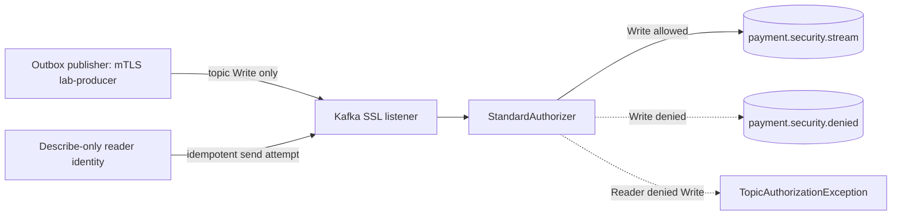
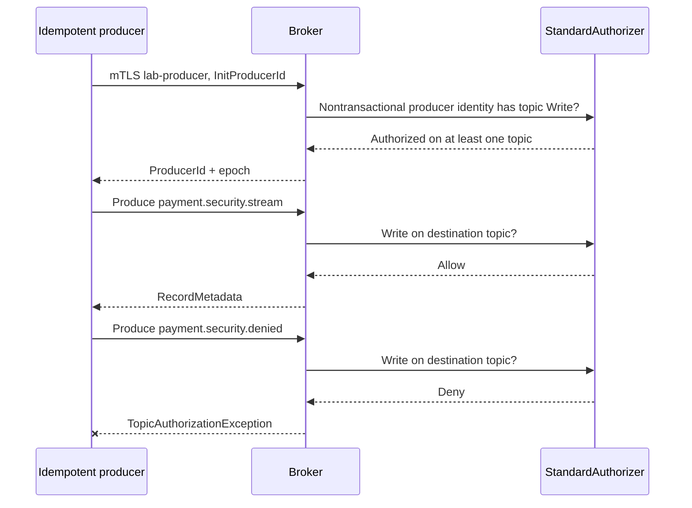

# Chapter 37 — Kafka Idempotent Producer: Senior Engineering Reassessment

**Milestone 06.7AC — corrected tests verified November 10, 2026; fresh-broker ACL confirmation pending.** Original lab run on November 9, 2026:
12 E2E tests executed, 11 passed and 1 failed. A *successful producer
send* disproved the original assertion that cluster `IdempotentWrite` is
always required. Corrected code was subsequently rerun successfully: 12 tests, zero failures, errors or skips, at 04:38:28 CET on November 10, 2026. This rerun reused an existing broker with the obsolete IdempotentWrite ACL, so it does not independently prove the clean provisioned ACL state.

**Previously verified checkpoint:** 152 application tests plus 9 broker E2E
tests from milestone 06.7AB. The latest uploaded standard application
`clean verify` **failed**, with 11 integration errors caused by duplicate
Flyway V1 resources in the build output. Do not describe it as green.

## 1. Why are we doing this?

Our simulated payment outbox publisher may retry Kafka sends. Producer
idempotence reduces duplicate *broker retries within the same producer
session*. The payment business remains responsible for request idempotency,
outbox lifecycle, replay-safe consumer inbox and unique business event IDs.
This change must not introduce unnecessary cross-topic or cluster privilege.

**Architecture gate:** keep the scope to one mTLS producer identity with
exact topic Write ACL. Do not build extra identities or ACLs based on outdated
Kafka behavior.

## 2. Senior-engineering review — six questions

| Question | Assessment |
| --- | --- |
| Why? | Verify reliability-related producer configuration can operate with least privilege |
| At 10× traffic? | Producer ACL is not the predicted bottleneck; benchmark broker throughput, partitions, batching, database outbox backlog and consumer lag rather than assert capacity |
| Dependency fails? | Persist outbox event before publishing; broker failure leaves pending state, bounded retries/backoff and clear operator alerting; replay requires application-level deduplication |
| Simpler? | Yes. Reuse `lab-producer`, which has only exact topic Write. Remove redundant `lab-idempotent-producer` and obsolete cluster grant |
| Optimize for? | Correct business effects, least privilege, replay safety, operability, maintainability; then measured performance |
| Six-month regrets? | Overbroad ACLs, outdated copied documentation, world-readable local lab credentials, tests that validate expected myths instead of broker reality |

**Decision: REWORK** the original implementation; rerun both suites before
changing milestone status to verified.

## 3. Failure observation — what the evidence actually says

The original negative test
`topicWriteAloneCannotAuthorizeIdempotentProducerId` asserted an
exception. In the Kafka 4.1.2 secured broker lab, the producer holding
topic Write **successfully sent the record**, and JUnit reported:

```text
Expected java.lang.Exception to be thrown, but nothing was thrown.
Tests run: 12, Failures: 1, Errors: 0, Skipped: 0
BUILD FAILURE
```

This was an **incorrect test expectation**, not proof of an insecure broker.
KIP-679 changed the nontransactional idempotent-producer authorization
model in Kafka 2.8: topic Write permission suffices for
`InitProducerId` when the producer has no transactional ID. The
`IdempotentWrite` ACL was deprecated. Some Kafka authorization guides
still contain legacy generic tables; prefer version-specific design
and direct real-broker tests.

**Historical experiment is intentionally preserved here; do not rewrite it as
a passing run.**

Reference:
[KIP-679 — Producer will enable the strongest delivery guarantees](https://cwiki.apache.org/confluence/display/KAFKA/KIP-679%3A+Producer+will+enable+the+strongest+delivery+guarantee+by+default).

## 4. Corrected authorization contract

| Test | Identity | Config | Expected result |
| --- | --- | --- | --- |
| KSEC-06 | `lab-producer`: topic Write(stream) only | `enable.idempotence=true`, `acks=all` | Send succeeds; broker returns record metadata |
| KSEC-07 | `lab-reader`: Describe(allowed topic) only | Idempotent producer sending to stream | `TopicAuthorizationException` |
| KSEC-08 | `lab-producer` | Idempotent producer writing to denied topic | `TopicAuthorizationException` |

The identity used in the two denied cases must be authenticated with a
valid lab certificate. A timeout or unrelated handshake error cannot
replace the explicit `TopicAuthorizationException`.

The existing `KafkaIdempotentProducerAuthorizationE2E` class retains
three focused tests. The certificate generator and ACL provisioning no
longer create the extra idempotent identity or grant cluster
`IdempotentWrite`. The runner still selects twelve cases across four
test classes.

**No `transactional.id` is configured.** Transactional producers have
separate transactional-ID ACL semantics and are not covered here.

## 5. Architecture diagram



## 6. Successful and rejected sequences



## 7. Testing and reproducibility

The last uploaded standard regression test failed independently of Kafka:
duplicate `V1__create_payments 2.sql` and
`V1__create_payments.sql` were observed under
`target/classes/db/migration/`. This caused the Flyway initializer
to fail and 11 application integration errors (8 ledger, 3 metrics).
The error concerns duplicate **compiled classpath resources**, not
proof that a canonical source migration was changed.

**Before rerunning:**

```bash
ROOT="$(git rev-parse --show-toplevel)"
git -C "$ROOT" pull --ff-only origin feat/payment-ledger

# Inspect first; do not remove canonical source migrations.
find "$ROOT/src/main/resources/db/migration" -maxdepth 1 -type f -print
find "$ROOT/target/classes/db/migration" -maxdepth 1 -type f -print 2>/dev/null || true
git -C "$ROOT" status --short

# Clear only build output and run a clean build.
mvn -B --no-transfer-progress -f "$ROOT/pom.xml" clean verify
```

If duplicates reappear after clean, inspect the source tree and sync tools
before changing application code. A project stored in a synced folder
can have conflicting copies; the root cause is **not yet proven** and
must be investigated using the observed paths and versions.

The prior secured-broker session has already been torn down and had its
credentials deleted. For a new session:

```bash
cd "$ROOT/ops/monitoring/kafka-security-lab"
bash generate-certificates.sh
docker compose -f compose.yaml up -d
bash provision-topics-acl.sh
bash run-e2e.sh
```

**Target (not yet proven after rework):** 152 standard application tests
and 12 secured-broker E2E tests, each with zero failures/errors/skips.

After capturing sanitized summaries, tear down with
`docker compose -f compose.yaml down -v`, inspect `generated/`,
and delete disposable material. Passwords, PKCS12 files and CA private
keys must never be committed or shared.

## 8. Failure analysis and hardening backlog

- **What failed?** One outdated assertion: topic Write did not block
  InitProducerId on modern Kafka. Correcting the test is appropriate;
  granting additional privileges would have been the wrong response.
- **What else failed?** Flyway duplicate V1 in target classpath. Isolate
  build resource duplication from Kafka authorization debugging.
- **What is proven?** The failed run demonstrated an authorized send
  succeeding; other eleven E2E tests reported passing. Corrected current
  code still needs an actual rerun.
- **What is not proven?** Producer retry deduplication during injected
  network failure, exactly-once payment effects, stable throughput at
  10×, transactional producer semantics, cert rotation or production
  controller security.
- **Known lab secret gap:** `generated/` permissions and container
  secret mounts currently expose temporary local credential files to
  other local accounts. Harden separately with proper UID/GID mounts,
  secure secret storage and a no-sync environment.

## 9. Interview defense

**Q: What did the failing test teach us?**
A: A test can fail because the requirement is wrong. Broker behavior
was consistent with KIP-679; we removed an obsolete ACL and its
redundant identity rather than forcing the infrastructure to satisfy an
incorrect assumption.

**Q: Is Kafka idempotence exactly-once payment processing?**
A: No. Producer sequence numbers handle a subset of broker retry
duplication. Database outbox/inbox uniqueness and domain invariants
provide independent protection across process restarts and application
retries.

**Q: Why does the group need no cluster idempotent grant?**
A: Authorization is operation- and resource-scoped. Nontransactional
producer initialization uses topic Write authorization on modern
Kafka; the consumer has separate topic Read and group Read.

**Q: Which engineering decision changed?**
A: Cluster `IdempotentWrite` was removed as unnecessary for this Kafka
version. The negative tests now assert real topic-level denial, and
the documented historical failure is retained for traceability.

## 11. Focused corrective rerun — November 10, 2026

The developer fast-forwarded `feat/payment-ledger` from `7984d2c`
to `1d5fa35` and confirmed the obsolete assertion name was absent.
The opt-in secured Kafka suite then compiled 37 test source files and passed
**12 tests (0 failures, 0 errors, 0 skipped)**; Maven reported
`BUILD SUCCESS` at **04:38:28 CET** with total time 3.482 seconds.

The four groups were: principal authorization (4), secured broker
Describe (2), negative mTLS/ACL (3), and idempotent producer (3).
The Describe-only producer's attempted Write to the stream was rejected;
Kafka also logged a cluster authorization error in the same negative
scenario and a non-transactional-producer shutdown warning. Because the
assertion passed, classify the scenario as an expected denial, but keep
any unexpected close-time warning for later client-library assessment.

**Verification boundary:** This was a focused rerun using the existing
broker and previously generated credentials. The previous broker had been
provisioned with a redundant `User:CN=lab-idempotent-producer` cluster
`IdempotentWrite` ACL, which may still have existed. This is **not**
evidence that a fresh cluster is free of the old grant. The corrected
provisioning script does not add it. For workflow efficiency, leave
fresh-broker ACL verification as a separate hardening task instead of
blocking further core payment development. The last uploaded application
`clean verify` still requires separate investigation of duplicate
Flyway V1 build resources.
