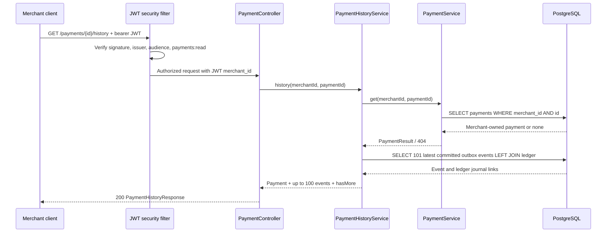

# Chapter 38 — Merchant payment history and auditability

## Business case and scope

A merchant needs to inspect the transitions of **one of its own**
simulated payments and correlate capture/refund transitions to immutable
accounting journals. The system previously exposed only the latest
payment status and kept the underlying committed events internal.

This increment adds `GET /api/v1/payments/{id}/history`. It is
**read-only**, uses the existing `payments:read` JWT authority, and
derives the merchant from the validated JWT—not the URL, query
parameters or request body. Unknown or another merchant's payment
returns the existing 404 contract.

No production payment processing, settlement, money movement or
legally complete accounting audit report is implemented.

## Sequence and trust boundary



## Contract

```http
GET /api/v1/payments/{id}/history
Authorization: Bearer <signed-token-with-payments:read>
```

The response contains `payment` (the same fields as the existing
payment GET endpoint), `events` (up to 100 newest committed
transitions), and `hasMore` (true when 101 or more rows exist).

Each event includes `eventId`, `targetState`, `recordedAt`,
`dispatchedAt` (nullable) and `ledgerEntryId` (nullable). A null
ledger ID is expected for authorization and other transitions that
produce no journal; capture and full refund currently create journals.

**Important limitations:**
- `recordedAt` is the outbox row creation time, not a network delivery
  timestamp.
- `dispatchedAt` is an outbox acknowledgement, **not proof** of
  downstream consumption, projection update or financial settlement.
- The query is intentionally limited; `hasMore=true` indicates older
  events are omitted. Pagination and a legal audit export are separate
  future capabilities.
- Ties in timestamp are broken deterministically by descending event
  UUID; UUID ordering is not business causality.
- The response contains only nonsecret simulation metadata, not
  arbitrary account postings.

## Design decision — reuse over new infrastructure

A narrow read-only Spring service uses JDBC and the existing ownership
check; it joins committed `payment_outbox` rows with matching
`ledger_entries` by merchant, payment and event ID. No new tables,
migrations, streaming service, repository abstraction, cache or topic
were introduced.

At high volume, bound the response, review the query plan for
`merchant_id, payment_id, created_at, id`, and introduce **keyset**
pagination if older entries must be navigable. Do not expose
unbounded per-merchant histories. Read-only database transactions do
not provide cross-service consistency and are not proof of immutable
external audit storage.

## Testing and evidence

- `PaymentControllerWebTest`: read-scope success, absence of token,
  insufficient scope, missing merchant claim.
- `SimulatedPaymentTransitionServiceIT`: after authorization,
  capture and refund, the merchant sees three events; only capture
  and refund have ledger entry links; another merchant receives 404.
- `PaymentOpenApiIT`: history route is generated in the scoped API spec.
- `mvn -B --no-transfer-progress clean verify` is the full regression
  gate. The new code has been **committed but not yet locally verified**;
  check the latest Java CI and Security CI results before marking done.

## Interview discussion: why not event sourcing?

The existing `payments` table remains the source of current status.
`payment_outbox` provides durable committed change records for
reliable delivery, not a complete historical event-sourcing model:
there is no deterministic event-store rebuild, correction versioning,
legal retention guarantee or total ordering across services. The
narrow history API is useful **without claiming** these stronger
properties.

## Questions a reviewer should ask

1. Can an attacker enumerate another merchant's payment or its event IDs?
2. Can a missing JWT or only `payments:write` access the history?
3. Does a full refund retain the original capture journal?
4. What do `recordedAt`, `dispatchedAt` and `ledgerEntryId` actually prove?
5. What happens after 100 events and how would keyset pagination work?
6. Can we demonstrate both the success and cross-merchant 404 with
   PostgreSQL and signed JWTs?
