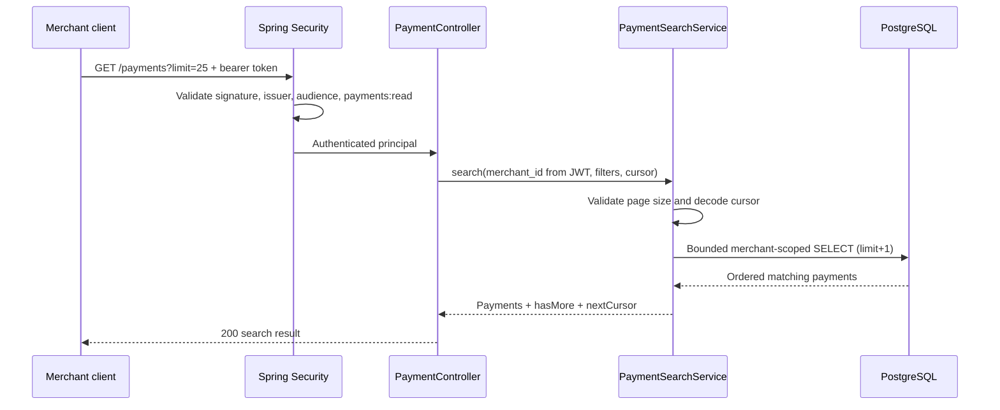

# Chapter 39 — Merchant payment search with keyset pagination

## Business requirement

A merchant needs to find its own simulated payments without knowing
their UUIDs. The API supports exact `status` and `merchantReference`
filters, and returns newest-first bounded pages. This extends the
existing merchant-owned single-payment read and per-payment history.

## Contract

```http
GET /api/v1/payments?limit=25&status=RECEIVED&merchantReference=order-42
Authorization: Bearer <signed-token-with-payments:read>
```

Response: `payments` (up to `limit` records), `nextCursor`
(nullable) and `hasMore` (boolean). Pass `cursor=nextCursor` on the
next request with the same filters. Default `limit=25`, maximum 100.
Malformed status, cursor, reference and out-of-bounds limit return 400.
The authenticated JWT `merchant_id` determines tenant ownership.
No merchant identifier is accepted from client filters.

## Sequence and boundaries



## Why keyset instead of OFFSET?

`OFFSET` makes deep pages increasingly expensive to locate and can
repeat or skip records as new payments are inserted. The query orders
by `created_at DESC, id DESC` and advances with
`(created_at, id) < (cursor_timestamp, cursor_uuid)`. The timestamp
is stable after creation; the UUID is a unique tie-breaker. The query
requests `limit + 1` to determine `hasMore` without an expensive
total row count.

The URL-safe Base64 cursor is versioned (`v1`) and includes a SHA-256
fingerprint of the validated merchant identity and exact filter set.
Changing merchant or filters rejects continuation with HTTP 400.
This fingerprint is **not a MAC or cryptographic authentication**:
the cursor can be decoded or modified by a client and is not an
authorization grant. Every database query still enforces
`merchant_id = ?`, regardless of cursor contents. Do not put secrets
or private data into cursor payloads. The caller must preserve the
original filters while navigating pages. Statuses can change between
pages, so filtered results are **not** a snapshot-isolated audit
export. For stable reporting use a dedicated snapshot/reporting
strategy.

## Security and operational notes

- Read scope required; no cross-tenant search or merchant selector.
- Filters are parameterized, not concatenated SQL values.
- Empty, malformed or overly large parameters are rejected. Cursor replay with mismatched filters or tenant is rejected.
- No total count is returned or calculated.
- Index review is required with realistic data volumes. Candidate
  access path: `(merchant_id, created_at DESC, id DESC)`; evaluate
  optional status/reference filters with `EXPLAIN (ANALYZE, BUFFERS)`
  before adding extra indexes. Small lab datasets do not validate
  production plans.
- Pagination requests should be rate limited at the edge when deployed.
- Search is a read-only business capability, **not** an audit service
  and not real fund settlement.

## Testing

- Web slice: read-scope access, filters and response shape, denied
  unauthenticated or ordinary write-scope access, bad status.
- PostgreSQL IT: page forward through three owned payments, confirm
  no duplicates, exclude another merchant, check exact filters,
  cross-filter/tenant cursor replay and malformed cursor/limit.
- OpenAPI IT: new GET on `/api/v1/payments` is present alongside POST.
- Gate: `mvn -B --no-transfer-progress clean verify` plus Java and
  Security CI; the new increment is **unverified until tests pass**.

## Interview questions

1. Why include a unique secondary ordering column?
2. Does Base64 make the cursor trusted?
3. What happens if an existing payment changes status between pages?
4. Why should the tenant identifier come from the validated JWT?
5. Under what workload would you add an index or switch read models?
6. How would you upgrade the cursor contract without breaking clients?
