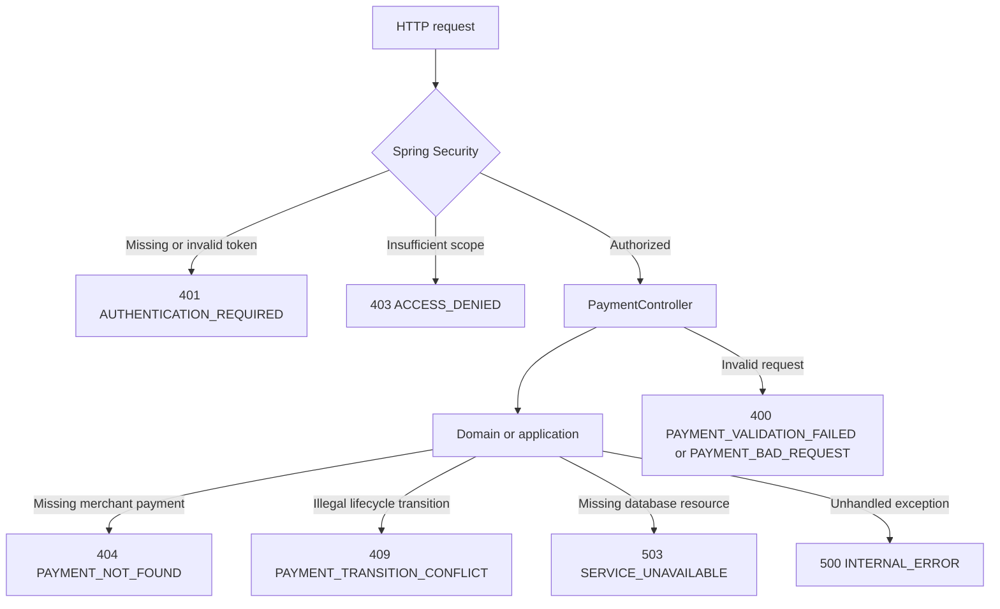

# Chapter 40 — Stable API error handling and resilience foundation

## Purpose

Payment API clients need machine-readable errors to distinguish
bad requests, merchant ownership failures, business conflicts and
temporary infrastructure outages. Error contracts must not expose
database hosts, passwords, stack traces or persistence state. This
increment evolves the existing RFC 9457 `ProblemDetail` boundary:
it does **not** introduce a new global exception hierarchy or an
error-management microservice.

## Error model and ownership



Existing public codes for idempotency conflicts, merchant identity,
validation, transition conflict, missing payment and bad request
remain unchanged. Newly introduced public codes are
`AUTHENTICATION_REQUIRED`, `ACCESS_DENIED`,
`SERVICE_UNAVAILABLE` and `INTERNAL_ERROR`.

A response uses `application/problem+json`, and includes:
`type`, `title`, `status`, `detail`, `code`, and when present
`correlationId`. Temporary database resource failures include
`retryable: true`. The correlation identifier is generated by
the request filter; never trust a client-provided value.

## HTTP versus domain semantics

Domain and application failures do not know HTTP status codes.
The API adapter maps explicit `PaymentTransitionConflictException`
to 409. Arbitrary `IllegalStateException` now becomes 500, not 409.
Missing merchant-scoped payment retains 404.
`DataAccessResourceFailureException` maps to 503 because a
database resource needed by the request cannot be reached.
Other SQL exceptions are **not automatically** classified as
temporary outages. Unexpected failures receive a generic 500.
Known validation failures retain 400 even with the 500 catch-all.

The Spring Security filter chain runs *before* MVC exception advice.
It must therefore serialize 401/403 directly and retain
`WWW-Authenticate` for bearer-token challenges.

## Example

```json
{
  "type": "urn:problem:enterprise-payment-platform:service-unavailable",
  "title": "Service Unavailable",
  "status": 503,
  "detail": "A required service is temporarily unavailable.",
  "code": "SERVICE_UNAVAILABLE",
  "correlationId": "a20c8b62-945c-4e4d-9f81-29f7031798bc",
  "retryable": true
}
```

The example correlation ID is illustrative.

## Retry safety and operational behavior

A `retryable` hint is **not** a guarantee of exactly-once execution.
After a timeout, the client might not know whether the server
committed an operation. Retry payment creation with the **same**
merchant and `Idempotency-Key`. For simulated transitions use
the **same** `Event-Id`; never generate a new event identity
for the same logical retry. Use bounded exponential backoff with
jitter and request deadlines; observe failures rather than flooding
a sick database. Never retry 400/401/403/409 automatically.

Do not put a Retry-After header on every 503 unless there is a
realistic, defensible retry window. Log technical exceptions on
the server with correlation IDs; never echo diagnostics publicly.
Restrict log retention and avoid logging tokens and credentials.

## Tests and acceptance

- Unit: previously published 400/403/404/409 codes retain their
  reviewed values; 503/500 details are sanitized.
- Web: explicit simulated transition conflict returns 409.
- Web: unexpected Java failure returns 500 (not accidental 409).
- Web: PostgreSQL resource failure returns 503 with retry hint.
- Web: malformed JSON remains a validation 400.
- Web security: unauthorized and insufficient-scope requests return
  RFC 9457 with bearer-token challenge semantics.
- Full gate: `mvn -B --no-transfer-progress clean verify`,
  followed by successful Java CI and Security CI.
  **Do not report this increment as verified until these run.**

## Deliberately deferred

A remote service call timeout may justify 504 **only when acting as a
gateway or proxy**; database timeouts do not automatically map to 504.
429 depends on actual throttling enforcement and is not introduced
as an unsupported promise. Domain exception types must be created
only for real business invariants, not one class per status.
An Audit module remains a separate backlog decision.

## Interview questions

1. Why do 401 and 403 need a handler outside MVC advice?
2. Why is a generic `IllegalStateException` unsafe to classify as 409?
3. What makes a database failure retryable, and how does idempotency
   influence payment client behavior?
4. What is the difference between 500, 503 and gateway-specific 504?
5. How do correlation IDs help without leaking sensitive diagnostics?
6. Why not define a new enum for standard HTTP statuses?
