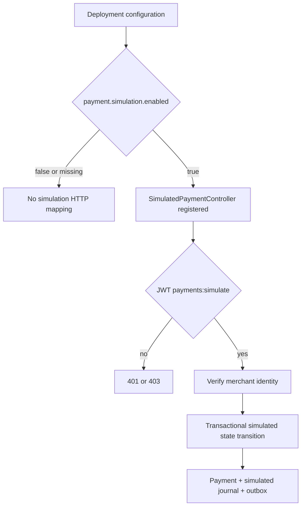

# Chapter 42 — Fail-closed training-only simulation API

## Business and security requirement

The simulated payment transition endpoint is for training and controlled
demonstrations, not real payment authorization, capture or settlement.
Granting `payments:simulate` to a JWT principal must **not** by itself
activate simulation capabilities in a deployment.

Deployment authorization and caller authorization are separate layers:

1. The deployer explicitly opts into the simulated transition HTTP API.
2. The caller presents a signed, validated JWT with `payments:simulate`.
3. The merchant claim identifies the owner of the targeted payment.
4. The application enforces valid state transitions and atomic
   payment/ledger/outbox persistence.

Absent the deployment opt-in, the route is not registered.

## Configuration contract

Default application configuration:

```yaml
payment:
  simulation:
    enabled: ${PAYMENT_SIMULATION_ENABLED:false}
```

Explicit training-only opt-in:

```bash
PAYMENT_SIMULATION_ENABLED=true
```

**Never enable this property in a deployment handling real funds.**
The property is not a runtime client parameter and is not controlled
by JWT claims. Configuration management for a deployment must restrict
who can set it; a boolean property is not a complete deployment
environment attestation.

## Architecture



`PaymentController` retains ordinary merchant creation, reading,
history and search. The training route lives in
`SimulatedPaymentController`, guarded by Spring Boot's
`@ConditionalOnProperty` with `havingValue = "true"` and no
`matchIfMissing`. The existing security rule still requires the
independent scope when the controller exists.

Because the controller is not registered when disabled, an authorized
request to its URL receives 404 from MVC. Its operation is also absent
from the dynamically generated OpenAPI schema. This is a deployment-
time feature boundary, not protection against a compromised deployer
or direct calls into internal Java services.

## Tests and quality gate

- `SimulationDisabledWebTest`: without explicit opt-in, no mapping
  exists and a valid simulated-scope request cannot execute the
  transition service; ordinary merchant search still responds.
- `PaymentControllerWebTest`: explicitly enabled, validates scope,
  merchant identity, HTTP errors and normal transitions.
- `PaymentBearerTokenIT`: explicitly enabled, executes real signed
  bearer-token lifecycle requests with PostgreSQL.
- `PaymentOpenApiIT`: explicitly enabled for its reviewed
  simulation-inclusive contract baseline.
- Direct service integration tests remain available to validate
  transaction semantics independent of the HTTP feature toggle.

Run `mvn -B --no-transfer-progress clean verify` and require
successful Java CI and Security CI before closing this milestone.

## Alternative designs rejected

- A runtime if-statement only in the controller leaves the HTTP route
  mapped and generally advertised in OpenAPI.
- Using only JWT scope conflates deployment permission with request
  authorization.
- A separate simulation microservice would add operational complexity
  without improving the educational use case at this stage.

## Interview questions

1. Why should a deployment switch and OAuth authorization both exist?
2. What is the difference between disabling a mapping and returning
   403 from a mapped handler?
3. What should happen to OpenAPI when the training controller is absent?
4. Why do direct application-service tests not require an HTTP toggle?
5. What controls must prevent enabling training functionality in a
   real-money deployment?
