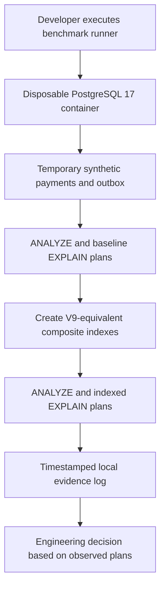

# Chapter 44 — Reproducible PostgreSQL 17 Performance Lab

## Goal and baseline

Milestone 12 validated Flyway V9 indexes and passed 182 tests plus Java/Security CI on
`2523f7bc`. That gate establishes correctness and confirms the possible
index access paths. It is **not** a realistic performance benchmark.

Chapter 44 adds a separate **opt-in, synthetic** benchmark. It compares
real PostgreSQL plans and timing before and after adding composite
indexes matching V9, without touching the application database.

## Safety boundary

The launcher uses Docker `postgres:17-alpine` with:
- `--network none`: no external networking and no published host port
- an ephemeral database stored on a bounded container tmpfs
- a temporary, randomly generated database initialization password
- a trap that destroys the container after success or failure
- temporary SQL tables only; no application migrations or real data
- results saved under `target/postgresql-benchmark/` (not tracked in Git)

It does **not** consume `DB_URL`, `DB_PASSWORD`, production secrets or
an existing database. `docker exec` invokes `psql` via the container's
local socket. No fixture rows represent real transactions.

## How to execute on your development Mac

Prerequisites: Docker Desktop running; Docker CLI, OpenSSL, Git, Bash.
Use the repository root, with no active production database connection:

```bash
git switch feat/payment-ledger
git pull --ff-only origin feat/payment-ledger
bash ops/benchmarks/postgresql/run.sh
```

Results are written to a timestamped log in
`target/postgresql-benchmark/`. The launcher does not run during
normal `mvn verify` or GitHub CI, avoiding fluctuating timing gates.

## What is measured

The script creates 100,000 synthetic payment rows across 10 merchants
and 100,000 outbox events, then runs:
1. Merchant newest-first page, 26 rows (25 + 1 lookahead)
2. Tenant + status + deep keyset continuation, 26 rows
3. Merchant-owned payment transition history, 101 rows

First it records `EXPLAIN (ANALYZE, BUFFERS)` with no V9-style
indexes. It then creates the equivalent ordered indexes, runs
`ANALYZE`, and repeats each query. Finally it prints table row counts
and index sizes.

**Interpretation**: Compare planner node names (`Seq Scan`,
`Bitmap Heap Scan`, `Index Scan`), explicit sorts, estimated/actual
row counts, `Buffers: shared/local hit/read`, and
`Execution Time`. Temporary tables often report **local**, not
shared, buffer hits. PostgreSQL may legitimately choose sequential
scans for small or low-selectivity workloads.

## Important caveats

- Before/after execution ordering changes the state of caches. A
  single pass does not provide robust median/p95 statistics, nor
  does it show throughput under concurrency or real write costs.
- V9-equivalent indexes are applied to *benchmark temporary tables*,
  not the actual application tables. Column types and predicates
  match the relevant access paths, but no claim of a full production
  database replica is made.
- Status/reference distributions, merchant skew, data scale,
  hardware and cold/warm buffer effects will influence the planner.
- An explicit `EXPLAIN ANALYZE` runs the query; do not blindly run
  the script's SQL against a live production database.
- No new index or caching layer should be introduced simply because
  one isolated execution plan looks faster.
- To establish p50/p95 and concurrency impact, use a separate
  controlled load test with repeated runs and representative data.

## Architecture view



## Acceptance criteria

- Script starts without any app database connection strings.
- Docker has no published network ports; cleanup on exit.
- Both synthetic datasets have expected row counts.
- Before/after query plans, timings and buffer counts are captured.
- The system does not claim a speedup until results are examined.
- Existing Java and Security CI remain green.
- Any measured results are labelled with revision, dataset and host
  context; numeric improvements are never invented.

## Interview practice

1. Why choose `EXPLAIN (ANALYZE, BUFFERS)` rather than `EXPLAIN`?
2. How do cache warming and the planner skew a simple before/after?
3. Why can PostgreSQL prefer a sequential scan despite a matching index?
4. Why are indexes for merchant reads not free for writes?
5. What evidence would justify indexing the optional `status` filter?
6. How would you design a repeated-run p95 load test before deploying?
