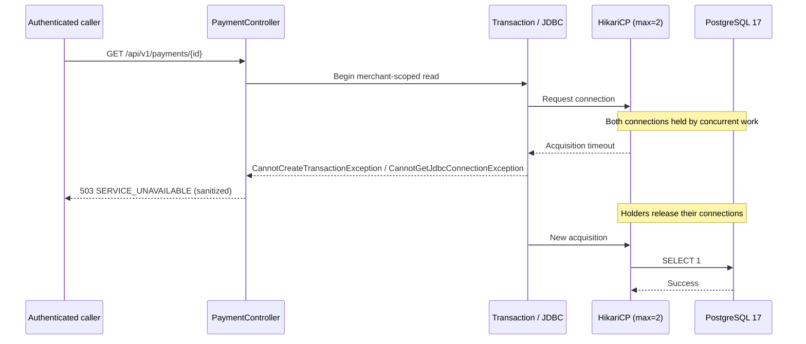

# Chapter 48 — HikariCP Connection Pool Saturation and Recovery

## Goal

The first two PostgreSQL benchmarks measured serial query latency and
write-index overhead. They did **not** test the application when multiple
requests compete for a limited database connection pool.

This increment establishes a deterministic **integration failure test**
for connection acquisition and recovery, plus a sanitized HTTP response
for the common Spring connection-exhaustion exception types. It does not
claim p95 latency, throughput or service capacity under sustained load.

## Architecture and failure boundary



## Deterministic test design

`HikariPoolSaturationIT` is a dedicated Testcontainers Spring context
configured to:
- `maximum-pool-size=2`
- `minimum-idle=0`
- `connection-timeout=500ms`
- `validation-timeout=250ms`

Two worker threads acquire and hold one connection each while a
`CountDownLatch` synchronizes the main test. A third acquisition
must fail with a SQL exception within a bounded period. Once the
workers release the leases, the test acquires a connection and
executes `SELECT 1`, proving recovery.

This is not a timing microbenchmark: CI scheduling can add variance,
so the test checks a generous upper limit rather than asserting exact
wall-clock equality with the configured 500 ms timeout. The pool
statistics test observes `getActiveConnections() == 2` only after the
workers have confirmed they hold both leases.

No sleep is used to create contention. Resources are closed with
try-with-resources, and a `finally` block always releases the
waiting workers. PostgreSQL runs in a disposable container.

## HTTP and diagnostic boundary

`PaymentApiExceptionHandler` now maps:
- `DataAccessResourceFailureException`
- `CannotGetJdbcConnectionException`
- `CannotCreateTransactionException`

to HTTP 503, error code `SERVICE_UNAVAILABLE`, a generic detail and
an advisory `retryable=true`. The implementation does not expose
the JDBC URL, connection pool name, exception message or stack trace
in public responses or application failure logs.

`PaymentControllerWebTest` verifies that an authenticated HTTP
request receives a sanitized 503 when its application service throws
the transaction-acquisition failure. The unit handler test covers
both Spring JDBC and transaction exception variants.

**Operational caveat:** `retryable=true` does not authorize unsafe
blind retries of payment writes. The caller must preserve the original
idempotency key or event UUID and use bounded backoff.

## Validation commands

```bash
ROOT="$(git rev-parse --show-toplevel)"
git -C "$ROOT" pull --ff-only origin feat/payment-ledger
mvn -B --no-transfer-progress -f "$ROOT/pom.xml" clean verify
```

The new integration test belongs to the ordinary Failsafe
`*IT.java` suite, so it must pass both locally and in Java CI.
Security CI is a separate acceptance gate.

## What this test does not prove

- Concurrent **HTTP** request p95/p99 across a real network
- Aggregate requests per second under sustained mixed read/write load
- Lock contention, deadlock probability and database wait-event profiles
- Production-ready pool size across application replicas
- PostgreSQL capacity, autoscaling behavior, external payment throughput
- Dependency recovery after a full PostgreSQL process crash

A subsequent controlled load-testing experiment can exercise these
scenarios with synthetic traffic, resource metrics and rate limits.
Do not tune `DB_POOL_MAX_SIZE` or adopt an API SLO based only on this
deterministic exhaustion/recovery regression.

## Interview questions

1. What is the difference between connection-pool saturation and slow SQL?
2. Why is acquisition timeout not the same as transaction timeout?
3. Why are two latches preferable to relying on `Thread.sleep`?
4. Why map transaction-acquisition failures to 503 rather than 500?
5. What telemetry would reveal persistent pool starvation in production?
6. How do pool sizes multiply across replicas, migration jobs and worker processes?
