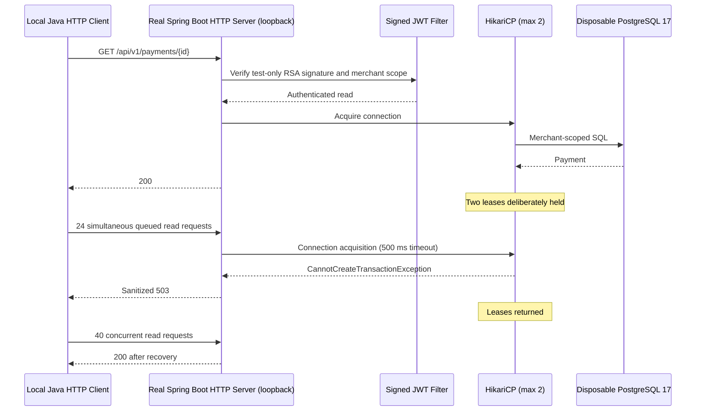

# Chapter 49 — Controlled Concurrent HTTP Load & Pool Starvation Lab

## Purpose

Earlier increments validated PostgreSQL access paths (V9), statistical
serial database read/write timings, and deterministic connection-pool
exhaustion. This increment adds a **real loopback HTTP** experiment
to observe latency and HTTP status outcomes under concurrent requests.

This is an opt-in development experiment, **not** a production load
test or a service-level objective.

## System boundary



## Implementation

- `src/test/java/dev/asambataiden/payment/performance/ConcurrentHttpLoadLab.java`
- `ops/benchmarks/http/run-local.sh`
- A real Spring Boot random-port web server bound to `127.0.0.1`
- A real, ephemeral `postgres:17-alpine` Testcontainers instance
- Synthetic merchant/payment created using the existing application service
- Ephemeral RS256 signing key and test-only JWT decoder: requests still
  pass through the actual stateless Spring Security filter chain
- `PAYMENT_SIMULATION_ENABLED` remains false; no simulation transitions
- Hikari configuration: maximum pool 2, minimum idle 0,
  acquisition timeout 500 ms
- Java 25 `HttpClient`, bounded request deadlines, and
  bounded worker pools (no unlimited threads or external traffic)

Three phases run sequentially:

1. **Warm-up:** 8 requests across 2 concurrent workers; expect 200.
2. **Forced saturation:** hold two JDBC leases while 24 HTTP requests
   use 12 workers; expect sanitized 503, not unbounded waiting.
3. **Recovery:** release leases, then 40 HTTP requests across 8
   workers; expect 200 and no pool growth beyond its configured cap.

Each phase reports counts by status and observed client-side p50,
p95, p99 and total request throughput. The reported throughput is
specific to that short phase, not sustained capacity. Phases use
different concurrency and traffic conditions, so their percentiles
must not be compared as identical workloads.

## Running

From the Git repository, with Docker Desktop running:

```bash
git switch feat/payment-ledger
git pull --ff-only origin feat/payment-ledger
bash ops/benchmarks/http/run-local.sh
```

The runner uses the Maven `-Dtest=ConcurrentHttpLoadLab` selector
rather than the ordinary `*Test.java` or `*IT.java` discovery
patterns. It saves evidence under `target/http-load-lab/` and
removes disposable containers through Testcontainers.

The experiment **must be run explicitly**. It is not executed by
ordinary `mvn clean verify` or Java CI, which still compile the class
but do not execute it.

## Interpretation and risk controls

The outcome can demonstrate that the real HTTP stack correctly
returns 503 when acquisition fails, and that it recovers after leases
are released. It cannot characterize realistic variable SQL latency,
sustained mixed traffic, saturation of multiple app replicas, remote
network TLS overhead, or production p95/p99.

Real workload load tests should additionally measure Hikari pending
threads/connection acquisition timers, database wait events,
JVM thread queues, CPU, memory, HTTP throughput and auth overhead,
with warmup, sustained phases, confidence intervals and stop limits.
Do not tune production pool capacity using only this 3-phase lab.

No test token or password is printed. The lab cannot accept a user
supplied host URL, so it cannot accidentally target a production API.

## Acceptance

- The local runner exits successfully.
- All 8 warm-up requests return 200.
- All 24 forced pool-exhaustion requests return sanitized 503.
- All 40 recovered requests return 200.
- No request gets an unexpected 401, 403 or 500.
- No server binds to a non-loopback address.
- Normal Maven, Java CI and Security CI stay green.
- Evidence is recorded with revision and run configuration.

## Interview questions

1. Why is MockMvc insufficient for measuring real HTTP latencies?
2. How do Hikari acquisition timeout and transaction timeout differ?
3. Why test starvation response and recovery separately?
4. Why does a short burst throughput figure not prove sustainable RPS?
5. What changes when TLS, a gateway and network propagation are added?
6. How would you prevent load tests from reaching payment production endpoints?
