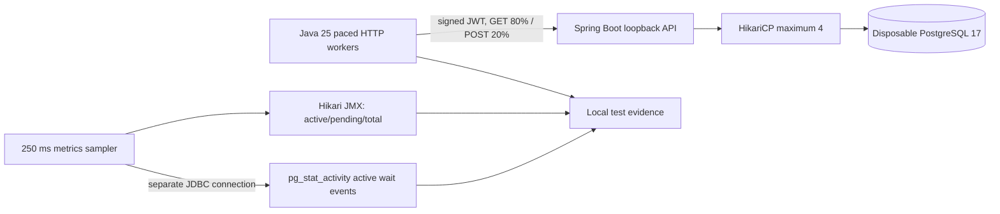

# Chapter 51 — Bounded Mixed HTTP Workload and Database Telemetry

## Why this experiment exists

Chapter 49 established deterministic HTTP failure/recovery when a tiny
HikariCP pool is **deliberately exhausted**. This chapter introduces a
separately invoked, paced *mixed* request workload to observe both
normal authenticated payment reads and creation of unique simulated
payments. It complements, rather than replaces, the previous test.
**No financial transactions or external API endpoints are used.**

## Architecture



The separate monitoring JDBC connection does not compete for the
application's four HikariCP connection slots. The database monitor
reports active sessions with non-null wait types; it is a *sampled
count*, not a comprehensive breakdown or proof that PostgreSQL
locks are the bottleneck.

## Controlled workload

- Harness: `src/test/java/dev/asambataiden/payment/performance/MixedHttpWorkloadLab.java`
- Runner: `ops/benchmarks/http/run-mixed-local.sh`
- Bound to `127.0.0.1`, random server port and disposable database
- Ephemeral RS256 key, genuine Spring Security bearer-token filter chain
- Synthetic merchant with one pre-created read target
- **20 serial warm-up requests**, then **300 measured requests**
- **80% authenticated GET** on a merchant-owned payment; **20% authenticated POST** with unique idempotency keys and synthetic amounts
- 8 bounded worker threads and at most 25 scheduled requests per second
- Hikari maximum 4, acquisition timeout 1000 ms, request timeout 5 seconds
- Samples at 250 ms: Hikari active, pending and total; active PostgreSQL sessions with wait events

The request count and pacing constrain this experiment, but OS scheduling
and DB/HTTP backpressure can make it run longer than the nominal
12-second dispatch window. There is no external URL parameter to
accidentally target a production service, and Kafka and simulated
transition publishing are disabled.

## Execute locally

```bash
ROOT="$(git rev-parse --show-toplevel)"
git -C "$ROOT" pull --ff-only origin feat/payment-ledger
bash "$ROOT/ops/benchmarks/http/run-mixed-local.sh"
```

Docker Desktop must be available. The output is saved beneath
`target/http-load-lab/`. `MixedHttpWorkloadLab` is excluded from
normal Maven Surefire/Failsafe class patterns and is executed only with
its explicit test selector. Ordinary CI compiles it but does not run it.

## Validation

The test fails if:
- Any measured request is missing or responds with an unexpected HTTP
  status; GET expects 200 and POST expects 201.
- No meaningful database and pool metrics were collected.
- The separate metrics sampler raises errors.
- The observed active connection count exceeds the four-slot limit.

The log reports per-operation sample counts, successful and unexpected
responses, p50/p95/p99 client-side latency, short-run completed
requests/sec, and maximum sampled active/pending pool connections and
database wait count. **No measured throughput or latency value should
be stated until the developer supplies the successful execution log.**

## Interpretation and limits

This is a deliberately small loopback experiment: one app instance,
one PostgreSQL instance, a uniform tenant, lightweight GET endpoints,
fixed 80/20 mix and a single dispatch pace. There is no TLS proxy,
external identity provider, Kafka traffic, realistic skew, parallel
replicas or live business processing. Load-generator and application
resources also share the development host.

The 300-request sample is insufficient to establish a reliable
production p99 or sustained capacity. The run measures latency under
a *particular offered load*, not maximum RPS, and can be queue-limited.
A successful run does not justify increasing Hikari maximum pool size.

For future capacity engineering, use longer steady-state stages,
several controlled arrival rates, independent iterations, JVM CPU
and GC metrics, PostgreSQL query and lock wait breakdowns, and
aggregate application connection budgets across replicas.

## Interview discussion

1. What distinguishes offered RPS from achieved RPS?
2. Why measure HTTP write success separately from read success?
3. How is a unique idempotency key important in a payment load test?
4. Why should metrics sampling avoid consuming Hikari connections?
5. What does a sampled `pg_stat_activity` wait count fail to capture?
6. Why cannot 300 requests establish production p99 reliability?
