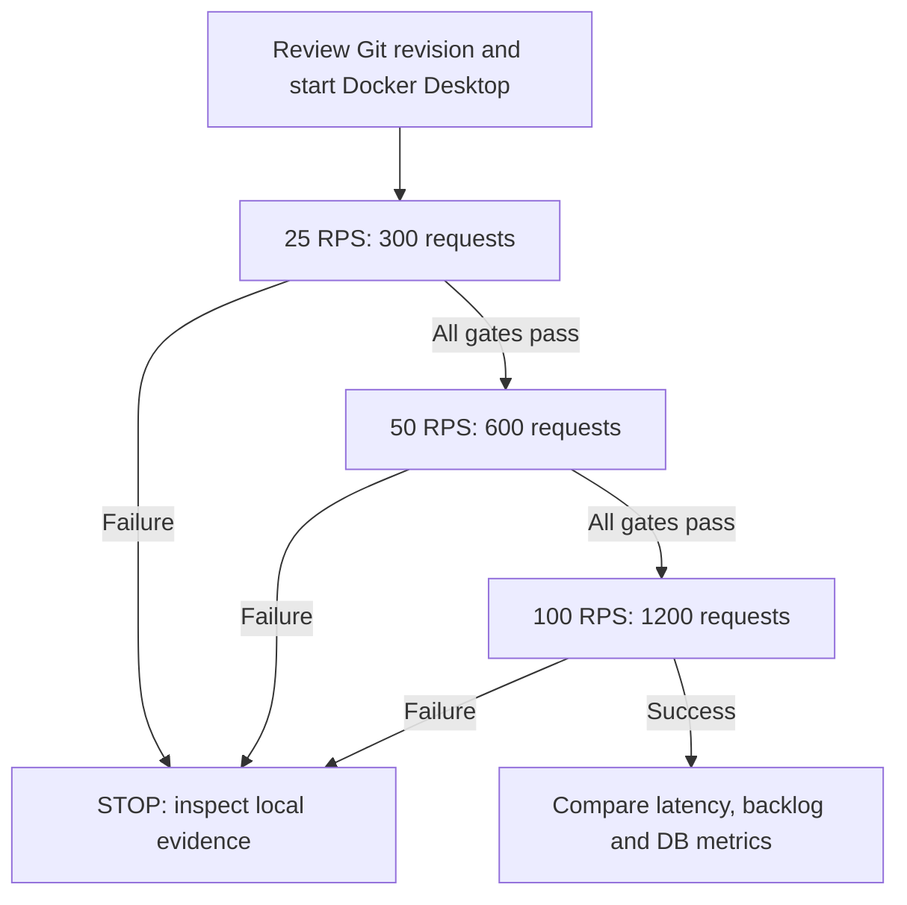

# Chapter 53 — Controlled 25/50/100 RPS Rate Ladder

## Motivation and safety boundary

Chapter 52 recorded a successful 25 requests/second loopback HTTP
mixed-workload baseline with maximum sampled Hikari active connections
of one, no pending acquisitions and no observed DB waits. **That
baseline did not saturate the four-connection application pool.**
The next experiment tests whether latency, errors, pending acquisitions
or load-generator backlog increase with the offered request rate.

All activity is opt-in and synthetic. The Spring server binds to
`127.0.0.1`, uses ephemeral locally signed JWTs and communicates only
with a disposable PostgreSQL 17 Testcontainers instance. No external
URL, live credential or real payment processing is supported.

## Experiment design



Each rate launches an **independent Maven invocation**, fresh Spring
Boot context and isolated database. The measured offered-load window
is nominally 12 seconds per rate. This gives larger samples at higher
rates while preserving a fixed interval. All three runs keep:

- The same 80% GET / 20% POST synthetic payment mix
- 8 fixed worker threads and unique idempotency keys
- Hikari maximum 4, acquisition timeout 1000 ms
- 20 warm-up requests, then 300/600/1200 measured requests
- At most **32 outstanding client requests**; exceeding this limit
  immediately fails the test instead of allowing infinite queueing
- A 5-second per-request HTTP timeout
- 250 ms snapshots of Hikari active/pending/total and PostgreSQL
  active sessions with non-null wait events via a separate JDBC link

The load generator uses a nanosecond target schedule. It records
maximum dispatch lag, outstanding requests, completed RPS,
per-operation p50/p95/p99 and status distributions.

The harness rejects any rate other than 25, 50 or 100. If the current
rate fails (HTTP response, metrics sampling or generator backpressure),
the shell runner **stops** rather than attempting the higher rates.

## Execution

```bash
ROOT="$(git rev-parse --show-toplevel)"
git -C "$ROOT" pull --ff-only origin feat/payment-ledger
bash -n "$ROOT/ops/benchmarks/http/run-rate-ladder.sh"
bash "$ROOT/ops/benchmarks/http/run-rate-ladder.sh"
```

Results are under `target/http-load-lab/`: one summary and separate
per-rate logs containing the complete diagnostic output.

The regular `mvn clean verify` and Java CI compile the opt-in
`MixedHttpWorkloadLab` class but do **not** execute it. Running the
rate ladder and validating its numbers requires the developer's local
Docker environment.

## Interpretation and acceptance

Functional gates: no unexpected HTTP status (GET 200, POST 201),
all scheduled requests complete within their deadlines, monitoring
samples exist, no monitor failures, Hikari active count never exceeds
four, and no generator queue overflow.

Capacity interpretation is separate: rising p95/p99, observed Hikari
pending acquisitions, database waits, or scheduling lag can indicate
pressure. A run that passes functional gates can still have poor
performance; avoid declaring a target SLO passed without agreed
requirements. Zero sampled PostgreSQL waits cannot prove zero
contention. A twelve-second burst per stage is **not** enough for
sustainable peak capacity, especially with a shared Mac and
Docker Desktop host.

The generated data is intentionally small and single-tenant; real
production-like testing requires multi-tenant distributions,
different read targets, longer steady-state windows, repeated
independent runs, externalized load generation and JVM/DB CPU
measurement. No production pool resizing is justified by this
lab alone.

## What to document after execution

Record the exact tested Git SHA, UTC timestamp, machine/Docker
information, rate-specific sample counts and status distribution,
read/write p50/p95/p99, completed RPS, pool active/pending,
PostgreSQL waits, maximum outstanding work and scheduling lag.
Clearly separate observed results from recommendations.

## Interview prompts

1. What distinguishes offered rate from achieved completion rate?
2. Why is load-generator backlog a validity risk?
3. Why abort a higher-rate test after a lower-rate failure?
4. How can p99 be misleading for 60 write samples?
5. Why must Hikari pool changes consider aggregate DB budgets?
6. How would you design a real multi-tenant steady-state ramp?
