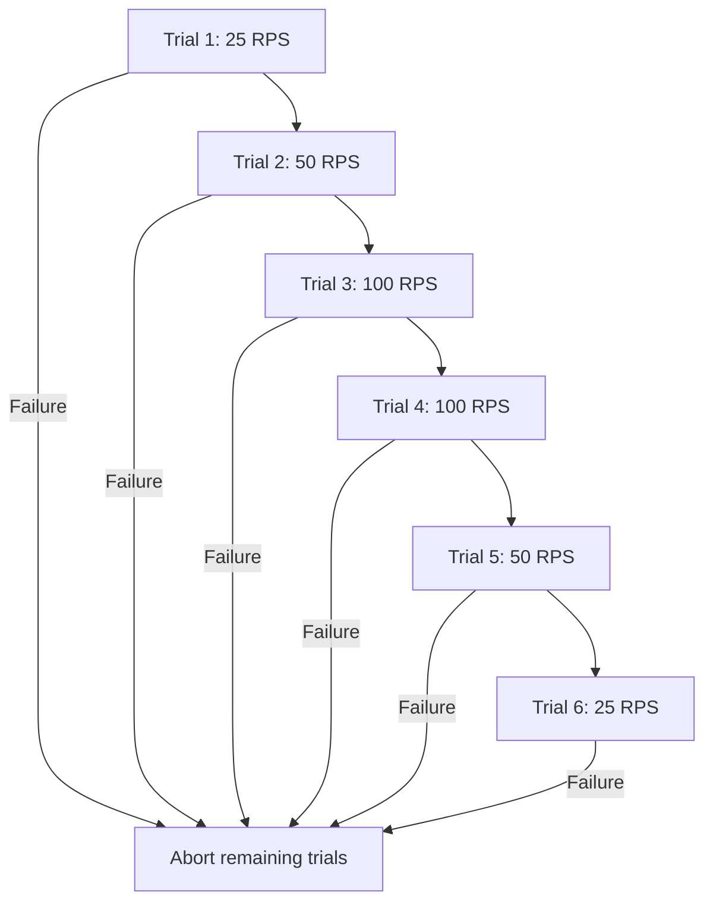

# Chapter 55 — Multi-Tenant Repeatability and JVM Telemetry Lab

> **Correction discovered in Milestone 19 (Chapter 61):** The earlier
> benchmark's merchant-selection logic unintentionally directed **all
> POST/write requests to merchant 0**, because both the POST selector
> and merchant selector depended on correlated modulo values. The
> overall 70/10/10/10 tenant assumption **did not hold separately for
> writes**. The recorded outcomes remain accurate for the workload
> actually executed, but must **not** be presented as evidence of
> per-tenant write fairness. The scheduler was corrected afterward,
> with a dedicated unit test and per-tenant statistics. See
> [Chapter 61](61-tenant-fairness-and-windowed-latency-from-zero.md).
>

## Motivation

Chapter 54's 25/50/100-RPS ladder passed but measured one tenant and
one repeatedly cached read target. A single trial per rate also
confounded apparent latency improvements with JVM warm-up, host load
and run order. This increment improves *workload realism and
observability* before increasing the offered rate.

## Environment and safety

All calls use a Spring Boot HTTP server bound to `127.0.0.1`,
signed ephemeral test JWTs, and a disposable PostgreSQL 17 database
managed by Testcontainers. Synthetic merchant IDs, simulated-payment
writes and unique request idempotency keys only. No external
payment network, TLS gateway, shared database or live credential.
The test remains **opt-in** and excluded from ordinary Maven testing.

## Workload changes

- Four synthetic merchant identities; each has a separate JWT.
- Eight pre-created payment records per merchant (32 seeded reads).
- Deterministic **70/10/10/10 merchant skew**, representing one
  dominant tenant and three smaller tenants.
- 80% authenticated payment GET / 20% simulated-payment POST.
- Distinct idempotency key per POST, with no duplicate-key retry
  exercise in this benchmark.
- Allowlisted 25, 50 or 100 RPS; **12 seconds** of paced requests,
  8 workers, maximum 32 outstanding, a 5-second HTTP timeout.
- 20 unmeasured warm-up requests each trial.
- Each trial starts a separate disposable DB and Spring context;
  POSTs cannot accumulate across independent trials.

This retains a bounded, reproducible workload but does not produce
a statistically representative production tenant distribution.
Reads cover only 32 seeded records, so cache effects remain strong.

## Metrics captured

Every 250 ms the sampler uses an independent JDBC connection
(outside Hikari) to query `pg_stat_activity`, while the Hikari pool
MXBean supplies active, idle, pending and total connections.

The metrics output additionally reports:
- Average sampled active and idle connections
- Count of sampled intervals with pending acquisition threads
- Highest sampled active connections, pending threads and active
  PostgreSQL waits
- Process CPU seconds consumed during the measured phase (where
  available via the Java operating-system MXBean)
- JVM heap bytes used, thread count and GC collection count delta
- Actual completed RPS, maximum client outstanding requests,
  and maximum generator schedule lag
- Per-operation p50, p95, p99 and HTTP status counts

CPU time is not CPU utilization percentage; heap and thread
counts are point-in-time readings. Periodic sampling can miss brief
spikes and transient lock contention. Repeated p99 measurements from
short runs are exploratory, not a production SLO.

## Repeatability design



Ascending then descending order provides two observations at each
rate with a partial control for run-order effects. It does not
substitute for randomized trials, adequate sample size or controlled
hardware conditions. Failed stages stop the experiment immediately.

## Run locally

```bash
ROOT="$(git rev-parse --show-toplevel)"
git -C "$ROOT" pull --ff-only origin feat/payment-ledger
bash -n "$ROOT/ops/benchmarks/http/run-repeated-rate-ladder.sh"
bash "$ROOT/ops/benchmarks/http/run-repeated-rate-ladder.sh"
```

The runner records the source Git revision and per-trial logs beneath
`target/http-load-lab/`. Before interpreting the numbers, confirm
that all six `BUILD SUCCESS` lines appear in the summary.

## Acceptance and interpretation

Each individual trial requires every GET to return 200, every POST
to return 201, no unexpected status, valid monitoring samples, no
sampler error and no more than four active Hikari connections.
The generator fails closed if it exceeds 32 outstanding calls.

Check variance between the two runs at each rate. If higher-rate
latency remains lower, investigate JVM/JIT warm-up, database caching,
CPU availability and OS scheduling rather than claiming load
improved performance. Connection-pool averages and pending-sample
counts help establish whether pool tuning is justified, but should
be interpreted alongside database wait events and client backlog.

A passed test is **not** production throughput certification.
Follow-on work may add longer sustained intervals, randomized
read/write mixes, more representative data sizes, hardware profiling
and concurrent idempotency-retry correctness tests.

## Interview practice

1. Why can one hot tenant distort capacity planning?
2. Why test descending as well as ascending RPS?
3. Why is CPU time not CPU percentage?
4. Why do 250-ms Hikari samples undercount short-lived occupancy?
5. How would you measure fairness and latency across tenants?
6. What is the difference between a successful HTTP POST and
   correct payment idempotency under concurrent retries?
