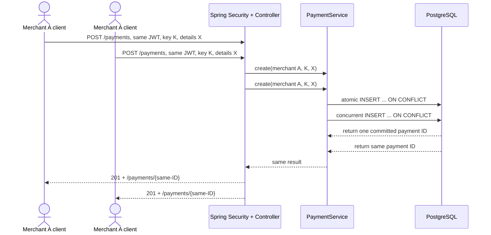

# Chapter 57 — Concurrent Payment Retries, Explained from Zero

> **Milestone 18, Part A: correctness before capacity.** This is a
> complete beginner tutorial for an implemented test. It protects
> simulated payment intake, not a real card payment or bank transfer.

## 1. What problem are we solving?

Imagine you press "Submit order" in an online shop. The shop's
network connection drops just after the server stores your order.
The shop does not know whether the first request succeeded, so it
sends the request again. If the server creates a different payment
record on every try, one purchase could be recorded many times.

The problem becomes more difficult when **eight requests arrive at
nearly the same instant**, not sequentially.

**Goal:** all eight requests from one merchant with the same
`Idempotency-Key` and identical payment details return a *single*
payment identifier. A changed request using the same key must be
rejected. Another merchant must not retrieve the payment.

No real money is involved here.

## 2. Mini dictionary

| Term | Everyday meaning | In our Java platform |
| --- | --- | --- |
| Retry | Try the same operation again after uncertainty | Resend an HTTP POST |
| Idempotency | Repeating an operation has the same persisted outcome | One payment for a merchant/key/details |
| Race condition | The result depends on timing between workers | Two requests attempt insertion together |
| Concurrency | Several things are happening at overlapping times | Eight HTTP calls submitted together |
| Thread | A path through a running Java program | One test worker per request |
| Transaction | One DB work unit that commits or rolls back | `@Transactional` in `PaymentService` |
| Unique constraint | Database refuses duplicate values in specified columns | Merchant and idempotency key |
| JWT | Signed evidence of identity and permissions | Signed test bearer token |
| Merchant/tenant | A separate customer organization | `merchant_id` from verified JWT |
| HTTP 201 | A creation-style success response | First POST or matching retry |
| HTTP 409 | The request conflicts with existing state | Same key but different payment terms |
| HTTP 404 | This resource cannot be found within the caller's scope | Another merchant's payment |

**Key distinction:** the idempotency key is a *retry identifier*,
not an authentication credential. We still validate the JWT and
scope every time.

## 3. How the implementation works



Java code does **not** rely on "check whether a record exists,
then insert" alone. Two concurrent threads could both see nothing
and both insert. The database's composite uniqueness constraint
arbitrates competing inserts atomically, and the application checks
that a repeated key uses the original amount, currency and reference.

**Source investigation (open in this order):**

1. `PaymentController.create` — reads HTTP JSON, key and trusted JWT.
2. `CreatePaymentRequest` — validates the incoming request.
3. `PaymentService.create` — runs the application transaction and
   checks for changed payment details.
4. `PaymentStore` — defines the persistence interface.
5. PostgreSQL adapter — the actual atomic insert SQL.
6. Flyway migrations V1 and V2 — schema and merchant ownership.
7. `PaymentBearerTokenIT` — the real security-filter HTTP test.
8. `PaymentServiceIT` — existing service-level two-thread race test.

The HTTP test covers the same correctness principle through
more layers than the service-level test. It does **not** measure
the sustainable requests/second capacity of the server.

## 4. How we implemented the additional test

Location:
`src/test/java/dev/asambataiden/payment/payments/api/PaymentBearerTokenIT.java`

New test:
`concurrentSignedHttpRetriesReuseOneRowAndEnforceMerchantIsolation`.

### Step A — Generate unique synthetic test data

The test creates a random merchant identifier and an independent
random idempotency key. Why random? Different test runs should not
interfere with each other's database records.

It generates a temporary RSA key pair and signs a token for the
merchant, granting `payments:read payments:write`. A test-only
JWT decoder checks the signature and issuer/audience. It does not
turn off Spring Security.

### Step B — Prepare eight workers

`Executors.newFixedThreadPool(8)` creates up to eight test workers.
`CountDownLatch ready` waits for every worker to be prepared.
`CountDownLatch start` holds those workers until the test releases
them together.

**Why both latches?** Without the ready gate, the first request could
finish before other threads even start; that would not meaningfully
exercise the race.

This is **synchronized release**, not a guarantee that all requests
reach PostgreSQL on the same CPU instruction.

### Step C — Send the same authenticated POST

Each worker submits the same amount (`29.99`), currency
(`EUR`), merchant reference (`same-order`) and
`Idempotency-Key`. All workers must receive HTTP **201** and
status `RECEIVED`.

Every HTTP response contains a `Location` header such as
`/api/v1/payments/{uuid}`.

### Step D — Prove the persisted outcome

We collect all eight Location values into a Java `HashSet`.
A set holds distinct values only.

- If all requests return the same payment location, the set size is 1.
- If even one request creates a second payment, the set size becomes
  2 or more and the test fails.

Then the test independently queries PostgreSQL:

```sql
SELECT count(*)
FROM payments
WHERE merchant_id = ?
  AND idempotency_key = ?;
```

It must return **1**. This second check matters: identical HTTP
responses alone would not prove that the database has no duplicates.

### Step E — Check a dangerous retry

We send another POST with the **same merchant and same key**, but
change the amount to `30.99`. Expected HTTP response: **409
Conflict**. The original stored row must remain unchanged.

### Step F — Prove tenant isolation

A different merchant receives its own correctly signed JWT with
`payments:read`. It attempts to GET the first merchant's record.
Expected response: **404 Not Found**, preventing cross-tenant
disclosure. The test checks the database count is still 1.

## 5. Run it yourself, step by step

### Prerequisites

- JDK 25 and Maven 3.9+
- Docker Desktop started
- The `feat/payment-ledger` repository checked out
- No actual payment credentials or live endpoints needed

### Step 1 — Open your repository and retrieve updates

```bash
ROOT="$(git rev-parse --show-toplevel)"
git -C "$ROOT" status --short --branch
git -C "$ROOT" pull --ff-only origin feat/payment-ledger
```

`ROOT` remembers your project directory, even if the terminal
happens to be inside an `ops` subfolder. `--ff-only` avoids
accidental merge commits. If the pull refuses to run, inspect local
changes instead of force-resetting them.

### Step 2 — Check the tools

```bash
java -version
mvn -version
docker info
```

If Docker is not reachable, start Docker Desktop before testing.

### Step 3 — Run the targeted HTTP security integration test

```bash
mvn -B --no-transfer-progress -f "$ROOT/pom.xml" \
  -Dit.test=PaymentBearerTokenIT verify
```

This executes the named integration test via Maven Failsafe.
The class includes *other* signed-JWT security tests too; don't
assume only the new method ran. Observe the actual test count.

### Step 4 — Run the full regression suite

```bash
mvn -B --no-transfer-progress -f "$ROOT/pom.xml" clean verify
```

Watch for `BUILD SUCCESS`; check unit/integration counts and
failures, then inspect the current GitHub Java/Security CI gates.
No historical green build automatically validates a later commit.

## 6. What can go wrong?

| Symptom | Likely explanation | First check |
| --- | --- | --- |
| Docker container cannot start | Docker daemon unavailable | `docker info` |
| 401 Unauthorized | Token signature/issuer/audience invalid | Trusted test issuer and token setup |
| 403 Forbidden | Missing `payments:write` scope | JWT scope |
| 409 during identical calls | Key unexpectedly paired with changed payload | Compare request JSON and key |
| Multiple Location values | Concurrent insert logic broken | Unique constraint and SQL adapter |
| Timeout waiting for worker | Scheduling, DB locks or connection capacity | Full test logs, Hikari timeout |
| Cross-tenant GET returns 200 | Serious isolation regression | Stop and inspect merchant scoping |

Do not respond to concurrency failures by increasing a DB pool
limit without investigating the actual invariant and transaction.

## 7. What does this prove — and not prove?

If the tests pass, we have evidence that the tested concurrent
signed-JWT HTTP retries produce one persisted simulated payment
and that the tested conflict and tenant-isolation cases work.

This does **not** prove:
- exactly-once delivery across Kafka;
- safe retry semantics for every possible downstream service;
- financial settlement correctness;
- production capacity, recovery time or compliance certification;
- that no untested race or failure remains.

A broader **sustained-performance** experiment is a separate
Milestone 18 activity and should be judged by latency, load
generator validity, JVM/DB telemetry and explicit safety cutoffs.

## 8. Think like a senior engineer: questions and answers

**Q: Why not check for the key before inserting?**
A: Two request threads could both see an empty result and each
attempt an insert. A database uniqueness constraint gives us
cross-process arbitration even if we deploy multiple replicas.

**Q: Why do we still compare payload values after an idempotent lookup?**
A: The same key must identify the *same logical operation*, not
silently accept a different amount or currency.

**Q: What does `CountDownLatch` add?**
A: It makes a concurrency test more effective by coordinating when
workers leave the start gate; without it, a supposedly concurrent
test may be accidentally sequential.

**Q: Why test this through HTTP if a service integration test exists?**
A: To cover the actual bearer token, scope, controller, mapping,
transaction and database boundaries together.

**Q: What is the difference between correctness and throughput?**
A: Correctness asks, "Did we create one and only one payment record
for this key?" Throughput asks, "How many requests can this
configuration complete per second?" Fast but incorrect is unacceptable.

## 9. Your learning journal exercise

Explain in your own words:

1. The difference between an idempotency key and JWT authorization.
2. Why all eight responses must have the same Location.
3. Why we also run a SQL count query.
4. What changes when the payload differs.
5. Why merchant B sees HTTP 404.
6. One thing the current test has **not** proved.

Record the exact Git commit, local test results, and CI run links
after actually executing the tests. Do not invent benchmark numbers.
