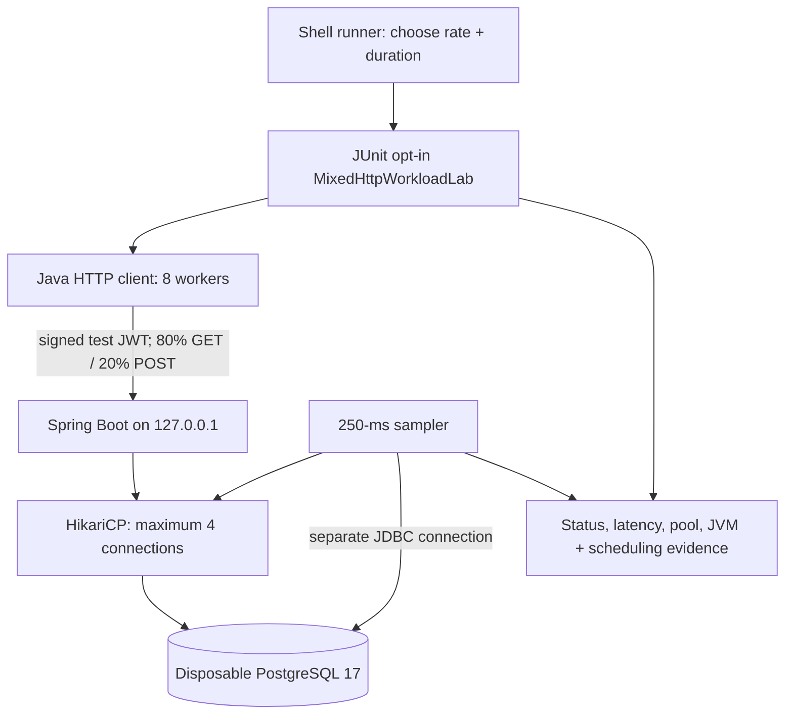

# Chapter 59 — Sustained HTTP Load Testing From Zero (Milestone 18, Part B)

> **This is a step-by-step learning tutorial, not merely a runbook.**
> This project records **simulated payments only**. Never use this
> test against a production API, live merchant or real payment processor.

## 1. Start with the simplest problem

Imagine a restaurant has ten customers during lunch.
The kitchen serves them without trouble. Does that prove the
kitchen could serve customers continuously all afternoon?
No. A short rush can work while a longer period exposes
slowdowns, queues, insufficient equipment or exhaustion.

Our previous experiments lasted **12 seconds per stage**.
They successfully processed synthetic requests at 25, 50 and
100 requests/second. Those results are valuable but **do not
prove sustained capacity**.

This lesson extends the time window **without arbitrarily
raising the arrival rate**. That helps us observe whether
performance remains stable for longer under a controlled
and reproducible workload.

### The experiment asks

- Can the app complete all synthetic requests at the prescribed rates?
- Does HTTP read/write latency degrade?
- Do threads begin waiting for database connections?
- Do JVM CPU time, heap, thread counts or GC events change?
- Does our client fall behind the requested sending schedule?

It does **not** answer whether this is a production-capable
payment processor or whether it can run at this rate for hours.

## 2. New words explained

| Term | Plain language | Meaning here |
| --- | --- | --- |
| Workload | Tasks we ask a system to do | HTTP GET and POST requests |
| RPS | Requests per second | How fast the client schedules requests |
| Offered load | How much work we attempt to send | 25 or 50 requests/second |
| Completed throughput | How much work actually finishes per second | Calculated from completed calls and elapsed time |
| Duration | How long the test keeps submitting calls | 30 or 60 seconds |
| Warm-up | Practice before counting results | 20 initial calls |
| p50/p95/p99 | Percentile boundaries | Client-side HTTP latency distribution |
| HikariCP | Reusable DB connection pool | Limits simultaneous database leases |
| Pending connection | Someone waiting for a free DB connection | Hikari threads awaiting acquisition |
| GC | Automatic cleanup of unused Java objects | JVM collection count |
| Heap | JVM-managed memory for objects | Sampled heap memory in MiB |
| Testcontainers | Creates temporary real dependencies | Disposable PostgreSQL 17 |
| Fail-fast | Stop immediately on a broken safety check | Skip stage 2 if stage 1 fails |
| Synthetic | Created for training rather than representing a live user | All payment IDs, JWTs and values |

**Important:** `p95 = 10 ms` means about 95% of the **sampled
requests** completed in 10 ms or less. It does not mean 95%
of *all future requests* are guaranteed to be that fast.

## 3. What we changed — before and after

**Before:**
`MixedHttpWorkloadLab` always used 12 seconds per stage.
The existing rate-ladder scripts rely on that default.

**After:**
The harness accepts a **separate optional system property**
`mixed.lab.duration.seconds`, defaulting to 12.
We allow **only 12, 30 or 60 seconds**.
Rates remain restricted to **25, 50 or 100 RPS**.

The total measured requests are:

```text
requests = offered_requests_per_second × duration_seconds
25 × 30 = 750 requests
50 × 60 = 3000 requests
```

Why the strict lists? A typo such as 6000 seconds, or an
unintended high rate, should not create unlimited test traffic.
We also forbid more than **6000 measured requests per execution**.

These checks do not replace Docker resource limits or an independent
load generator; they are practical safety rails for this local lab.

## 4. System architecture: which program does what?



In ordinary words, the shell script **starts the test**.
The Java test **sends the requests**.
The Spring Boot app **processes them**.
PostgreSQL **stores the simulated records**.
A metrics sampler **observes how busy the system is**.
The script **saves what actually happened to logs**.

The tests create temporary RSA signing keys and JWTs. We do
not turn off the security filter, nor do we connect to a live
identity provider.

## 5. Step-by-step code walk-through

### Step A — Configure the duration

File:
`src/test/java/dev/asambataiden/payment/performance/MixedHttpWorkloadLab.java`.

```java
private static final int RATE = Integer.getInteger("mixed.lab.rate", 25);
private static final int DURATION_SECONDS =
        Integer.getInteger("mixed.lab.duration.seconds", 12);
private static final int REQUESTS = RATE * DURATION_SECONDS;
```

`Integer.getInteger` reads a **JVM system property** (a
`-Dname=value` argument), not an HTTP parameter or
database entry. If the property is absent, the default is used.

The default 12 seconds keeps our earlier experiments working
without altering their original design.

### Step B — Check the safety limits

```java
if (DURATION_SECONDS != 12 && DURATION_SECONDS != 30
        && DURATION_SECONDS != 60) {
    throw new IllegalArgumentException(
            "mixed.lab.duration.seconds must be 12, 30, or 60");
}
if (REQUESTS > 6000) {
    throw new IllegalArgumentException("Safety cap: at most 6000 measured requests");
}
```

A startup configuration error should fail immediately, before
the load generator creates thousands of requests.

The client is also limited to eight workers, a maximum of
32 outstanding calls, and a five-second request timeout.
The test refuses an unexpectedly large outstanding queue.

### Step C — Increase the monitoring requirement

At 250-ms intervals, 30 seconds should produce roughly
120 samples; 60 seconds roughly 240.

We require at least **three samples per second** to avoid
silently accepting a long run where monitoring stopped.

```java
assertTrue(captured.size() >= DURATION_SECONDS * 3,
        "Pool/DB sampling coverage too low for this duration");
```

This is a **coverage check**, not proof that every
milliseconds-long spike was captured.

### Step D — Run two independent stages

File: `ops/benchmarks/http/run-sustained-local.sh`.

The script executes:

```text
Stage 1: 25 requests/sec × 30 sec = 750 measured requests
Stage 2: 50 requests/sec × 60 sec = 3000 measured requests
```

Each Maven test creates a new Spring Boot application context
and disposable PostgreSQL database, so stage 2 does not inherit
the growing data of stage 1.

### Step E — Check real outcomes

The test expects every GET to return HTTP **200**, and
every successful simulated-payment POST to return **201**.

It reports latency (p50/p95/p99), actual completed RPS,
Hikari active/pending connections, sampled PostgreSQL waits,
JVM telemetry and load-generator scheduling lag.

It fails on unexpected HTTP results, missing monitoring,
sampler errors, unbounded outstanding work or inconsistent
database pool limits.

A test that passes these functional checks could still be
too slow for a real production requirement. **We have not
set a production latency SLO in this laboratory.**

## 6. Your hands-on terminal lesson

**Prerequisites:** Java 25, Maven 3.9+, Docker Desktop running,
and the Git repository checked out. This is independent of
the application's live database password or production JWT issuer.

### Command 1 — Discover your repository root

```bash
ROOT="$(git rev-parse --show-toplevel)"
printf 'Root: %s\n' "$ROOT"
```

This works from any directory *inside* the Git repository,
including deep `ops/` paths. If it fails, first `cd`
into the checked-out repository.

### Command 2 — Update your feature branch

```bash
git -C "$ROOT" status --short --branch
git -C "$ROOT" pull --ff-only origin feat/payment-ledger
```

Do not discard uncommitted files to force a pull.

### Command 3 — Verify the prerequisites

```bash
java -version
mvn -version
docker info
```

`docker info` must connect to Docker Desktop.

### Command 4 — Check the script before executing it

```bash
bash -n "$ROOT/ops/benchmarks/http/run-sustained-local.sh"
```

`bash -n` checks shell **syntax**; it does not execute
the script and cannot guarantee that all runtime behavior works.

### Command 5 — Start the explicit opt-in benchmark

```bash
bash "$ROOT/ops/benchmarks/http/run-sustained-local.sh"
```

The runner saves timestamped detailed evidence under
`target/http-load-lab/`. It prints a short per-stage
summary, retaining the full Maven output in separate files.

**Never change the runner to point at a production URL**.
The Java test has a hard-coded loopback target and
provisions disposable PostgreSQL.

## 7. How to read the output without guessing

Example *field names* (not real results):

```text
MIXED_HTTP_LAB phase=measured op=read samples=... success=...
MIXED_HTTP_LAB phase=measured op=write samples=... success=...
MIXED_HTTP_LAB telemetry merchants=... avg_active=... process_cpu_sec=...
MIXED_HTTP_LAB rate=... duration_target_sec=... total=... elapsed_sec=...
```

Check each line in order:

1. **Samples** — 80% GET and 20% POST, all expected.
2. **Success/Unavailable/Unexpected** — look for any non-successful
   results; no unexpected response is acceptable for this gate.
3. **p95/p99** — compare read and write separately.
4. **Completed RPS** — compare achieved completion rate with
   the offered schedule.
5. **Hikari active/pending** — investigate connection pressure
   if connections approach four or threads await a lease.
6. **CPU seconds/GC/heap** — investigate resource demand,
   but do not mistake process CPU-seconds for utilization percent.
7. **Max schedule lag** — the client generator itself can fall
   behind, invalidating the intended offered-load rate.

An occasional `ERROR` log in an intentional negative-path
unit test is not automatically a failure; here we must
inspect its context and the final Maven result.

## 8. Troubleshooting guide

| What you see | Simple explanation | Action |
| --- | --- | --- |
| `docker info` fails | Docker is not ready | Start Docker Desktop and retry |
| 401 / 403 | Token rejected / permission missing | Inspect test-only JWT configuration and scopes |
| 409 | Same key reused with different details | Inspect merchant, key and payload |
| 503 | Database connection or resource unavailable | Inspect Hikari pending/active, SQL time and DB logs |
| Request timeout | The operation exceeded five seconds | Inspect HTTP, SQL and host resource contention |
| `max_outstanding` limit | Client has a backlog | Stop and investigate, do not simply increase limits |
| Sampler coverage too low | Missing observations during test | Check DB monitoring and host scheduling |
| A stage fails | Result not trustworthy or correctness issue | Keep later stages stopped; preserve its full log |

Do not optimize based only on one fast or slow trial. Do not
increase the Hikari connection count without an explicit
database connection budget and evidence of pool contention.

## 9. The evidence we still need

This chapter describes implemented source changes and the
required experiment; it **does not claim any 30- or
60-second results**.

After a successful local run, document:
- Tested Git SHA and UTC time;
- 750/3000 measured request counts and success/error breakdown;
- GET and POST p50/p95/p99 separately;
- Achieved throughput and maximum schedule lag;
- Hikari occupancy, pending connections and DB waits;
- JVM CPU time, GC collections and heap observations;
- Caveats: two short sustained stages on one developer machine,
  one app instance, a synthetic small dataset.

## 10. Interview practice and exercises

**Q1. Why not infer sustained capacity from a 12-second test?**

Because caches, warm-up and short-lived bursts can hide problems
that appear only after continued load.

**Q2. Why is an arrival rate different from achieved throughput?**

An arrival rate is how fast we *attempt* to submit requests;
throughput is how many requests *finish* over elapsed time.
If the generator queues, the intended schedule may not be met.

**Q3. What does Hikari 'pending' show?**

Threads waiting to acquire a database connection.
Sustained pending may indicate pool pressure, although it
does not automatically mean the pool should be enlarged.

**Q4. Why separate correctness and performance tests?**

Correctness asks whether we always produce the right durable
result, including during retries and concurrent calls.
Performance asks how efficiently we handle valid work.
A fast system that creates duplicates is not acceptable.

**Q5. What must change before we call this production-ready?**

We need explicit workload/SLO requirements, much longer
independent trials, bigger realistic datasets, multiple
application instances, external traffic generation, failure
and recovery drills, monitoring, security and deployment
controls, and an approved production identity provider.

### Homework

Explain these lines in your own words:

```java
private static final int REQUESTS = RATE * DURATION_SECONDS;
assertTrue(captured.size() >= DURATION_SECONDS * 3);
```

Then answer: why does the test use a **new disposable database**
for each stage instead of writing to one permanent database?

If you can explain all three without reading the answers,
you understand the main design choices behind this lesson.
