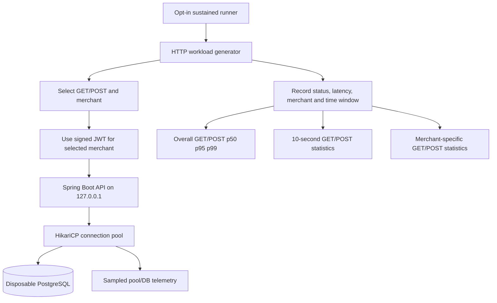

# Chapter 61 — Time-Windowed Latency and Merchant Fairness, From Zero

> **Milestone 19:** instrument an existing isolated, opt-in, simulated-payment
> HTTP benchmark. This page teaches the implementation before asking for
> measurements. **No results from the new implementation are claimed yet.**

## 1. First understand the problem without technical words

Suppose a supermarket reports, "Our average checkout takes five minutes."
That sounds reasonable. But imagine its busiest customers wait one minute
while a smaller group waits twenty minutes. The overall report hides
unequal treatment.

Or suppose the supermarket is fast for the first five minutes of opening,
then becomes very slow. A single average for the entire day could hide
that worsening trend.

Our HTTP tests previously printed one p95 for *all* GETs and one for
*all* POSTs over the whole stage. This lesson adds two views:

1. **Over time:** how long did operations take in each **10-second window**?
2. **By merchant:** how long did GETs and POSTs take for each synthetic tenant?

The aim is **measurement quality**, not to declare production fairness.

## 2. Important words, explained

| Word | Beginner meaning | In this experiment |
| --- | --- | --- |
| Tenant / merchant | One separate shop using our platform | Four signed JWT identities |
| Hot tenant | Shop sending most requests | Merchant index 0, target 70% |
| Cold tenant | Smaller shop with fewer requests | Merchant indices 1–3, target 10% each |
| Operation | Type of request | GET = read; POST = write |
| p95 | 95th percentile of measured request times | One statistic per operation/group |
| Time window | A fixed slice of the test timeline | 0–10, 10–20, 20–30 seconds, etc. |
| Sampling | Recording selected observations instead of everything | Hikari/DB checks every 250 ms |
| Instrumentation | Code that records what happened | `Sample`, `reportBreakdowns` |
| Correlation | Two choices accidentally move together | Old tenant selector made every POST hot |
| Regression test | Test preventing a bug from silently returning | `MixedHttpTenantDistributionTest` |

**Do not confuse** request latency samples (each request timed) with
Hikari connection samples (observed every 250 ms).

## 3. A bug discovered before implementing the metrics

The previous load generator selected the merchant using
`requestNumber % 10`, with the first seven remainders mapped to
merchant 0. It selected a POST when `requestNumber % 5 == 0`.

**What went wrong?** Any multiple of 5 has remainder **0 or 5**
when divided by 10. Both select the hot merchant. Consequently,
**100% of measured POST requests were sent to merchant 0**, even though
the *overall* distribution was described as 70/10/10/10.

The old successful runs were real, but their workload was less
balanced than we thought. Their measured results are not deleted.
Chapters 55, 56 and 60 should be read with this correction.

### Corrected deterministic formula

The load generator now uses a small separate helper:

```java
int n = Math.abs(sequence);
int bucket = ((n / 5) * 7 + (n % 5) * 3) % 10;
return bucket < 7 ? 0 : bucket - 6;
```

**What does it mean?** The arithmetic spreads *both* GETs and POSTs
across the ten distribution slots instead of always assigning writes
to the busy merchant.

Every **50 consecutive requests**, counted from sequence 1:

| Merchant | GET requests | POST requests | Total |
| --- | ---: | ---: | ---: |
| 0 — hot | 28 | 7 | 35 |
| 1 | 4 | 1 | 5 |
| 2 | 4 | 1 | 5 |
| 3 | 4 | 1 | 5 |
| **Total** | **40** | **10** | **50** |

So the hot tenant gets 70% of reads **and** 70% of writes;
each other tenant receives 10% of each operation.

**Where the code lives:**
`src/test/java/dev/asambataiden/payment/performance/MixedHttpTenantDistribution.java`

**Where we verify the formula:**
`src/test/java/dev/asambataiden/payment/performance/MixedHttpTenantDistributionTest.java`

The unit test inspects four separate blocks of 50 requests and checks
exact read/write counts for each merchant. It also checks valid
negative warm-up sequences and rejects invalid zero / minimum-integer
inputs. The test's reported success must still be confirmed by CI.

## 4. How requests flow and where time is measured



We keep the real application logic unchanged. **All changes
are in the test/benchmark instrumentation**, so normal payment
behavior, authentication and transaction semantics remain untouched.

## 5. What changed in the Java test?

File: `src/test/java/dev/asambataiden/payment/performance/MixedHttpWorkloadLab.java`.

### Step 1 — Remember more information per request

Old: `Sample(boolean write, int status, double ms)`.

New:

```java
record Sample(boolean write, int status, double ms,
              int merchantIndex, int window) {}
```

A **record** is a small immutable group of values.
The new fields tell us **who** the request belonged to,
and **which part of the measured timeline** scheduled it.

### Step 2 — Assign a time window

```java
int window = n < 0 ? -1 : (n - 1) / (RATE * 10);
```

At 25 RPS, the first 250 measured requests fall into
the 0–10-second group, the next 250 into 10–20 seconds.
We assign the window from the **planned request sequence**,
not from when a slow request happened to finish.

Negative sequence values are the 20 warm-up requests; they
receive window `-1` and are excluded from measured analysis.

### Step 3 — Group the measured results

`reportBreakdowns` loops over each 10-second window and
each operation type, then emits counts and p50/p95/p99.

It also loops over merchants 0–3 and each operation type,
calculating the same statistics. It asserts that all requests
are included in exactly one time window and exactly one
merchant group and that neither operation is absent.

The new breakdowns print only for durations **30 or 60 seconds**.
The older 12-second experiments retain their existing concise
output format.

### Step 4 — Understand the sample-size limitation

For the 25 RPS × 30-second experiment, each 10-second window
has 250 requests total and approximately 50 writes.
Each cold tenant receives only **15 POSTs across the full
30-second stage**.

A p99 computed from 15 requests is effectively a *near maximum*,
and is **not a stable production p99**. The p95/p99 reports are
useful for exploratory comparisons, not definitive fairness SLAs.

### Step 5 — Prevent the workload from lying

The separate `MixedHttpTenantDistributionTest` checks exact
per-merchant read and write counts. Without that test, a small
formula change could silently direct all writes to the hot
tenant and make the resulting chart look more representative
than the real traffic.

## 6. Hands-on commands and explanation

Prerequisites: Java 25, Maven 3.9+, Docker Desktop running,
branch `feat/payment-ledger`.

```bash
ROOT="$(git rev-parse --show-toplevel)"
git -C "$ROOT" status --short --branch
git -C "$ROOT" pull --ff-only origin feat/payment-ledger

# First prove the distribution mathematics, without Docker.
mvn -B --no-transfer-progress -f "$ROOT/pom.xml" \
  -Dtest=MixedHttpTenantDistributionTest test

# Check the safe benchmark runner's shell syntax.
bash -n "$ROOT/ops/benchmarks/http/run-sustained-local.sh"

# Then run both isolated sustained stages with the corrected workload.
bash "$ROOT/ops/benchmarks/http/run-sustained-local.sh"
```

The `mvn ... test` command compiles test sources and executes
the selected JUnit unit test. The `bash -n` command checks syntax
without running HTTP requests. The final command runs the opt-in
30-second and 60-second workloads and writes logs beneath
`target/http-load-lab/`. It aborts on the first failing stage.

## 7. How to read the new output

Look for the following kinds of lines:

```text
MIXED_HTTP_LAB breakdown=window start_sec=0 end_sec=10 op=read ...
MIXED_HTTP_LAB breakdown=window start_sec=0 end_sec=10 op=write ...
MIXED_HTTP_LAB breakdown=tenant merchant_index=0 op=read ...
MIXED_HTTP_LAB breakdown=tenant merchant_index=1 op=write ...
```

Then check:

1. All expected request groups are present.
2. Every group records the expected HTTP status code.
3. Read p95 remains reasonably consistent across time windows,
   or any trend is investigated.
4. Write p95 is analyzed **separately** from read p95.
5. Hot and cold tenants are compared with sample counts and
   request-mix context—not merely headline percentiles.
6. The pool, JVM and DB telemetry still show whether resource
   bottlenecks are emerging.

**No performance numbers are inserted here until the revised
benchmark is run.** The earlier Chapter 60 results describe the
pre-correction distribution.

## 8. Alternatives, troubleshooting and decision rules

- **Why not just a global average?** It hides long-tail requests
  and unequal experiences between merchants.
- **Why not use a random merchant selector?** Randomness makes
  proportions vary; deterministic counts help reproduce and debug
  a small educational benchmark. Larger production load studies
  may use reproducible seeded random distributions.
- **Why not report an SLO now?** We haven't defined real customer
  requirements or collected enough representative per-tenant data.
- **Why not tune Hikari yet?** The previous runs showed no sampled
  connection acquisition queue; tuning without evidence may harm DB
  stability.

If a group has unexpectedly zero requests, treat that as a broken
workload/test setup. If a SQL count grows unexpectedly,
distinguish normal simulated POST creation from a duplicate-key
correctness failure. If the client falls behind, investigate
the load generator before blaming the server.

## 9. Interview Q&A

**What is multi-tenant fairness?** Different customers should
receive predictable service according to their agreed isolation
and resource-sharing policy. This test *measures* disparities;
it does not enforce quotas or guarantee fairness.

**What caused the all-hot-write bug?** Selecting write operation
and merchant using correlated modulo functions. Every POST's
sequence number was divisible by five, and these values mapped
to the hot tenant.

**How did you prevent recurrence?** Extracted the deterministic
selector, verified exact per-operation tenant frequencies with
JUnit, and added separate merchant and time-window breakdowns.

**What is the difference between scheduled and completion-time
windows?** Scheduled windows group by when the generator intended
to send each request; completion windows group by when the
response finished. Our chosen windows facilitate offered-load
comparison and must not be mistaken for real-time completion
histograms.

**What must you do before increasing load?** Confirm expected
request distribution, checks and CI, preserve safety bounds,
run with a disposable database, inspect client scheduling
and monitor application/database constraints.

## 10. Learning exercise

Without looking at the code, explain why
`n % 5 == 0` combined with `n % 10 < 7`
means every write reaches merchant 0.
Then calculate 25 RPS × 30 seconds and estimate how many
writes each merchant should receive at the corrected skew.
Finally explain why cold-tenant p99 from 15 requests is
not a reliable production metric.
