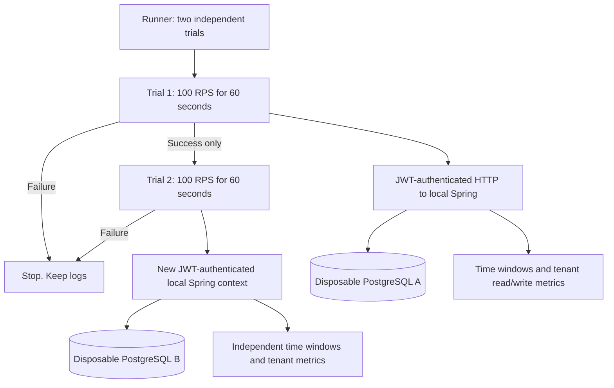

# Chapter 63 — Repeatable Tenant Fairness Measurements, Explained from Zero

**Milestone 20: improving measurement confidence**. This is an **educational synthetic-only** performance lab. No real payments or live card data; every trial starts a separate localhost Spring Boot server, disposable PostgreSQL 17 database and test JWT issuer.

## 1. Why we need this increment

**Everyday example:** Suppose a restaurant serves four shops. One very large shop places 70% of orders and three small shops each place 10%. On a quiet day, one small shop's single unusually slow order can make its reported "p99" look terrible. We cannot conclude the restaurant is unfair based on a handful of examples.

Our previous 25 RPS / 30 sec run had just **15 write operations per cold tenant**. Our 50 RPS / 60 sec run had **60 per cold tenant**. The next step must increase *useful per-tenant observations* and repeat the experiment independently, not blindly increase maximum throughput.

Our approach: **two independent 100 RPS × 60-second trials**, each within the existing approved upper limit of 100 RPS and 60 seconds.

## 2. Vocabulary

| Word | Plain-language meaning | This experiment |
| --- | --- | --- |
| Trial | One complete experiment | One Java test with its own Spring/DB instance |
| Repeatability | Do similar conditions produce similar outcomes? | Compare trial 1 against trial 2 |
| Throughput | Finished work per second | Completed HTTP requests / elapsed seconds |
| Offered load | The work we attempted to send | 100 requests per second |
| Tenant skew | Some customers send more work | 70/10/10/10 |
| p95/p99 | Ranked tail of observed response times | Calculated separately for each tenant/operation |
| Sample size | Number of real measurements | 120 cold-tenant writes per trial |
| Confidence | Strength of inference from available evidence | Still limited with only 2 short local trials |
| Reproducibility | Can another run follow the same documented method? | Commit SHA, fixed settings and saved logs |

**Be careful:** two runs are helpful, not a statistically robust estimate of production reliability. Nor does having 120 samples establish an accurate p99.

## 3. The test design



Every trial sends exactly **6,000 measured** HTTP calls:
- **4,800 GET requests** and **1,200 POST requests**
- Merchant 0: 3,360 GET / 840 POST
- Merchants 1, 2 and 3 *each*: 480 GET / 120 POST

The test uses eight client workers, a maximum of 32 outstanding calls, four maximum Hikari connections and 250-ms pool/database sampling. The API remains bound to `127.0.0.1`; the payment simulation lifecycle endpoint and Kafka integration remain disabled.

The client still reads a small, bounded dataset of eight seeded payment records per tenant. This can be cache-friendly. Real tenant fairness under production contention is not yet demonstrated.

## 4. What was implemented, in real source code?

### Source file 1 — completion rates by tenant

`src/test/java/dev/asambataiden/payment/performance/MixedHttpWorkloadLab.java`

When printing each tenant's GET/POST latency, we now also report:

```java
success / elapsedSeconds
```

This is the **number of successful requests for that tenant and
operation divided by the entire measured trial's elapsed time**.

For instance, in a 60-second trial, merchant 1 is expected to receive
480 GETs and 120 POSTs. That corresponds to about **8 successful
GET/s** and **2 successful POST/s**, assuming all requests finish
at the scheduled rate.

The actual values must be read from the log; the numbers above are
**workload expectations, not measured results**.

Why does this matter? A global completion rate of 100 requests/s
could hide a merchant receiving fewer than its expected share.
Our per-tenant counts and rates expose that difference.

### Source file 2 — repeated runner

`ops/benchmarks/http/run-repeated-sustained-local.sh`

The shell script does four things:

1. Checks installed tools and Docker availability.
2. Saves the timestamp and exact Git SHA.
3. Runs two fresh `MixedHttpWorkloadLab` stages, always 100 RPS and 60 seconds.
4. Stops at the first failure and saves both the full trial log and a readable summary.

It does **not** increase the application's pool size, bypass JWT
authentication or reuse a production database.

## 5. Hands-on: run from any repository subfolder

Prerequisites: Java 25, Maven 3.9+, Docker Desktop running.

```bash
ROOT="$(git rev-parse --show-toplevel)"
git -C "$ROOT" status --short --branch
git -C "$ROOT" pull --ff-only origin feat/payment-ledger

# Read before running; -n checks shell syntax only.
bash -n "$ROOT/ops/benchmarks/http/run-repeated-sustained-local.sh"

# Execute two isolated 100-RPS/60-second trials:
bash "$ROOT/ops/benchmarks/http/run-repeated-sustained-local.sh"
```

`bash -n` checks the script's *syntax*, not the correctness of
the benchmark's Java implementation. The final command is the
actual experiment, creating a separate disposable test database for
each stage.

All logs go to `target/http-load-lab/`. The output displays lines
beginning with `MIXED_HTTP_LAB`, including per-operation percentiles,
ten-second windows, four merchant breakdowns, pool/JVM telemetry and
a final stage summary.

## 6. What a successful run would mean

The acceptance gates require:
- each GET returns HTTP 200;
- each POST returns HTTP 201;
- all 6,000 measured requests are accounted for **per trial**;
- tenant and ten-second-window totals account for every sample;
- no broken pool/database sampler;
- bounded outstanding calls and monitored Hikari connections;
- two `BUILD SUCCESS` results.

**Do not invent results:** successful CI on the Java tests does not
mean this opt-in experiment passed. The developer must execute the
runner locally and provide the output before we can publish timings.

## 7. How to compare trials correctly

Compare matching rows: merchant 0 GET trial 1 versus merchant 0 GET
trial 2, merchant 1 POST trial 1 versus merchant 1 POST trial 2, etc.

Always show **sample counts** beside p95 and p99.

Do **not** calculate `(trial1_p95 + trial2_p95)/2` and call that
a pooled percentile. It is not: a percentile of combined request
samples requires the raw per-request latency values. Our logs only
contain summaries.

Because the test runs client and server on the same Mac, their CPU
activity can interfere. Docker Desktop overhead and OS scheduling
also limit generalization.

## 8. What if the results are different?

| Finding | Beginner interpretation | Next diagnostic |
| --- | --- | --- |
| One merchant slower in only one run | Possible random host or sampling variation | Repeat without changing settings |
| All merchants slower in second run | Possible machine resource change or cache/JVM effects | Inspect CPU time, GC, schedule lag |
| Large `max_schedule_lag_ms` | Client may have failed to generate load on time | Validate load generator and host capacity |
| Hikari pending samples | Threads waited for DB connections | Check transaction duration and PostgreSQL |
| POST errors | Correctness/availability issue | Preserve full log; do not raise load |
| High cold-tenant p99 | Tail samples remain sparse | Examine counts and raw latency distribution before claiming unfairness |

## 9. Senior-engineer interview questions

**Q: Why compare trials separately?** Independent test contexts
can have different runtime warm-up and host conditions. Averaging
percentiles conceals variation and is not a mathematically valid
combined percentile.

**Q: Why measure completed RPS per tenant?** It catches skewed
traffic and throughput shortfalls that a global average could hide.

**Q: Why not declare fairness if the p95 numbers match?** We need
explicit fairness targets, realistic resource contention and
a sample design capable of supporting statistical inference.

**Q: Why is the benchmark never sent to production?** It generates
synthetic payment creation traffic and uses ephemeral credentials,
so it is only authorized against its own disposable loopback lab.

## 10. Learning checkpoint

Explain in your own words:
1. Why 15 cold-tenant POSTs are insufficient to assess p99.
2. Why 120 observations per merchant are an improvement but still limited.
3. Why two independent runs are more informative than one.
4. Why completed RPS and offered RPS are not interchangeable.
5. Why the test retains a hard cap of 100 RPS and 60 seconds.

Once we have the console evidence, record the measured numbers in
the *next* chapter with exact commit and CI links.
