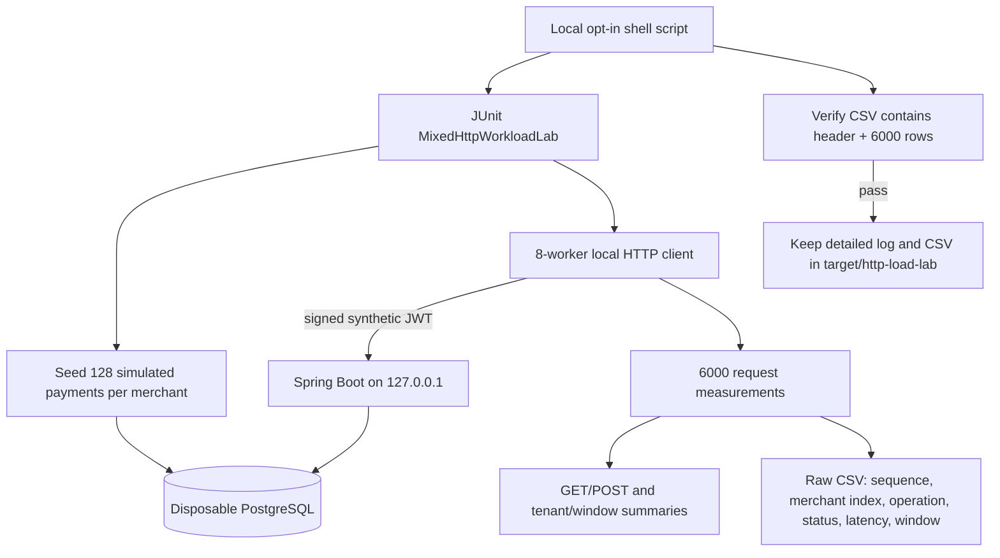

# Chapter 65 — Larger Synthetic Corpus and Raw Latency Evidence, From Zero

> **Milestone 21 — implementation tutorial, not a measured result.**
> All payment records are synthetic. The API and disposable PostgreSQL
> are only reachable from the controlled local lab. Do not use real
> payment identities, customer data or authorization credentials.

## 1. Why do we need this?

Imagine a librarian who knows where eight books are located.
Finding one of them is easy. Now imagine the same librarian must
search hundreds of books. A test against eight books cannot
represent the more demanding situation.

In our earlier lab, each merchant had only **eight seeded
payments**. That small read corpus could stay very hot in caches.
Also, previous logs showed only p50, p95 and p99, which cannot
be combined correctly across independent runs.

This milestone provides a **larger, explicitly controlled
synthetic dataset** and exports the individual request timings
needed for better post-run analysis.

**This is not yet a production-sized dataset.**
Four merchants × 128 records = **512 seeded records**, and
6,000 additional HTTP calls still run for a maximum of 60 seconds.
The database remains tiny compared with a real payment provider.

## 2. Understand the new words

| Word | Meaning without jargon | How we use it |
| --- | --- | --- |
| Test corpus | A prepared collection of sample data | 128 simulated payments per merchant |
| Seed | Create sample records before the measured run | 512 total payment records initially |
| Raw observation | One individual measured event | A single GET or POST latency |
| CSV | Text table with comma-separated values | One header plus 6,000 request rows |
| Percentile | Position in sorted measurements | p95/p99 reconstructed from actual raw samples |
| Cardinality | Number of distinct values | 128 possible read IDs per merchant |
| Integrity check | Verify an output file is complete | Exactly 6,001 CSV lines including header |
| Opt-in | Runs only when requested explicitly | Separate shell command, not default CI |

## 3. Architecture and boundaries



No raw card data, personal merchant names, bearer tokens,
request JSON bodies, payment UUIDs or full endpoint URLs
are written to the CSV. The merchant index is just 0–3,
not an identifying tenant value.

## 4. Exactly what code changed, and why

### A. Bound the dataset size

`MixedHttpWorkloadLab.java` now reads:

```java
private static final int RECORDS_PER_MERCHANT =
        Integer.getInteger("mixed.lab.seed.records", 8);
```

The defaults remain eight seeded records per merchant, so
earlier experiments are not silently changed.

Allowed values are **8** or **128** only. A typo such as
`1280000` fails during test initialization rather than
creating millions of records.

Our new runner explicitly uses:

```text
-Dmixed.lab.seed.records=128
```

This prepares 512 seeded payments across four merchants,
then uses them as GET targets. Writes continue to create
new synthetic payment records during the measured stage.

### B. Remember which request produced a measurement

The Java record `Sample` now also stores the sequence number:

```java
record Sample(
    boolean write, int status, double ms,
    int merchantIndex, int window, int sequence) {}
```

A Java `record` groups several related values into one
immutable data object. The sequence makes each CSV row
traceable back to its scheduled position within the
test—without printing sensitive payment identifiers.

### C. Export opt-in request timings

The new `exportRawSamples` method writes:

```csv
sequence,merchant_index,operation,http_status,latency_ms,window_start_second
```

Every **measured** request produces one row. Warm-up
observations are not exported. The exporter uses
`Locale.ROOT` for decimal periods, UTF-8 encoding,
and restricts the destination to `target/http-load-lab`
with a `.csv` extension.

No CSV is produced by the legacy rate ladder unless an
explicit `mixed.lab.csv.path` system property is supplied.

### D. Verify the evidence isn't silently incomplete

The runner requires an actual CSV and exactly **6,001
lines**: one header and 6,000 measured samples.
The runner stops with a failure if that check does
not pass. This check detects missing or truncated rows
but does not independently prove every CSV field is
correct—parsing and semantic validation are a possible
future enhancement.

### E. Preserve old safety limits

The new experiment remains:
- localhost `127.0.0.1` only
- 100 requests/second for 60 seconds, **not faster or longer**
- 8 HTTP worker threads; at most 32 outstanding requests
- Hikari maximum 4 connections
- fresh isolated PostgreSQL container
- synthetic signed JWTs, 80% GET/20% POST
- corrected 70/10/10/10 merchant distribution

## 5. Run it yourself on your Mac

Prerequisites: Java 25, Maven, Docker Desktop, repository
checked out on `feat/payment-ledger`.

### Step 1 — Find your repository folder

```bash
ROOT="$(git rev-parse --show-toplevel)"
printf 'Repository: %s\n' "$ROOT"
```

### Step 2 — Update safely

```bash
git -C "$ROOT" status --short --branch
git -C "$ROOT" pull --ff-only origin feat/payment-ledger
```

If your working tree contains changes, inspect them first;
do not erase them merely to force an update.

### Step 3 — Verify the runner's Bash syntax

```bash
bash -n "$ROOT/ops/benchmarks/http/run-large-corpus-evidence-local.sh"
```

`bash -n` checks syntax but does not execute HTTP requests.

### Step 4 — Run the experiment

```bash
bash "$ROOT/ops/benchmarks/http/run-large-corpus-evidence-local.sh"
```

The command creates temporary test containers, initializes the
data corpus, runs **one opt-in 60-second measured stage**, and
writes timestamped log, CSV and summary files under:

```text
target/http-load-lab/
```

### Step 5 — Understand your CSV

Find the latest CSV:

```bash
find "$ROOT/target/http-load-lab" -maxdepth 1 \
  -name '*large-corpus-100rps-60s.csv' -print
```

For a chosen matching file, inspect:

```bash
head -n 6 "/path/to/the/file.csv"
wc -l "/path/to/the/file.csv"
```

Replace the placeholder with the path from the runner.
Expected **file length = 6001 lines**. Real latency
values will vary and must be recorded after the test,
not predicted in advance.

## 6. What the test will — and won't — prove

If this gate passes, we will have:
- a larger synthetic read dataset than the earlier lab;
- correctly paced local HTTP requests according to the harness;
- one raw latency sample for every measured HTTP call;
- per-merchant and ten-second summaries;
- a complete CSV row-count integrity check;
- a reproducible command and a pinned Git revision.

But we will **not** have demonstrated:
- meaningful high-cardinality production-scale indexing;
- a realistic payment traffic distribution;
- high throughput under real TLS/load-balancer conditions;
- horizontal scaling or long-term endurance;
- production payment authorization or settlement.

## 7. Why not change more at the same time?

If we increased both the seed dataset and maximum throughput,
we could not easily distinguish whether any latency change came
from more records or more requests. Keeping 100 RPS constant
makes a narrower comparison with Chapter 64 possible.

However, Chapter 64's results were measured in **two separate
trial executions** on a changing developer machine. Any
difference from this larger-corpus trial will be an observation,
not a proven causal effect of dataset size. A proper A/B test
would randomize controlled runs under matched conditions.

## 8. Troubleshooting

| Symptom | Meaning | First action |
| --- | --- | --- |
| Docker unavailable | Testcontainers cannot create Postgres | Start Docker Desktop |
| Property rejected | Seed count is not 8 or 128 | Use the allowlisted value |
| A request is HTTP 401/403 | JWT identity or scope rejected | Inspect test-only auth |
| Unexpected HTTP result | Functional or resource failure | Stop and preserve full log |
| CSV absent | Evidence export failed or was disabled | Check `mixed.lab.csv.path` |
| CSV not 6001 lines | Missing/truncated evidence | Stop, inspect full logs |
| Pool pending rises | A DB connection may be unavailable | Inspect query time and pool budget |
| Heap increases | Could be expected allocation or longer-lived objects | Gather time-series evidence before claiming a leak |

## 9. Interview preparation

**Q: Why preserve raw HTTP latency measurements?**

Because a single p95 tells us little about distribution shape,
outliers, per-tenant variability or pooled percentiles. Raw
observations allow later analysis without rerunning the experiment.

**Q: Why restrict the CSV to synthetic numeric indices?**

To avoid exporting tokens, payment IDs or user data into
log files, while retaining enough context to group results
by tenant and operation.

**Q: Why constrain seeded record counts?**

Bounded configurations make accidental local resource
exhaustion less likely, help enforce reproducibility,
and prevent accidental massive test-data creation.

**Q: Does a 128-record corpus mean we're production-scale?**

No. It is an incremental learning step. Realistic performance
studies need datasets sized to actual requirements and
reliable, representative workload models.

**Q: Why is the CSV row-count gate necessary?**

A test might print summary statistics but fail while writing
evidence. A separate check makes the missing artifact visible.

## 10. Practice task

After you run the test, use the CSV to explain:
1. Why the file contains exactly 6,000 data rows.
2. Why the test creates 512 initial seed records.
3. Which columns identify the tenant and GET/POST operation.
4. Why the CSV does not contain JWTs or real payment details.
5. Why a passing 100-RPS localhost result is not a production SLO.
