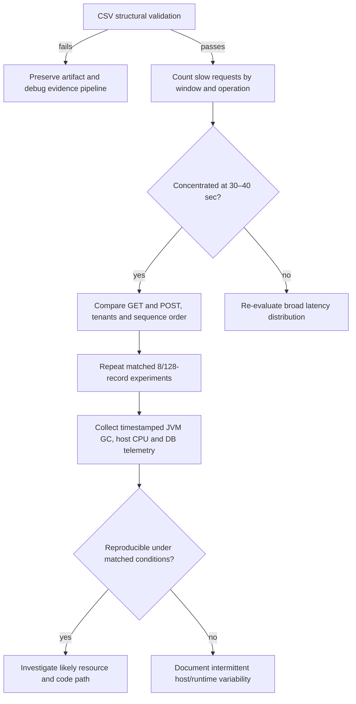

# Chapter 66 — Large-Corpus Results and the Unexpected Latency Spike

> **Milestone 21 evidence, investigated—not explained away.**
> The developer's synthetic localhost experiment used Git revision
> `e3c2ef2b5744acce4b3976b86cb3a08ea4ac3355`, starting at
> **2026-11-10T10:42:14Z**. It included exactly one bounded
> 100-RPS / 60-second measured stage and disposable PostgreSQL.

## 1. The important result

The runner returned `BUILD SUCCESS`: **6,000 measured HTTP successes**,
consisting of 4,800 GET 200s and 1,200 POST 201s, no unavailable or
unexpected statuses. It created **512 seeded simulated payment records**
(128 per merchant) and exported **6,000 raw request rows** to a local
CSV; the script's 6,001-line check (one header, 6,000 data rows)
passed.

**But** a transient slowdown occurred in the **30–40-second**
scheduled-request window. It is an important diagnostic finding
even though no request failed. Never call this run "uniformly fast."

The exact tested implementation SHA passed:
- [Java CI](https://github.com/asambataiden/enterprise-payment-platform/actions/runs/42801079424)
- [Security CI](https://github.com/asambataiden/enterprise-payment-platform/actions/runs/42801079229)

The opt-in load test **was not a CI job**. Its measurements are
grounded in the local terminal evidence supplied by the developer.

## 2. Beginner explanation

Imagine a shop handles every order, but for ten seconds its
checkout queue grows and a few customers wait much longer.
The day still ends with every order fulfilled. A report saying
"zero errors" is technically correct, but hides a temporary
customer-experience problem.

That is what happened here. The correct response is not to
automatically increase database connections or declare a bug
in the new dataset. First identify **which individual calls
were delayed** and whether the delay affected multiple merchants
or only one.

## 3. Complete stage metrics

| Metric | Observed |
| --- | ---: |
| Total successes | 6000 |
| GET successes | 4800 |
| POST successes | 1200 |
| Unexpected / unavailable | 0 / 0 |
| Completed rate | 100.00 RPS |
| Elapsed measured time | 59.998 s |
| GET p50/p95/p99 | 2.741 / 4.677 / 20.070 ms |
| POST p50/p95/p99 | 4.484 / 7.482 / 21.051 ms |
| Seed records per merchant | 128 |
| Raw CSV data rows | 6000 |

## 4. Why whole-stage p95 concealed a local event

| Scheduled window | GET samples | GET p95 (ms) | GET p99 (ms) | POST samples | POST p95 (ms) | POST p99 (ms) |
| --- | ---: | ---: | ---: | ---: | ---: | ---: |
| 0–10s | 800 | 5.062 | 6.098 | 200 | 7.886 | 9.123 |
| 10–20s | 800 | 4.347 | 5.135 | 200 | 7.478 | 8.053 |
| 20–30s | 800 | 4.512 | 8.148 | 200 | 6.858 | 7.735 |
| **30–40s** | **800** | **29.322** | **118.327** | **200** | **23.398** | **111.576** |
| 40–50s | 800 | 3.795 | 4.547 | 200 | 6.286 | 6.642 |
| 50–60s | 800 | 3.460 | 4.230 | 200 | 5.960 | 8.325 |

**p95** asks where roughly 95% of the sampled request durations
fall. **p99** summarizes the slowest 1% boundary. We must
compare them in the *same operation and same time window*.

The slowdown affected **both GET and POST**, and the
following window returned to low latency. This is a
**transient** event in these measurements, not a
progressive deterioration throughout the full minute.

Do not infer that the increase from 8 to 128 initial records
caused the spike. The earlier 8-record experiments ran at
other times on the same developer machine. This is not
a controlled causal experiment.

## 5. Tenant outcomes and potential disparities

| Merchant | GET count | GET p95 (ms) | GET p99 (ms) | POST count | POST p95 (ms) | POST p99 (ms) |
| --- | ---: | ---: | ---: | ---: | ---: | ---: |
| 0 (hot) | 3360 | 4.663 | 20.070 | 840 | 7.526 | 21.051 |
| 1 | 480 | 5.026 | 82.621 | 120 | 4.747 | 5.850 |
| 2 | 480 | 4.710 | 14.418 | 120 | 9.120 | 111.576 |
| 3 | 480 | 4.555 | 5.887 | 120 | 6.642 | 9.493 |

Merchant 2's write p99 of **111.576 ms** was unusually
high, but its group contains only **120 POST samples**.
The figures do not establish tenant discrimination, a
repeatable per-tenant defect or the location of the bottleneck.
The hot merchant and merchant 1 reads also showed elevated
tail values, which further merits examination of shared
host/runtime effects.

## 6. Pool and client observations

| Metric | Observed |
| --- | ---: |
| Hikari max configured | 4 |
| Max sampled active connections | 1 |
| Sampled pending acquisitions | 0 |
| Max sampled PostgreSQL wait count | 0 |
| Pool/DB samples | 241 |
| Monitoring failures | 0 |
| Maximum outstanding HTTP requests | **15** |
| Maximum scheduling lag | 3.574 ms |
| CPU time | 23.202 process CPU seconds |
| GC collections | 12 |
| Heap snapshot | 74.03 MiB |
| Thread snapshot | 42 |

The prior small-corpus repeat trials had **at most 2 outstanding
HTTP requests**. The new run reached **15**; the transient
latency event may help explain increased in-flight overlap,
but the console summary alone does not establish when the
maximum occurred.

**What we can say:** no Hikari connection-acquisition queue
or active PostgreSQL wait was observed in 250-ms snapshots.
**What we cannot say:** no thread ever waited, no GC pause
occurred or PostgreSQL was categorically irrelevant. Such
short events can evade sampling.

## 7. New investigation tool — offline, no network needed

The individual CSV file is on the developer's Mac. To investigate
actual slow requests, we added the standard-library-only script:

`ops/benchmarks/http/analyze-raw-latency.py`

The script validates CSV headers, all 6,000 unique sequence
numbers, expected operation/status, per-tenant distribution,
and scheduled ten-second windows. It prints counts of
observations above **20 ms**, **50 ms** and **100 ms** per
operation/window, as well as the 20 slowest requests
with only synthetic fields. It does not read credentials,
query a database, make network calls or emit raw identifiers.

### Exact macOS commands, including space-safe paths

```bash
ROOT="$(git rev-parse --show-toplevel)"
git -C "$ROOT" pull --ff-only origin feat/payment-ledger

CSV="$ROOT/target/http-load-lab/20261110T104214Z-56749-large-corpus-100rps-60s.csv"
test -f "$CSV" || { echo "CSV not found" >&2; exit 1; }

python3 "$ROOT/ops/benchmarks/http/analyze-raw-latency.py" "$CSV"
```

The output should begin with `VALIDATED rows=6000` if the
data pass all structural checks, followed by the time-window
tail counts and 20 slowest individual request records.

**Important:** those results have not yet been supplied.
Do not invent which sequence IDs were slow, how many requests
exceeded 100 ms, or the root cause.

## 8. Investigative decision tree



Do not increase connection pools or add caches until
instrumentation supports a specific diagnosis.

## 9. Q&A for interviews

**Q: Why is zero HTTP errors not enough?** Because some
requests can be much slower without failing. Tail latency
can seriously affect users while all response codes remain
successful.

**Q: Why was the 30–40-second p95 more revealing than
the overall p95?** A short slowdown can be diluted by
thousands of fast requests outside that window.

**Q: Why investigate raw observations?** They let us count
how many requests exceeded thresholds, identify the affected
operations and tenants, and examine clustering by scheduled
sequence. Aggregated percentiles alone cannot provide that
detail.

**Q: Did the larger dataset cause the slowdown?** Not proven.
The dataset and run conditions changed, so a controlled
comparison and time-correlated runtime telemetry are needed.

**Q: What is the next safe engineering action?** Analyze the
existing local CSV first, then design controlled A/B repeat
runs and time-correlated diagnostics if the pattern persists.

## 10. Learning exercise

Explain why a test with 6,000 successful HTTP requests can
still have a performance incident. Describe the difference
between a **global p95**, **windowed p95** and **per-tenant p99**.
Finally, explain why a 250-ms resource sampler cannot disprove
a 100-ms JVM or host scheduling pause.
